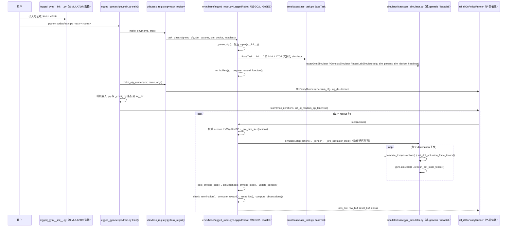

---

type: entity
tags: [repo, quadruped, legged-gym, amp, deepmimic, multi-simulator, eth, booster]
status: complete
updated: 2026-06-08
summary: "lupinjia/LeggedGym-Ex 扩展 legged_gym 至多仿真器并集成 AMP、DeepMimic 等模仿任务，覆盖 Go2、K1、TRON1 等机型。"
related:
  - ./legged-gym.md
  - ../methods/amp-reward.md
  - ../methods/deepmimic.md
  - ./isaac-lab.md
sources:
  - ../../sources/repos/leggedgym_ex.md
---

# LeggedGym-Ex

**LeggedGym-Ex**（<https://github.com/lupinjia/LeggedGym-Ex>）在 [legged_gym](./legged-gym.md) 范式上扩展 **多仿真后端**（Isaac Gym、Isaac Sim、Genesis）与 **多种模仿学习算法**（AMP、DeepMimic、DreamWaQ 等），面向 **Go2、Booster K1、TRON1** 等机型提供统一训练入口。

## 英文缩写速查

| 缩写 | 英文全称 | 简要说明 |
|------|----------|----------|
| AMP | Adversarial Motion Prior | 风格先验 + 任务奖励 |
| RL | Reinforcement Learning | legged_gym 风格 PPO 训练 |
| legged_gym | Legged Gym | ETH RSL 足式 RL 框架 |
| Sim2Real | Simulation to Real | 域随机化与 actuator 建模 |

## 为什么重要

- **四足模仿学习合集**：把「参考运动 → 策略」多种算法挂在同一 legged_gym 配置体系下，便于对照 AMP vs DeepMimic。
- **仿真器迁移试验床**：同一 env 配置可切换 IsaacGym / IsaacSim / Genesis，适合验证重定向参考在不同物理后端下的可跟踪性。

## 源码运行时序图

入口：`python legged_gym/scripts/train.py --task=<任务名>`（任务名见 `legged_gym/envs/__init__.py` 中的 `task_registry.register`，如 `go2`、`go2_ee`）。仿真后端由环境变量 `SIMULATOR` 决定（Python 3.10+ 需设为 `genesis` 或 `isaaclab`；Python 3.6–3.8 为 `isaacgym`），见 `legged_gym/__init__.py`。

图依据：lupinjia/LeggedGym-Ex@09283fe，读过 `README.md`、`legged_gym/__init__.py`（SIMULATOR 选择段）、`legged_gym/scripts/train.py`（全文）、`legged_gym/utils/task_registry.py`（`make_env`、`make_alg_runner` 段）、`legged_gym/envs/__init__.py`（`task_registry.register` 段，grep 核对）、`legged_gym/envs/base/base_task.py`（`__init__` 段）、`legged_gym/envs/base/legged_robot.py`（`__init__`、`step`、`_pre_sim_step`、`post_physics_step` 段）、`legged_gym/simulator/isaacgym_simulator.py`（`step`、`_pre_simulator_step` 段）。`IsaacGymSimulator` 的 `__init__` 内部细节及 `rsl_rl` 的 `learn` 未读。未运行代码。

说明：`legged_gym/__init__.py` 在 Python 3.9 时未定义 `SIMULATOR`，后续导入会失败；README 未给出训练命令，入口以 `scripts/train.py` 为准。

## 关联页面

- [legged_gym](./legged-gym.md)
- [AMP_for_hardware](./amp-for-hardware.md)
- [DeepMimic](../methods/deepmimic.md)
- [Isaac Lab](./isaac-lab.md)

## 参考来源

- [LeggedGym-Ex 仓库归档](../../sources/repos/leggedgym_ex.md)
- 源码核对（2026-11-02）：lupinjia/LeggedGym-Ex@09283fe，读过 README.md、legged_gym/__init__.py（SIMULATOR 选择段）、legged_gym/scripts/train.py、legged_gym/utils/task_registry.py（make_env、make_alg_runner 段）、legged_gym/envs/__init__.py（task_registry.register 段）、legged_gym/envs/base/base_task.py（__init__ 段）、legged_gym/envs/base/legged_robot.py（__init__、step、_pre_sim_step、post_physics_step 段）、legged_gym/simulator/isaacgym_simulator.py（step、_pre_simulator_step 段）；时序图依据以上文件，未运行代码。

## 推荐继续阅读

- GitHub：<https://github.com/lupinjia/LeggedGym-Ex>
