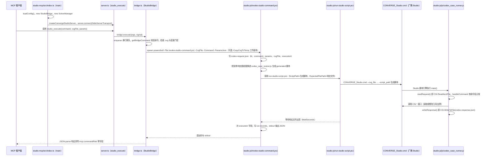

# CONVERGE Studio MCP（Legiiiit/converge-studio-mcp）

## 一句话定义

CONVERGE Studio MCP（Legiiiit/converge-studio-mcp）是将 CONVERGE Studio 工作流接入 MCP。

## 英文缩写速查

| 缩写 | 英文全称 | 简要说明 |
|------|----------|----------|
| MCP | Model Context Protocol | 代理与工程软件工具的交互协议 |
| CAE | Computer-Aided Engineering | 计算机辅助工程软件与分析 |
| API | Application Programming Interface | 软件可供自动化调用的接口 |

## 为什么重要

对 CAE 自动化而言，代理能否稳定完成任务，取决于工程步骤是否清楚、工具边界是否明确、结果是否保留可审查证据。将 CONVERGE Studio 工作流接入 MCP；文章按专业软件将其列为一项执行层工具。

## 核心原理

**项目自身范围：** MCP interface for CONVERGE Studio workflows.

**工作流：** AI 客户端经 MCP 发起几何/网格/求解设置等操作，具体工具范围按官方 README 确认。

**仓库映射说明：** 文章未给出该项目完整的 owner/repository URL；此处按文章中的项目名/描述与公开 GitHub 仓库匹配。引用时请以本页链接的仓库 README 为准。

## 工程实践

1. 从目标问题识别所需的 Skill、MCP、CLI 或软件接口，不把指导文件当成求解器。
2. 依照仓库 README 检查安装前提、软件/许可证、输入文件和输出证据。
3. 小规模运行并逐项核对几何、网格、边界、求解状态和物理量，再决定是否扩大任务。

文章所述的项目特征：将 CONVERGE Studio 工作流接入 MCP；文章按专业软件将其列为一项执行层工具。

## 局限与风险

必须拥有 CONVERGE Studio 软件与有效许可证；文章没有给出明确 owner 链接，本页根据同名公开仓库匹配，需再次确认适用性。

源码状态核验：该 GitHub 仓库于 2026-10-07 可公开访问。仓库 API 报告许可证为 MIT。 涉及商业软件时，安装包和有效许可证需由使用者自行提供。

## 源码运行时序图

入口：`node studio-mcp/dist/src/index.js`（`npm run build` 后以 stdio 注册到 MCP 客户端；运行需 Windows、Windows PowerShell 5.1 与已授权的 CONVERGE Studio，`CONVERGE_STUDIO_CMD` 指向厂商 `CONVERGE_Studio.cmd`）。下图为 `studio_execute` 工具路径；`studio_gui`、`solver_*` 等工具未画。

图依据：converge-studio-mcp@671ea2b，读过 `README.md`、`studio-mcp/package.json`、`studio-mcp/src/index.ts`、`studio-mcp/src/bridge.ts`（StudioBridge.execute/enqueue/executeNow）、`studio-mcp/src/server.ts`（工具注册，studio_execute 段）、`studio-js/invoke-studio-command.ps1`（第 396 行起）、`studio-js/run-studio-script.ps1`（第 125 行起）、`studio-js/js/codex_case_runner.js`（头部与 main）。`solver.ts`、`studio-gui-driver.ps1`、各命令 handler 内部未读。

## 关联页面

- [CAE / CFD 代理工具项目总览](../overview/cae-cfd-agent-skills-landscape.md)
- [sim-plugin-openfoam](./svd-ai-lab-sim-plugin-openfoam.md)

## 参考来源

- [公众号文章原始资料归档](../../sources/blogs/wechat_cae_cfd_agent_skills_2026-10-07.md)
- [GitHub 仓库资料归档](../../sources/repos/legiiiit-converge-studio-mcp.md)
- [Legiiiit/converge-studio-mcp 官方仓库](<https://github.com/Legiiiit/converge-studio-mcp>)
- 源码核对（2026-11-02）：Legiiiit/converge-studio-mcp@671ea2b，读过 README.md、studio-mcp/package.json、studio-mcp/src/{index.ts,bridge.ts,server.ts}、studio-js/{invoke-studio-command.ps1,run-studio-script.ps1}、studio-js/js/codex_case_runner.js；时序图依据以上文件，未运行代码。

## 推荐继续阅读

- [项目 README](<https://github.com/Legiiiit/converge-studio-mcp/blob/main/README.md>)