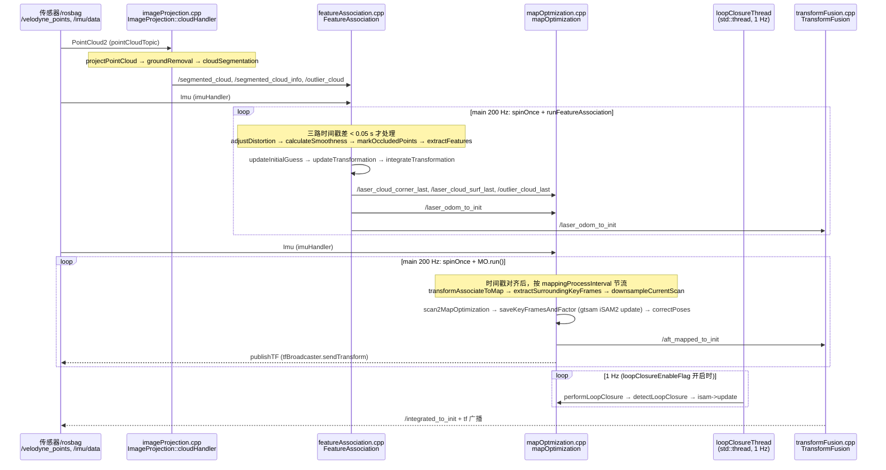

---

type: entity
tags: [repo, lidar, loam, ground-vehicle, slam, hku]
status: complete
updated: 2026-07-21
related:
  - ../entities/fast-lio.md
  - ../comparisons/lidar-slam-lio-vio-selection.md
sources:
  - ../../sources/repos/lego_loam.md
summary: "LeGO-LOAM 是轻量地面优化激光 SLAM：点云分割与地面约束，适合起伏地形上的地面车辆。"
---

# LeGO-LOAM

**LeGO-LOAM** 在 LOAM 基础上增加 **地面分割与地面优化**，降低起伏地形的漂移。

## 英文缩写速查

| 缩写 | 英文全称 | 简要说明 |
|------|----------|----------|
| SLAM | Simultaneous Localization and Mapping | 同步定位与建图 |
| ROS 2 | Robot Operating System 2 | 机器人系统集成与通信的常用中间件 |
| LIO | LiDAR-Inertial Odometry | 激光-惯性里程计 |
| LiDAR | Light Detection and Ranging | 激光雷达，地形感知与建图主传感器 |
| VIO | Visual-Inertial Odometry | 视觉-惯性里程计，融合相机与 IMU 估计位姿 |

## 为什么重要

- **地面机器人友好**：分割地面点、利用几何约束。
- **轻量**：相对完整 3D 图优化 SLAM 更易部署。

## 核心结构/机制

| 阶段 | 说明 |
|------|------|
| **Projection** | 深度图投影 |
| **Segmentation** | 地面/非地面 |
| **Optimization** | scan-to-scan + mapping |

## 常见误区或局限

- **地面假设**：空中或楼梯密集场景假设失效。
- **ROS2**：社区以 ROS1 为主，迁移需评估。

## 源码运行时序图

入口：`roslaunch lego_loam run.launch`（启动 `imageProjection`、`featureAssociation`、`mapOptmization`、`transformFusion` 四个节点，另起 rviz 与两个静态 TF；数据来自 `rosbag play *.bag --clock` 或真实 `/velodyne_points`、`/imu/data`）。

图依据：RobustFieldAutonomyLab/LeGO-LOAM@896a7a9，读过 README.md、LeGO-LOAM/launch/run.launch、include/utility.h、src/imageProjection.cpp、featureAssociation.cpp、mapOptmization.cpp、transformFusion.cpp。

## 参考来源

- [sources/repos/lego_loam.md](../../sources/repos/lego_loam.md)
- [RobustFieldAutonomyLab/LeGO-LOAM](https://github.com/RobustFieldAutonomyLab/LeGO-LOAM)
- 源码核对（2026-11-02）：RobustFieldAutonomyLab/LeGO-LOAM@896a7a9，读过 README.md、LeGO-LOAM/launch/run.launch、include/utility.h、src/imageProjection.cpp、src/featureAssociation.cpp、src/mapOptmization.cpp、src/transformFusion.cpp；时序图依据以上文件，未运行代码。

## 关联页面

- [FAST-LIO](../entities/fast-lio.md)
- [LiDAR / LIO / VIO 选型](../comparisons/lidar-slam-lio-vio-selection.md)

## 推荐继续阅读

- https://arxiv.org/abs/1802.06611
