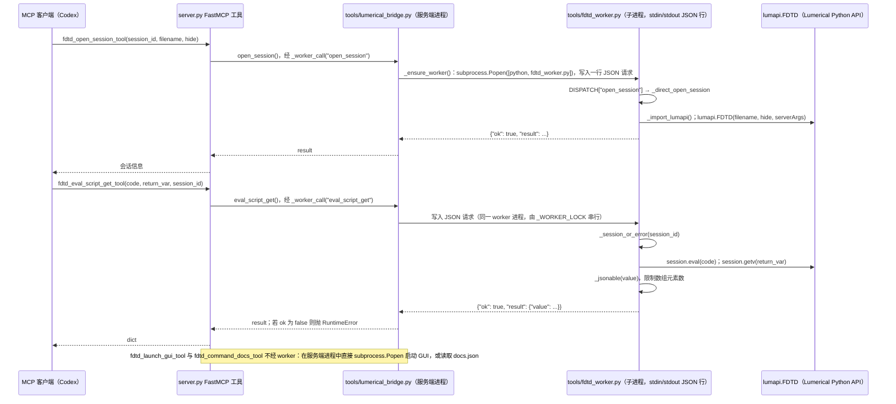

# Lumerical FDTD MCP（leisymqaz/lumerical-fdtd-mcp）

## 一句话定义

Lumerical FDTD MCP（leisymqaz/lumerical-fdtd-mcp）是控制 Ansys Lumerical FDTD 的 MCP 服务。

## 英文缩写速查

| 缩写 | 英文全称 | 简要说明 |
|------|----------|----------|
| MCP | Model Context Protocol | 代理与工程软件工具的交互协议 |
| CAE | Computer-Aided Engineering | 计算机辅助工程软件与分析 |
| API | Application Programming Interface | 软件可供自动化调用的接口 |

## 为什么重要

对 CAE 自动化而言，代理能否稳定完成任务，取决于工程步骤是否清楚、工具边界是否明确、结果是否保留可审查证据。控制 Ansys Lumerical FDTD 的 MCP 服务；文章将其列为按专业软件划分的工具，聚焦光子学时域仿真。

## 核心原理

**项目自身范围：** MCP server to control Ansys Lumerical FDTD from AI clients.

**工作流：** MCP 客户端将光子器件设计请求交给服务器，后者通过 Lumerical 接口设置结构、仿真和输出数据。

**仓库映射说明：** 文章未给出该项目完整的 owner/repository URL；此处按文章中的项目名/描述与公开 GitHub 仓库匹配。引用时请以本页链接的仓库 README 为准。

## 工程实践

1. 从目标问题识别所需的 Skill、MCP、CLI 或软件接口，不把指导文件当成求解器。
2. 依照仓库 README 检查安装前提、软件/许可证、输入文件和输出证据。
3. 小规模运行并逐项核对几何、网格、边界、求解状态和物理量，再决定是否扩大任务。

文章所述的项目特征：控制 Ansys Lumerical FDTD 的 MCP 服务；文章将其列为按专业软件划分的工具，聚焦光子学时域仿真。

## 局限与风险

需要本机 Lumerical 安装及许可；项目非官方产品时应核查版本、脚本执行权限和数值收敛。

源码状态核验：该 GitHub 仓库于 2026-10-07 可公开访问。仓库 API 未报告 SPDX 许可证，应检查仓库内 LICENSE 与依赖许可。 涉及商业软件时，安装包和有效许可证需由使用者自行提供。

## 源码运行时序图

入口：`python server.py`（位于 `lumerical-fdtd-mcp_publish_bundle/`，`__main__` 中 `mcp.run(show_banner=False, log_level="ERROR")`，默认 stdio）。会话类工具经 `tools/fdtd_worker.py` 子进程执行，Lumerical 由其中的 `lumapi.FDTD` 驱动，需本机安装 Ansys Lumerical。

图依据：leisymqaz/lumerical-fdtd-mcp@d962db1，读过 `README.md`、`lumerical-fdtd-mcp_publish_bundle/server.py`（全文）、`lumerical-fdtd-mcp_publish_bundle/tools/fdtd_worker.py`（全文）、`lumerical-fdtd-mcp_publish_bundle/tools/lumerical_bridge.py`（`_worker_call`、`_ensure_worker`、`open_session`、`eval_script_get`、`_direct_*` 别名段，并确认 `open_session` 等公开名称后被 worker 版本覆盖）。`pyproject.toml` 未读。未运行代码（无 Lumerical 环境）。

说明：`lumerical_bridge.py` 中前一组直接执行的函数（如 `open_session`，约第 192 行）在后文同名定义覆盖前，实际由 `_direct_*` 别名在 worker 中使用；图按最终公开名称的调用路径绘制。

## 关联页面

- [CAE / CFD 代理工具项目总览](../overview/cae-cfd-agent-skills-landscape.md)
- [Ansys AEDT MCP](./laplaceyoung-ansys-aedt-mcp.md)

## 参考来源

- [公众号文章原始资料归档](../../sources/blogs/wechat_cae_cfd_agent_skills_2026-10-07.md)
- [GitHub 仓库资料归档](../../sources/repos/leisymqaz-lumerical-fdtd-mcp.md)
- [leisymqaz/lumerical-fdtd-mcp 官方仓库](<https://github.com/leisymqaz/lumerical-fdtd-mcp>)
- 源码核对（2026-11-02）：leisymqaz/lumerical-fdtd-mcp@d962db1，读过 README.md、lumerical-fdtd-mcp_publish_bundle/server.py、lumerical-fdtd-mcp_publish_bundle/tools/fdtd_worker.py、lumerical-fdtd-mcp_publish_bundle/tools/lumerical_bridge.py（_worker_call、_ensure_worker、open_session、eval_script_get、_direct_* 段）；时序图依据以上文件，未运行代码。

## 推荐继续阅读

- [项目 README](<https://github.com/leisymqaz/lumerical-fdtd-mcp/blob/main/README.md>)