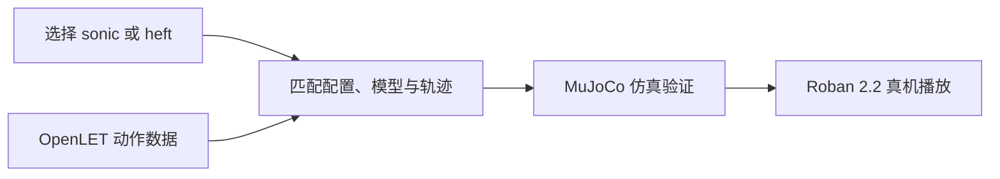

# LejuBFM 通用小脑运控基座模型

**LejuBFM** 是乐聚面向人形机器人全身运动控制发布的模型与配套开发流程；当前公开文档聚焦于用配套模型追踪离线动作轨迹，并通过仿真验证后在 Roban 2.2 真机播放。

## 一句话定义

**一个面向 Roban 2.2 的全身动作跟踪基座：模型、配置和轨迹按版本配套，支持从仿真到真机验证。**

## 英文缩写速查

| 缩写 | 英文全称 | 简要说明 |
|------|----------|----------|
| BFM | Behavior Foundation Model | 乐聚对通用小脑运控基座模型的称呼 |
| ONNX | Open Neural Network Exchange | 官方部署步骤使用的模型文件格式 |
| RK3588 | Rockchip RK3588 | 文档指定的 Roban 2.2 机载 ARM64 部署平台 |
| ARM64 | Advanced RISC Machine 64-bit | 官方真机编译目标架构 |

## 为什么重要

- **把动作参考转成统一运控入口：** 官方将其定位为可复用的全身动作基座，文档给出模型和轨迹配套播放的实操路径。
- **连接动作数据与真机部署：** OpenLET 小脑动作数据、模型轨迹播放、MuJoCo 仿真和 Roban 真机控制形成连续的开发入口。
- **适合作为动作跟踪工程案例：** 仓库不仅列模型文件，也公开配置、轨迹、控制器与启动流程，能据此核对真实部署约束。

## 核心机制与能力边界

官方架构页把 BFM 描述为机器人全身动作跟踪与协调控制能力。部署文档公开两种可选模型 **sonic** 与 **heft**，均需使用对应配置和轨迹。文档当前展示的是**离线轨迹追踪与播放**：先选模型、配置轨迹、在 MuJoCo 验证，再进入真机播放。公开资料没有给出模型结构、训练配方或跨本体零样本迁移能力，不能仅凭“通用基座”名称推断这些能力。

## 流程总览

模型与轨迹必须来自兼容版本；更换模型时要一并切换配置和轨迹。官方文档强调先仿真再真机，并要求确认急停、标定和现场防护条件。

## 工程实践

| 项目 | 官方文档现状 |
|------|--------------|
| 本体 | Roban 2.2，`ROBOT_VERSION=17` |
| 真机计算平台 | RK3588 / ARM64，gcc/g++ 11 |
| 仿真 | 开发机 Docker + MuJoCo |
| 模型 | sonic 或 heft；部署资料注明模型位于仓库 `beta` 分支 |
| 动作 | 必须选与模型配套格式和导出版本的 CSV 轨迹 |
| 安全验证 | 先仿真逐条检查动作范围与衔接，再上真机；高动态动作需保护吊架 |

LejuBFM 首页同时介绍 OpenLET 小脑动作集：800 多类动作、39,692 条数据；数据获取采用申请制。数据页说明动作重定向至鲁班机型并按 120 fps 重采样。该数据集规模与获取边界应以官方页面和审批结果为准。

## 局限与风险

- 当前部署说明限定 Roban 2.2；不能把参数、轨迹或控制配置直接套到 Kuavo、Unitree 等其它本体。
- sonic 与 heft 的轨迹格式及衔接行为不同，不应混用文件或随意替换 ONNX。
- 动作数据需单独申请；代码仓库可见不代表数据授权、模型许可或商用再分发许可已自动获得。
- 公开资料尚未给出模型架构、训练细节、定量评测协议或通用跨机型证据；实际能力需按具体版本和真机环境验证。

## 关联页面

- [OpenLET 社区](./openlet.md) — 乐聚真机数据与开发资源
- [LET-HumanMotion-Roban2](./openlet-humanmotion-roban2.md) — Roban 小脑动作集及申请边界
- [乐聚机器人](./leju-robotics.md) — 本体与运营方
- [运动小脑分类 A：走路底座](../overview/motion-cerebellum-category-01-locomotion-base.md) — 运控底座与相关方法

## 推荐继续阅读

- [LejuBFM 官方主页](https://www.lejubfm.lejurobot.com/)
- [离线轨迹追踪部署手册](https://www.lejubfm.lejurobot.com/docs/bfm/deployment)
- [OpenLET 小脑动作集申请页](https://openlet.openatom.tech/data/let-humanmotion-roban2)

## 参考来源

- [LejuBFM 官方文档归档](../../sources/sites/lejubfm-openlet-docs.md)
- [Lejulab_ARM 代码仓归档](../../sources/repos/lejulab-arm.md)
