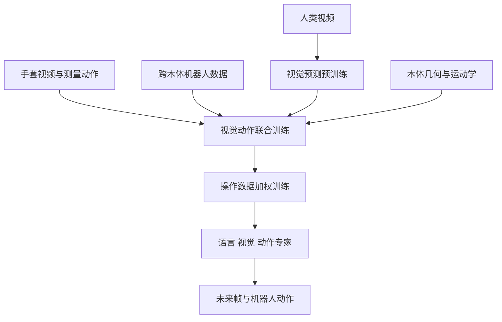

# Liber-0：从人类经验学习机器人操作

LiberAI 的 Liber-0 是联合预测未来视觉帧和动作的世界动作模型，利用人类视频、测量的手部动作和跨本体数据学习机器人操作。

## 英文缩写速查

| 缩写 | 英文全称 | 简要说明 |
|---|---|---|
| WAM | World Action Model | 联合建模视觉未来和动作 |
| PnP | Pick and Place | 抓取并放置任务 |
| VQA | Visual Question Answering | 视觉问答语义协同训练 |
| MoT | Mixture of Transformers | 按模态组织的 Transformer 专家 |

## 流程总览

## 核心原理

模型使用语言、视觉和动作专家，通过多模态注意力协作；共享物理编码器输入状态、本体条件和带噪动作。训练分为通用视觉预测、联合世界动作训练、操作强化三阶段。手套数据把人类视角视频和测量运动配对；LEO 的灵巧手、腕、腰及相机布局缩小人机运动与观测差异。多步任务可选用推理代理给出中间目标。

## 评测与边界

| 设置 | 结果与口径 |
|---|---|
| 任务级零样本 | 60 项各 10 次，总体成功率 36.0%；抓取放置 63.5%，短非抓取放置 34.0%，多步非抓取放置 10.5%。未使用针对评测任务采集的机器人示范。 |
| 内部进度基准 | 第三阶段直接评测 PnP / Non-PnP 为 81.4 / 72.3；机器人后训练后为 83.6 / 73.8。这些是进度分，不是成功率。 |
| 数据效率消融 | 8 任务中，25% 机器人示范加全部手套数据得 75.6 分，全部机器人示范的对照为 72.8 分。 |

结果来自作者自建平台和任务，不能直接外推到不同机器人。文章指出接触力与触觉仍是尚需补充的监督；博客正文未列出模型权重或可运行实现下载入口，演示页面的开放状态尚待核验。

## 源码运行时序图

暂不适用：本次核对的官方博客未提供可运行实现入口，无法依据源码绘制。

## 关联页面

- [视觉语言动作模型](../methods/vla.md)
- [GPT-6 Astra 具身策略评测](./paper-gpt-6-astra-embodied-policy.md)

## 参考来源

- [Liber-0 官方博客归档](../../sources/sites/liber-0.md)
