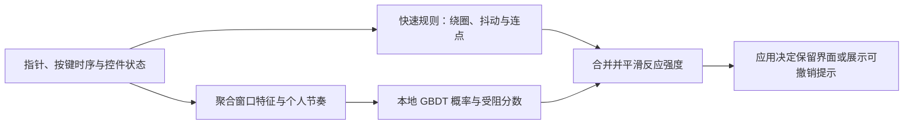
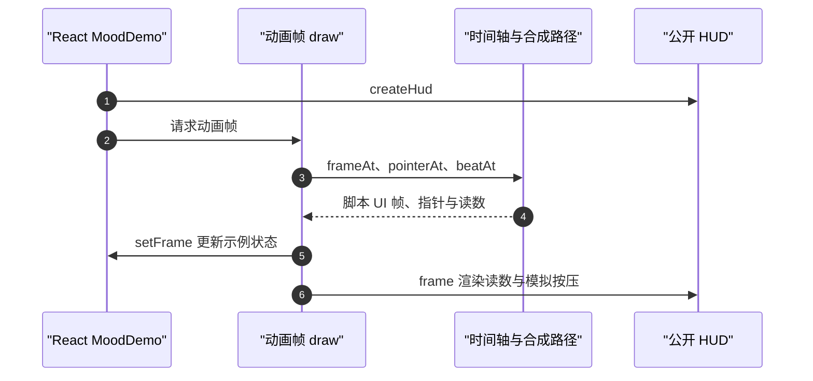

# Mood Recognition Beta · 浏览器端交互受阻识别

## 一句话定义

Libraries.dev 的实验模型根据指针、点击、滚动和输入节奏，估计用户是否在当前网页操作中受阻；应用可据此显示帮助，不从这些信号判定真实情绪。

## 英文缩写速查

| 缩写 | 英文全称 | 简要说明 |
|---|---|---|
| UI | User Interface | 应用自行决定是否改变的界面 |
| GBDT | Gradient-Boosted Decision Trees | 本地模型使用的梯度提升树 |
| HUD | Head-Up Display | 官网预览中跟随光标的读数面板 |
| JSON | JavaScript Object Notation | 模型结构和参数的文件格式 |

## 为什么重要

反复点击禁用按钮可能说明反馈不清晰，也可能只是操作习惯。端侧处理让应用在无需向服务端发送操作序列的前提下试验轻量提示，但信号是否准确、提示是否帮到人，是两个独立问题。

## 核心信息

| 项 | 内容 |
|---|---|
| 维护者 | Jakub Antalik，独立维护者 |
| 模型 | v0.4 Beta，360 棵小型梯度提升树；JSON 142 KB，gzip 后 32 KB，均不含 React 套件 |
| 输入 | 43 项行为度量，主窗口 8 秒，部分特征回看 15–60 秒 |
| 输出 | 模型给出六类概率；套件结合快速信号提供状态与反应强度 |
| 分发 | React 套件 0.5 与模型需从官网分开获取，适用模型许可 |

## 核心机制与流程总览

模型约每 250 ms 更新。抖动、绕圈、短时间连点及点击禁用控件有快速规则，能在较短窗口响应；界面反应层还会平滑输出。离开页面或失去活动由规则识别。文档称不读取文本、字段值或屏幕内容，推理不上传交互；默认个人节奏基线保存在本地存储，可改成仅存内存。

## 源码运行时序图

下图是固定提交的公开付款预览，**不是已运行的识别套件**。模拟指针和读数均由脚本提供；页面不拿访客的鼠标验证模型。

对公开源码的纯函数执行 7 项断言，确认模拟流程从默认、减弱按钮、突出条款到恢复及重置。未用真实交互测试未下载的模型。

## 工程实践

在固定流程中先排查禁用原因、焦点顺序和错误信息。对可选提示，测试规则基线、模型加规则、无提示三组，按任务和输入设备分别记录完成率、误提示时长与撤销次数。只改变可逆提示，不替用户勾选条款、触发支付或移动正在操作的控件。

## 局限与风险

- 官方在十多人的逐人留出测试中报告检出 48/60 个预设障碍，平静时间有 2.3% 被标记；时间占比不是会话误报率，预设障碍检出也不是情绪识别准确率。
- 短时间搜索可能漏报，正常的探索可能被标为迷失；鼠标、触屏与辅助输入的差异应单独检查。
- 当前模型及 React 套件不是 MIT，不作为独立文件再分发；商用发布查模型许可。旧套件 0.4 的历史 MIT 授权不覆盖模型或套件 0.5。

## 关联页面

- [AI 模型与智能体基准评测](../methods/ai-benchmark-evaluation.md)
- [AI 模型推理与服务部署](../methods/ai-model-serving-inference.md)
- [端云协同机器人](../concepts/edge-cloud-robotics.md)：可对照端侧延迟与隐私取舍，本案例没有机器人在环。

## 参考来源

- [官方产品、评测与许可核读](../../sources/sites/libraries-dev-mood-recognition.md)
- [公开预览源码核对](../../sources/repos/libraries-dev-mood-preview.md)

## 推荐继续阅读

- [官方技术文档与预览](https://libraries.dev/mood-recognition)
- [模型与套件许可](https://github.com/Jakubantalik/Libraries.dev/blob/d058179b10adf2a2290957c4662b9c0ada1de98b/LICENSE-MODEL.md)
