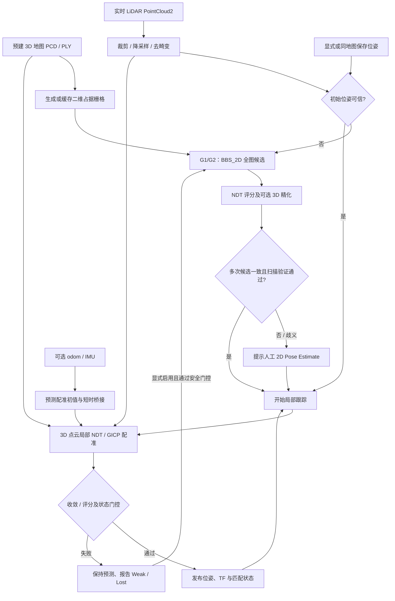
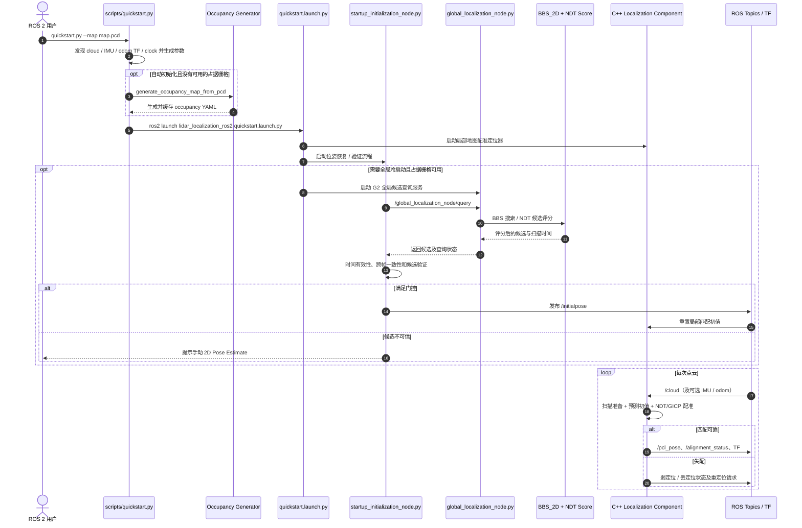

# lidar_localization_ros2｜ROS 2 无 GPS 的三维点云地图定位与全局重定位

## 一句话定义

**lidar_localization_ros2** 是 Ryohei Sasaki 维护的开源 ROS 2 地图定位框架：输入已有的三维点云地图和实时 LiDAR 扫描，初次上电可搜索初始位姿，随后以 NDT/GICP scan-to-map 跟踪位置；它**不是从零建图的 SLAM**，也不保证每次全局初始化都正确。

## 英文缩写速查

| 缩写 | 英文全称 | 简要说明 |
|---|---|---|
| LiDAR | Light Detection and Ranging | 激光雷达点云扫描 |
| BBS | Branch-and-Bound Search | 用二维地图栅格做全图候选位姿搜索 |
| NDT | Normal Distributions Transform | 点云到地图的配准，默认后端 |
| GICP | Generalized Iterative Closest Point | 可选 3D 点云配准后端 |
| IMU | Inertial Measurement Unit | 可选姿态与运动辅助数据 |
| TF | Transform | ROS 2 坐标变换树 |
| Nav2 | Navigation2 | ROS 2 规划与导航栈 |

## 为什么重要

- **冷启动不依赖 GPS 或人工位姿**：已有地图、可区分的 LiDAR 几何与满足门控的匹配候选即可启动；候选歧义时明确要求人工 2D Pose Estimate。
- **分离建图与定位**：可用同作者独立项目 [lidar_slam](./rsasaki-lidar-slam.md) 事先生成 .pcd 地图，运营时只运行定位，便于既定场地和重复巡航。
- **故障可观测**：输出匹配状态、丢定位信号，恢复路径包含候选评分、连续观测验证与重置保护。
- **适配 ROS 2/Nav2**：支持 Jazzy（主要目标）、Humble；既可独立发布 map→base_link，也可在 Nav2 场景发布 map→odom（仍需 odom→base_link 来源）。

## 核心信息

| 项目 | 官方原始资料证据 |
|---|---|
| 维护者 | Ryohei Sasaki（rsasaki0109）；所属类型按仓库注册表标注为「独立维护者（Independent Maintainer）」，不推断其雇主或院校 |
| 一手源码 | [lidar_localization_ros2](https://github.com/rsasaki0109/lidar_localization_ros2)；核对 main 快照 `285070fc`（2026-11-19） |
| 开源状态 | **已公开实现**；BSD-2-Clause，ROS 2 C++ 定位组件与 Python 全局初始化 / benchmark 工具 |
| 必需输入 | 已有 .pcd/.ply 3D 地图，sensor_msgs/PointCloud2 |
| 可选输入 | IMU、外部 odometry、已知或保存的初始位姿 |
| 输出 | /pcl_pose、/path、/alignment_status、/reinitialization_requested；可配置 TF |
| 使用定位 | 开始有全局搜索；跟踪阶段为局部 NDT（默认）或 GICP 配准；可配合 Nav2 |
| 主要验证 | Koide / JEPLO 数据集离线回放；未给出完整真实硬件在线验证 |

## 核心原理

### 启动状态机

1. `quickstart.py --map` 读取地图并发现点云、IMU、TF 与 `/clock`；按配置生成/复用基于 PCD 的 2D 占据栅格。
2. 若明确传入 `--initial-pose`，直接校验并进入跟踪；否则优先尝试同一地图身份的保存位姿并核验。
3. 缺少可信先验时，G1/G2 用二维占据栅格 BBS_2D 搜索 `x/y/yaw` 候选，再借助 NDT 扫描匹配评分（可配置 3D 精化）；启动监督器要求候选跨扫描一致并通过局部匹配验证。
4. 局部跟踪用上次位姿或可选 odom/IMU 预测作为初值，对当前点云进行裁剪、体素化/去畸变及 scan-to-map 配准；通过质量门控后发布位姿与 TF。
5. 连续匹配失败时先靠 odometry 做短时桥接并上报状态；恢复监督器可调用 G2 尝试重置，但 G3 连续自动恢复需要额外启用对应 bringup，且必须经过安全门控。

**无 GPS 不等于无先验地图**：二维 BBS 只是全局候选定位阶段，真正跟踪仍依赖三维预建地图。高度低且倒装的 Go2 MID-360 可能使全局搜索的高位点过少，导致多组地点评分相近。

## 流程总览



图中从人工位姿到跟踪表示**人工提供有效估计后的验证路径**，不代表自动强制接受；G3 自动恢复不等于所有 quickstart 模式默认开启。

## 源码运行时序图

依据官方 `scripts/quickstart.py` 中 `generate_occupancy_map` / `launch_parts`、`scripts/startup_initialization_node.py`、`scripts/global_localization_node.py`、`docs/global_localization.md` 及 C++ 扫描匹配组件核对主干运行链：



源码级范围：该图抽取真正的 CLI、launch、Python G2/启动节点和 C++ 运行边界；省略内部 C++ 细分 helper 和可选的独立 G3 supervisor，因此不代表默认每帧重新运行 BBS。未在 ROS 2 或 Go2 上自行执行。

## 实验与评测

官方 benchmark 在 **地图坐标系原位计算 xy 误差，不对输出轨迹做后对齐**；指标中「首次位姿耗时」「中位误差」「p95」不能混为单一精度。

| JEPLO / Go2 场景 | 自动初始化 | 首次位姿 | 位置误差中位数 |
|---|---|---|---|
| EIL_* 4 个室内序列，EIL_Mix lidar_slam_ros2 地图（2026-10-06） | 12/12 | 9.8–17.1 s | 0.03 m |
| 低位安装参数，大地图与重建输入（2026-10-11） | 18/18 | 约 8.8–14.6 s | 0.02–0.03 m |
| 跨会话 Long_Stairs ↔ Outdoor2（2026-11-18） | 4/4 | 12.3–13.3 s | 0.02 m |
| 全部跨会话组合（2026-11-18） | 24 次中 23 次有位姿，但有 5 次错误初始位姿 | 视序列而定 | 正确启动子集每序列 0.02–0.22 m |

这些是**项目作者的 JEPLO rosbag 离线回放成绩**，不是现场 Go2 实测 2 cm 的普适保证。跨会话包含几何相似条件与道具移动条件：EIL_Box 地图复用到其他序列时出现 1.05–5.50 m 的错误首位姿。Koide kidnapped 测试在传感器移动期间也出现巨大高分位误差。数据、重建方式与逐序列统计见原始 [benchmark](https://github.com/rsasaki0109/lidar_localization_ros2/blob/main/docs/benchmark.md)。

## 工程实践

```bash
# 已安装 ROS 2 与 lidar_localization_ros2，且驱动持续输出点云
ros2 run lidar_localization_ros2 quickstart.py --map /absolute/path/to/map.pcd
ros2 run lidar_localization_ros2 check_lidar_localization_bringup.py --profile standalone
```

Go2 + MID-360 若需要从零准备地图：官方教程先用 `lidarslam-map start my_area.bag` 建图，再启动 `ros2 launch lidarslam rko_lio_odometry.launch.py`，然后运行上述定位。低安装高度的大地图使用以下**有条件**的官方配置：

```bash
ros2 run lidar_localization_ros2 quickstart.py --map output/my_area/map.pcd \
  --occupancy-inflate-radius-m 0.2 --global-z-min 0.0 \
  --global-max-scan-points 1024 --global-max-candidates 16 \
  --refine-global-candidates
```

建议验证：启动候选是否唯一；`/alignment_status` 是否稳定；`map→odom→base_link` 是否只有一个 TF 发布者；地图和 LiDAR 的时间戳、外参、地面/高度裁剪；人为遮挡和位姿漂移后的状态与人工恢复入口。

## 局限与风险

- 需要**预建地图**及适合的几何重叠；对称环境、反复结构与场景变化可能错配，定位器局部 fitness 看似不错也不能证明所在位置正确。
- 0.02 m 是**特定评测条件下的误差中位数**，不是精度上界，不是首次位姿初始化耗时（通常 8–18 秒量级），也不是任意场景的真机在线保证。
- ROS 2 Jazzy 为上游主目标，Humble 受支持；实际 Nav2 接入仍需 2D occupancy map、正确 TF 和外部 odom→base_link。
- README 明确尚缺长时与真实硬件在线系统验证；Koide kidnap 场景及跨会话 JEPLO 在原文中均有恢复失败/误定位反例。
- G3 自动闭环重置存在单独启用及安全门控条件；不能把「可请求全局搜索」等同于「任何部署都能自动恢复」。

## 与其他工作对比

- [GN10 PointCloud Localization](./gn10-pointcloud-localization.md)：同属已有地图中的无人工初始位姿定位；GN10 用 ESDF + CUDA 并行匹配平面位姿，此项目用 BBS_2D 全图候选与 NDT/GICP 3D scan-to-map。
- [FAST-LIO](./fast-lio.md) / [LIO-SAM](./lio-sam.md)：偏向激光惯性里程计及 SLAM 建图；此项目消费已有地图，外部 odom 仅作辅助预测和桥接。
- [Navigation2](./navigation2.md)：消费定位结果做导航；此项目可输出 map→odom，并不负责路径规划与任务执行。

## 关联页面

- [GN10 PointCloud Localization](./gn10-pointcloud-localization.md)
- [里程计与激光雷达融合定位](../methods/lidar-odometry-fusion.md)
- [线匹配视觉定位](../methods/visual-line-matching-localization.md) — 同为在已知场地模型中做几何关联和位姿假设验证；这里使用 3D LiDAR，视觉线匹配依赖相机和已知场地线，二者不是同一实现。
- [导航·SLAM 技术总览](../overview/navigation-slam-autonomy-stack.md)
- [LiDAR / LIO / VIO 选型](../comparisons/lidar-slam-lio-vio-selection.md)
- [导航纵深路线 Stage 1](../../roadmap/depth-navigation.md)

## 参考来源

- [官方仓库、文档、源码与测试原文归档](../../sources/repos/lidar-localization-ros2.md)
- [官方 README 及流程图](https://github.com/rsasaki0109/lidar_localization_ros2)
- [Go2 官方分序列评测](https://github.com/rsasaki0109/lidar_localization_ros2/blob/main/docs/benchmark.md)

## 推荐继续阅读

- [官方 Global Localization G1/G2/G3 运作与重置门控](https://github.com/rsasaki0109/lidar_localization_ros2/blob/main/docs/global_localization.md)
- [官方 Unitree Go2 + Livox MID-360 启动教程](https://github.com/rsasaki0109/lidar_localization_ros2/blob/main/docs/go2_mid360_quickstart.md)
