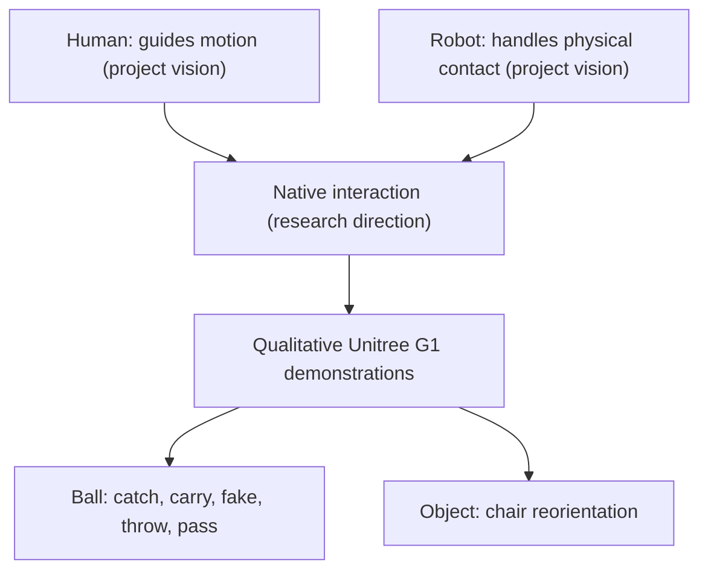

# LIFe — 原生物理交互（Native Interaction for Humanoid Robots）

> **资料范围（2026-11-09）：** 已通读[官方项目网页与 README](../../sources/sites/life-native-interaction-official.md)，尚无公开论文原文。封面中的 *Learning Native Interaction via Local Interaction Fields* 是展示标题；“Local Interaction Fields” 的具体机制尚无可核实的一手说明。本页为 **draft**，不把研究愿景当成已公开算法。

## 一句话定义

**LIFe** 展示一种面向 Unitree G1 的人形机器人交互研究愿景：由人引导整体运动，让机器人在真实物体交互中处理接触过程；当前公开证据是定性真机演示，而非可复现的训练/部署方案。

## 英文缩写速查

| 缩写 | 英文全称 | 简要说明 |
|---|---|---|
| LIFe | Learning Native Interaction via Local Interaction Fields | 用户提供视频封面的完整副标题；官方网页暂未给出 LIFs 的算法定义 |
| VR | Virtual Reality | 项目首页画面中的穿戴式操作设备与遥操作场景 |
| G1 | Unitree G1 | 官方网页标注的真实机器人本体 |
| HOI | Human–Object Interaction | 人和物体之间的物理交互；此处仅作领域背景词，不代表官方算法命名 |

## 为什么重要

全身运动流畅并不等价于可靠的物体接触。官方项目页特别指出，接近、抓稳、持续保持、适应变化与释放物体是难点。LIFe 试图从“人持续逐个操纵接触”走向“人引导运动、机器人处理交互”的研究方向，适合与人形[模仿学习](../methods/imitation-learning.md)及[HumanX](./paper-hrl-stack-05-humanx.md)的交互技能研究并排阅读；**两者不是同一个项目，尚不能断言算法继承关系**。

## 流程总览（官方愿景，不是网络架构图）

下图**只转述官方网页“Human guides motion + Robot handles interaction → Native interaction”** 的目标关系及网页明确列出的演示类别；没有将“Local Interaction Fields”猜成潜在特征、损失函数或控制模块。

## 核心原理（目前可核实的边界）

- **运动与接触的角色分工：** 官方写明 “Human guides motion / Robot handles interaction”。这反映系统愿景，未披露控制器实际输入、融合接口、自治程度、运动命令的频率或安全约束。
- **接触持续性：** 官网 “Continuity” 展示 hold、carry、ball fake、throw；“Reaction” 展示动态接球；“Collaboration” 展示人机传接球；“Adaptation” 展示椅子重定向。这些是网页描述的演示类别，而不是公布的独立评测任务。
- **未知技术核心：** “Local Interaction Fields”的形式化定义、输入输出维数、观测及动作、训练数据、优化目标、Sim2Real 过程尚无公开一手材料，不予推断。

## 演示与评测证据

| 公开资料 | 能证实什么 | 不能证实什么 |
|---|---|---|
| 官方项目页 “THE FILM” | 有约 **93 秒**真机演示，章节包括 Catch / Continuous interaction / Exchange / Reorient | 没有给出多次试验成功率、统计分布 |
| “THE MOMENTS” | 传接球、连续持球、抛球及调整椅子等定性场景 | 无同口径基线、消融或随机条件评测 |
| 官方 README | 页面素材与视频对外公开，机器人策略和论文未包含于仓库 | 不能依据这个仓库复现训练、推理或真机运行 |

## 结论

**现阶段 LIFe 的可验证价值是对“原生物理交互”的研究目标和实机展示；具体算法能力与可复现性仍待论文发布。**

- 可以确定演示关注连续接触、响应和人机协作，而不仅是步态运动。
- 不应以片段展示代替重复试验结果，或推断策略对物体、场景的分布外泛化。
- 不能将标题“Local Interaction Fields”解释成特定空间场、奖励或动作头。
- 官方仅提供站点素材仓库；机器人程序与权重未公开，不能复现。

## 工程实践（含开源状态）

- **本体与场景：** 官网标注 Unitree G1；展示 VR 操作者、球类与椅子等物体交互。
- **公开入口：** [项目页](https://qihanzhao.github.io/LIFe/)和[官方 GitHub](https://github.com/QihanZhao/LIFe)；网页可按 README 用 `python3 -m http.server 8000` 本地预览，**此命令只运行静态网页**。
- **未公开：** policy observations、训练源码、模型权重、实现细节及 manuscript。尚未公布具体运行框架、策略网络、推理频率、训练环境或硬件参数。
- **待补验收：** 正式论文、方法、实验设置与消融；如开放算法源码，再检查 README 的可运行入口、关键代码以及仿真 / 真机 IO。

## 源码运行时序图

**不适用（截至 2026-11-09）**：`QihanZhao/LIFe` 仅包含 HTML / CSS / JavaScript 前端和演示视频，没有机器人训练、推理或部署的运行入口；不把网站播放视频的时序冒充机器人控制源码时序。

## 与相关工作对比

| 研究 | 已核实的公开内容 | 本页判断 |
|---|---|---|
| LIFe | 官方 93 秒 G1 交互展示与网页愿景，未公开论文 | 技术机制、量化效果与训练接口未知 |
| [HumanX](./paper-hrl-stack-05-humanx.md) | 论文阐述 XGen 交互数据生成与 XMimic 交互技能学习 | 可比较研究目标，但目前**不能**宣称 LIFe 是 HumanX 的改进版本 |
| [OmniRetarget](./paper-hrl-stack-03-omniretarget.md) | 论文关注交互保持的动作重定向 | 面向相关任务，但 LIFe 是否使用此机制未知 |

## 局限与风险

1. 论文、技术报告与机器人策略实现没有公开，无法验证定量性能、部署可靠性、控制时延或接触安全。
2. 演示中人类引导与机器人处理接触的真实责任边界未披露，不应凭画面推断完全自主。
3. 官方仓库没有 ICRA 或 CoRL 接收声明；不要推定会议论文已经接收。
4. 本项目实体仍为 **draft**：已通读公开网页/README，但尚未取得作为算法论据的论文全文。

## 关联页面

- [HumanX：敏捷人形交互技能](./paper-hrl-stack-05-humanx.md)
- [OmniRetarget：交互保持动作重定向](./paper-hrl-stack-03-omniretarget.md)
- [模仿学习](../methods/imitation-learning.md)

## 参考来源

- [LIFe 官方主页与 README 一手归档](../../sources/sites/life-native-interaction-official.md)
- [LIFe 网页资源仓库归档](../../sources/repos/life-humanoid-project-page.md)
- [截图线索及标题核对](../../sources/videos/life-learning-native-interaction-local-interaction-fields.md)
- [LIFe 官方项目页](https://qihanzhao.github.io/LIFe/)
- [QihanZhao/LIFe：README.md](https://github.com/QihanZhao/LIFe/blob/main/README.md)

## 推荐继续阅读

- [官方 93 秒真机演示（官网内嵌）](https://qihanzhao.github.io/LIFe/#film)
- [HumanX：论文 arXiv:2602.02473](https://arxiv.org/abs/2602.02473)（**不同项目**；用于理解人形交互研究背景）
