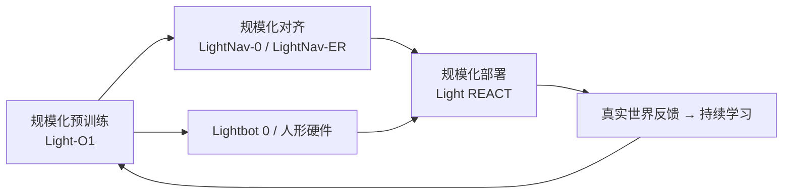

# 亮源新创（Light Origins）

**亮源新创（Light Origins）** 是面向 **Physical AI / 通用具身智能** 的人工智能公司（[About 页](https://www.lightorigins.com/en/about)，[中文](https://www.lightorigins.com/about)）：以 **Intelligence-first** 路线把基础模型能力从数字世界延伸到真实物理世界，覆盖基础模型、多模态感知、真实世界反馈、机器人系统与持续学习，并让 **模型、算力、数据、硬件与部署** 汇入同一学习闭环。

## 一句话定义

**以「规模化预训练 → 规模化对齐 → 规模化部署」三段范式组织 Physical AI 全栈研发，并围绕自研人形与开源子项目验证通用具身智能。**

## 英文缩写速查

| 缩写 | 英文全称 | 简要说明 |
|------|----------|----------|
| PAI | Physical AI | 在真实物理世界中可验证运行的 AI 系统 |
| AGI | Artificial General Intelligence | 公司使命语境下的 **Physical AGI** |
| RLHF | Reinforcement Learning from Human Feedback | 创始人 Roger Jiang 在 OpenAI 期间的奠基工作之一 |
| VLM | Vision-Language Model | LightNav-0 等对齐段成果所依托的预训练视觉-语言基座 |
| ICL | In-Context Learning | Light REACT 部署段将全身适应建模为具身 ICL |

## 为什么重要

- **三段范式锚点：** 官方使命明确 **Scalable pre-training / alignment / deployment**；站内 [Light-O1](./light-o1.md)、[LightNav-0](./paper-lightnav-0.md)、[Light REACT](./light-react.md) 分别对应预训练、对齐、部署段的公开成果，便于按阶段读技术路线。
- **OpenAI 系创始团队：** CEO **Roger Jiang** 曾参与 InstructGPT、ChatGPT、GPT-4 预训练/对齐/基础设施，并在 GPT-4 Technical Report **署名 8 次**——对大模型训练与对齐经验可迁移到具身基础模型。
- **国内具身开源触点：** GitHub 组织 [lightorigins](https://github.com/lightorigins) 已开源 **LightNav-0**、**Light-O1 Preview** 等；全景覆盖见 [国内具身开源 424 盘点](../queries/china-domestic-opensource-424-coverage.md)。
- **自研硬件叙事：** [Light-Loco-Parkour](./paper-light-loco-parkour.md) 等在 **Lightbot 0** 人形上验证全身跑酷；官网首页预告 **双足人形** 产品即将发布。

## 核心信息

| 字段 | 内容 |
|------|------|
| **机构** | 亮源新创（Light Origins） |
| **成立** | 2024（官网 Schema.org） |
| **总部/办公** | 北京 · 深圳 · 新加坡 |
| **官网** | <https://www.lightorigins.com/> |
| **GitHub** | <https://github.com/lightorigins> |
| **使命** | 在具身智能领域率先突破三段范式，实现 **Physical AGI** |
| **价值观** | 主人翁意识 · 坦诚高效 · 突破创新 · 追求极致 |
| **创始人** | Roger Jiang（CEO；UMD 物理学 Ph.D.；前 OpenAI） |

## 核心原理

亮源新创以 **Intelligence-first** 组织研发，将具身基础模型演进拆解为三个依次递进且形成数据回流闭环的规模化范式：

1. **规模化预训练（Scalable Pre-training）：** 从海量互联网人类视频恢复 3D 动作并离散化，预训练可迁移人类动作先验（代表成果：[Light-O1](./light-o1.md)，验证跨本体 Transfer Scaling Law）。
2. **规模化对齐（Scalable Alignment）：** 依托 Real2Sim2Real 数据引擎将 2,000+ 真实场景转化为 4,000+ 小时交互经验，经 ER 中期训练、SFT 与在线 RL 对齐空间智能与多本体导航（代表成果：[LightNav-0](./paper-lightnav-0.md)、[LightNav-ER](./lightnav-er.md)、[INSIGHT-Bench](./insight-bench.md)）。
3. **规模化部署（Scalable Deployment）：** 以全身韧性控制与紧凑机载策略应对真实运行中的外力扰动、硬件失效与接触丰富地形，持续收集真实反馈反哺预训练与对齐（代表成果：[Light REACT](./light-react.md)、[Light-Loco-Parkour](./paper-light-loco-parkour.md)、[Lightbot 0](./lightbot-0.md)）。

## 公开技术成果（截至 2026-09-21）

| 阶段 | 代表成果 | 站内页 | 开源（摘要） |
|------|----------|--------|--------------|
| 规模化预训练 | Light-O1 | [light-o1](./light-o1.md) | Preview 推理 + HF 权重 **已开源** |
| 规模化对齐 | LightNav-0 + LightNav-ER + INSIGHT-Bench | [paper-lightnav-0](./paper-lightnav-0.md) · [lightnav-er](./lightnav-er.md) · [insight-bench](./insight-bench.md) | LightNav-0 代码+权重、INSIGHT-Bench **已开源** |
| 规模化部署 | Light REACT | [light-react](./light-react.md) | 截至入库日 **未开源** |
| 全身跑酷 / 平台 | Light-Loco-Parkour + Lightbot 0 | [paper-light-loco-parkour](./paper-light-loco-parkour.md) · [lightbot-0](./lightbot-0.md) | **未开源** |

## 工程实践

| 项 | 说明 |
|----|------|
| **源码运行时序图** | **不适用**（机构实体总览页，无单一运行入口；各子项目运行时序见 [Light-O1](./light-o1.md)、[LightNav-0](./paper-lightnav-0.md)、[INSIGHT-Bench](./insight-bench.md)） |
| **按三段读成果** | 预训练看 Light-O1 的 human action prior 与 Transfer Scaling Law；对齐看 LightNav-0 的 VLM 空间意图 token 化；部署看 Light REACT 的全身 ICL 韧性 |
| **开源边界** | 以 [GitHub 组织](https://github.com/lightorigins) 与各项目页为准；Light-O1 完整训练 checkpoint、LightNav-ER 独立权重与 Light REACT 代码/论文截至 2026-11-21 均未公开 |
| **机构命名** | 中文官方名 **亮源新创**（非「光原点」）；英文品牌 **Light Origins** |

## 局限与风险

- **全栈未开源：** About 页与产品叙事覆盖完整闭环，但公开可复现主要为 **子项目级** 仓库，非端到端 monorepo。
- **硬件依赖：** 多项真机演示绑定 **Lightbot 0** 或自研人形，跨本体复现需核对观测/动作契约。
- **发布节奏快：** 2026 年内连续公开 O1 / REACT / Nav 等，工程文档与 arXiv 可能滞后于微信/Tech Blog。

## 关联页面

- **概念：** [Robot In-Context Learning](../concepts/robot-in-context-learning.md) — Light REACT 的部署段 ICL 读法
- **任务：** [Humanoid Locomotion](../tasks/humanoid-locomotion.md) — Light-Loco-Parkour 跑酷线
- **盘点：** [国内具身开源 424 覆盖](../queries/china-domestic-opensource-424-coverage.md) — 亮源新创条目
- **国内公司对照：** [Robbyant（蚂蚁灵波）](./robbyant.md) — 感知→世界模型→VLA 的 LingBot 模型全栈路线
- **子项目技术地图：** [3 篇技术地图](../overview/lightorigins-3blogs-technology-map.md)
- [视觉–语言导航（Vision-and-Language Navigation, VLN）](../tasks/vision-language-navigation.md)：对接其规模化对齐阶段代表成果 LightNav-0 所面向的视觉语言导航任务。

## 推荐继续阅读

- [Light Origins About（EN）](https://www.lightorigins.com/en/about)
- [Light Origins 关于我们（ZH）](https://www.lightorigins.com/about)
- [lightorigins GitHub 组织](https://github.com/lightorigins)

## 参考来源

- [Light Origins About 页归档](../../sources/sites/lightorigins-about.md)
- [Light-O1 项目页归档](../../sources/sites/light-o1.md)
- [LightNav-0 项目页归档](../../sources/sites/lightnav-0.md)
- [Light REACT 发布归档](../../sources/sites/light-react.md)
