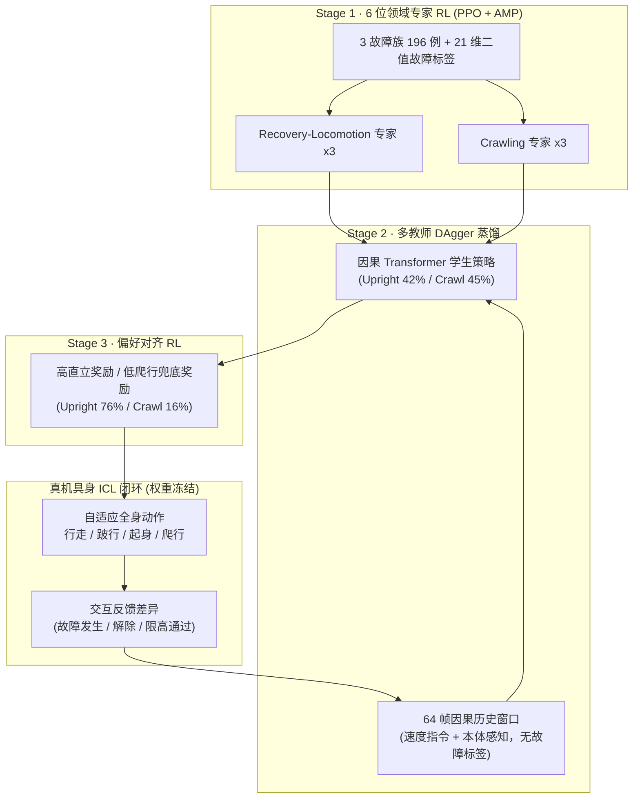

# Light REACT

**Light REACT**（**REsilient humAnoid ConTrol**，亮源新创 **2026-09-09** [Tech Blog](https://www.lightorigins.com/en/blog/light-react)，[微信发布](https://mp.weixin.qq.com/s/Xfps8-XAv3u1S--EpS5Ezw)）是面向 **人形机器人规模化部署** 的 **全身韧性控制** 框架：围绕四层「韧性金字塔（Resilience Pyramid）」与「RL → 多教师蒸馏 → 偏好对齐 RL」三阶段配方，使单一冻结 **64 帧因果 Transformer** 策略仅凭速度指令与本体感知历史，在外部冲击、摔倒及 **196 类硬件故障** 下自主重组行走、跛行、起身与爬行。

> **落地状态（2026-11-21 复核）：** 官方 [Tech Blog](https://www.lightorigins.com/en/blog/light-react) 已完整披露四层韧性金字塔、6 位专家训练细节、MLP / RNN / Transformer 蒸馏与偏好对齐定量对比及真机临时故障恢复演示；**仍无 arXiv 论文或公开代码**。

## 一句话定义

**用「6 专家分治 RL → DAgger 蒸馏到 64 帧因果 Transformer → 直立偏好 RL 对齐」，让冻结权重策略仅凭近期全身交互历史推断当前身体与环境约束，实现从抗扰行走、摔倒恢复到重伤爬行的无标签具身 ICL。**

## 英文缩写速查

| 缩写 | 英文全称 | 简要说明 |
|------|----------|----------|
| REACT | REsilient humAnoid ConTrol | 本文框架名：人形韧性全身控制 |
| ICL | In-Context Learning | 上下文学习；本文指权重不变、靠 64 帧因果上下文推断故障 |
| WBCL | Whole-Body Context Learning | 亮源新创对全身具身 ICL 的命名 |
| PPO | Proximal Policy Optimization | Stage 1 专家训练与 Stage 3 偏好对齐采用的强化学习算法 |
| AMP | Adversarial Motion Prior | 对抗运动先验；Stage 1 起身、行走与爬行风格参考约束 |
| DAgger | Dataset Aggregation | Stage 2 多专家在线蒸馏至单一学生策略 |

## 为什么重要

- **部署「最后一公里」：** 规模化部署必须能在故障、摔倒与环境受限后保留 **移动能力（mobility）** 而非执着于单一正常步态，否则现场人工介入会打断数据飞轮。
- **韧性金字塔四级统合：** 把以往割裂的「抗推行走」「倒地起身」「容错步态（LocoFormer / TOLEBI）」「无法直立时的爬行兜底」统一进单个通用策略。
- **记忆结构决定对齐成败：** 消融证明无记忆 MLP 蒸馏后有 **71.3%–79.8%** 帧落入模糊的 `Other` 姿态，而 **64 帧显式因果 Transformer** 既在蒸馏期将 `Other` 降至 **2.6%–9.6%**，更是三者中 **唯一** 在 Stage 3 偏好 RL 中能学会「能走则站、受限再爬」而不塌缩为全爬行的架构。
- **机构范式第三段：** 亮源新创 **规模化预训练 → 规模化对齐 → 规模化部署** 中，REACT 为 **部署段** 首个公开成果（预训练段见 [Light-O1](./light-o1.md)，对齐段见 [LightNav-0](./paper-lightnav-0.md)）。

## 核心信息

| 项 | 内容 |
|----|------|
| **机构** | 亮源新创（Light Origins） |
| **发布** | 2026-09-09（Tech Blog 与微信公众号同步公开） |
| **故障覆盖** | **3 类故障族 × 2 类技能集 = 6 位专家**，覆盖 **196 种故障情形**（Actuation Loss 86 + Joint Locking 86 + Knee-Fold Constraint 24） |
| **特权输入（Stage 1）** | 21 维二值故障指示向量（每关节 `1` 受损 / `0` 正常） |
| **学生架构对比** | 单帧 MLP vs 512 维单层 GRU RNN（+ 512→256→128 MLP 头）vs **64 帧因果 Transformer** |
| **部署输入** | 仅速度指令 $(v_x, v_y, \omega_z)$ + 本体感知历史（**无**故障标签、**无**在线梯度更新） |
| **开源** | **未开源**（无公开论文/GitHub/权重；见 [项目页核查归档](../../sources/sites/light-react.md)） |

## 核心原理

### 1）四层韧性金字塔（Resilience Pyramid）

1. **Level 01（Moderate pushes）：** 在中等外部推力下保持平衡并继续行走。
2. **Level 02（Extreme pushes）：** 极端推力导致摔倒后自主起身并恢复行走。
3. **Level 03（Hardware damage）：** 在单/多关节失效或锁定下完成倒地恢复，并演化出跛行（limping）、跳跃（hopping）等自适应步态。
4. **Level 04（Severe damage）：** 当双腿已无法支撑直立步态时，招募双臂转入全身接触式爬行（crawling）以维持机动性。

### 2）三阶段训练配方（RL → Distillation → RL）

| 阶段 | 方法与监督 | 关键设计与实测现象 |
|------|------------|-------------------|
| **Stage 1：6 位领域专家 RL** | **PPO + AMP**；输入含 **21 维二值故障指示器** | 故障族：**Actuation Loss**（86 例：12 单关节 + 66 双关节 + 8 单腿 3–6 关节链）、**Joint Locking**（86 例）、**Knee-Fold Constraint**（24 例，左右膝 90°–150° 12 档弯曲角）。Recovery–Locomotion 专家先藉外部辅助课程学起身再叠加速度跟踪；Crawling 专家加俯卧朝向奖励从倒地转爬行 |
| **Stage 2：多教师 DAgger 蒸馏** | 去除故障指示器，6 专家共同监督单策略（仅读速度指令与本体感知） | 对比 5,000 iter 教师动作 MSE 与 20 s 自主 rollout 帧分布：MLP 帧均呈 **71.3%–79.8%** `Other` 混合模糊态；GRU-512 RNN 降至 **17.3%–31.7%**；**64 帧因果 Transformer** 动作 MSE 最低且 `Other` 仅 **2.6%–9.6%**（直立 45.5%–52.4%、爬行 40.2%–48.7%） |
| **Stage 3：偏好对齐 RL** | 直立恢复与直立速度跟踪高奖励；爬行速度跟踪保留但奖励显著更低 | 蒸馏期直立 42% / 爬行 45% / Other 13% → **对齐后 Transformer 达直立 76% / 爬行 16% / Other 8%**；MLP 与 RNN 因难以稳定直立而塌缩向爬行主导 |

### 3）真机具身 ICL 验证

- **可逆硬件故障：** 双膝过热掉电后自主切至适应/爬行姿态，运行中途恢复供电时对齐后 Transformer 能凭近期交互历史推断故障已解除并重新站起直立行走（未做 Stage 3 对齐的蒸馏策略则未完成切回）；双腿捆绑并在运行中剪断绑带亦呈相同切换。
- **无损伤环境约束：** 给机器人施加高度受限外压阻止站立时，策略先尝试起身失败、从上下文推断环境受阻后转入爬行通过；抵达开阔区后感知约束消失并自主起立恢复直立行走。

### 流程总览

## 工程实践

| 项 | 建议 |
|----|------|
| **源码运行时序图** | **不适用**（截至 2026-11-21 官方仅公开 Tech Blog 与演示视频，未发布 arXiv 论文或 GitHub 源码仓库） |
| **为何需 3 阶段而非 2 阶段** | 纯蒸馏会把同一损伤下都能跟踪速度的「直立」和「爬行」等权混合，需靠 Stage 3 偏好 RL 建立优先级（能站不爬、避免关节外壳磨损） |
| **为何首选显式上下文窗口** | 64 帧因果 Transformer 在偏好 RL 中能借助显式历史分辨直立控制可行性，避免像 MLP / 512 维 GRU RNN 那样退化为只拿安全爬行奖励 |
| **与导航分工** | [LightNav-0](./paper-lightnav-0.md) 负责空间意图与目标可达；REACT 负责 **本体能力变化或环境受限下的机动执行** |

## 局限与风险

- **未开源 / 无同行评审论文：** 截至 2026-11-21 仅有官方 Tech Blog 与微信发布，缺少超参、奖励权重、真机硬件平台明细与独立可复现仓库。
- **上下文长度与推理算力预算未披露：** 64 帧因果 Transformer 在机载控制频率下的推理延迟、内存占用与是否依赖外部算力未说明。
- **硬件损伤下的安全边界：** 故障后继续强行爬行或单腿支撑可能放大其余正常关节的过载与二次损坏风险，现场需与电流/温度保护及急停机制联调。
- **与跑酷线关系：** 同机构 [Light-Loco-Parkour](./paper-light-loco-parkour.md) 偏 **前视深度感知跑酷蒸馏**（GRU 学生）；REACT 偏 **本体交互历史故障容错**（无外感知），二者是否共用基础框架未公开。

## 关联页面

- [对抗运动先验](../methods/amp-reward.md) — 延伸阅读，用运动数据塑造动作风格。
- [机器人 In-Context Learning](../concepts/robot-in-context-learning.md) — 全身上下文 vs 操作示范 ICL
- [亮源新创（Light Origins）](./light-origins.md) — 机构三段范式（部署段代表）
- [LightNav-0](./paper-lightnav-0.md) — 同机构规模化对齐成果
- [Light-O1](./light-o1.md) — 同机构规模化预训练成果
- [Light-Loco-Parkour](./paper-light-loco-parkour.md) — 同机构感知跑酷全身运动轴
- [Humanoid Locomotion](../tasks/humanoid-locomotion.md) — 人形运动任务中心
- [Whole-Body Tracking Pipeline](../concepts/whole-body-tracking-pipeline.md) — 全身控制管线
- [Sim2Real](../concepts/sim2real.md) — 仿真故障合成 → 真机部署链

## 参考来源

- [Light REACT 官方 Tech Blog 归档](../../sources/sites/light-react.md)
- [亮源新创 Light REACT 微信发布归档](../../sources/blogs/wechat_lightorigins_light_react_2026-09-09.md)
- [Light Origins About 页归档](../../sources/sites/lightorigins-about.md)

## 推荐继续阅读

- [Light REACT 官方 Tech Blog](https://www.lightorigins.com/en/blog/light-react)
- [亮源新创官网](https://www.lightorigins.com/)
- [LightNav-0 技术博客](https://www.lightorigins.com/en/blog/lightnav-0)
- [WAM-TTT / RoboTTT / StellaVLA / Zero-WAM 四路线 ICL 对比](../comparisons/wam-ttt-robottt-stellavla-zero-wam-embodied-icl.md)
