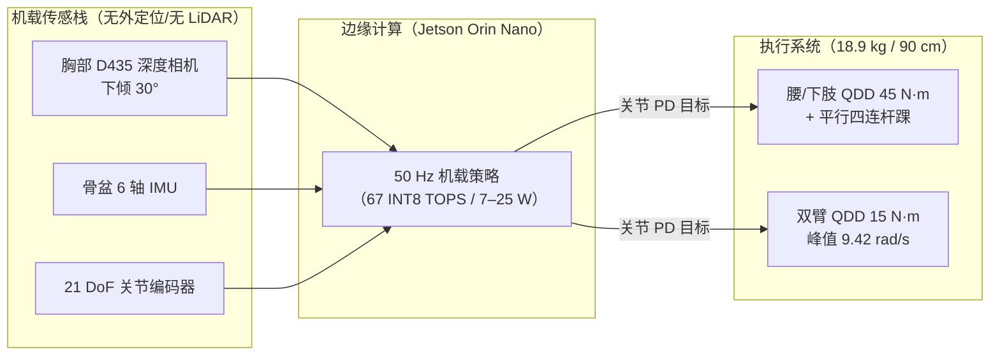

# Lightbot 0

**Lightbot 0** 是 **亮源新创（Light Origins）** 自研的紧凑型双足人形机器人实验平台，首发于 [Light-Loco-Parkour（arXiv:2608.02653 § VII-A）](https://arxiv.org/abs/2608.02653) 与 [LightParkour 官方技术博客](https://www.lightorigins.com/en/blog/lightparkour)（2026-08-03），并作为 [Light-O1](./light-o1.md) 等真机 loco-manipulation 与全身跑酷演示的统一硬件载体。

## 一句话定义

**90 cm / 18.9 kg / 21 DoF QDD 紧凑型自研人形；仅靠 30° 下倾胸部 D435 深度相机、骨盆 6 轴 IMU 与关节编码器，在 Jetson Orin Nano 上以 50 Hz 零样本机载运行感知全身策略。**

## 英文缩写速查

| 缩写 | 英文全称 | 简要说明 |
|------|----------|----------|
| QDD | Quasi-Direct Drive | 准直驱电机驱动；兼顾反向驱动性与高动态响应 |
| DoF | Degrees of Freedom | 自由度；Lightbot 0 全身共 21 个主动关节 |
| IMU | Inertial Measurement Unit | 惯性测量单元；安装于骨盆处的 6 轴 IMU |
| TOPS | Tera Operations Per Second | 算力单位；Orin Nano 标称 67 INT8 TOPS（7–25 W） |
| R2S2R | Real-to-Sim-to-Real | 稀疏人体种子 → 物理修复与增广 → 真机部署范式 |

## 为什么重要

- **紧凑级全感知真机载体：** 区别于常见 1.3 m 级人形平台（如 Unitree G1），90 cm / 18.9 kg 的低质心与较低力矩包络直接决定了策略不能照搬全尺寸人类动捕，必须依赖物理修复与课程增广。
- **纯机载极简传感与算力：** 无需 LiDAR、动捕或外部状态估计（odometry / mapping），仅用单一前下视 D435 + 骨盆 IMU + Jetson Orin Nano（7–25 W）即实现 50 Hz 闭环跑酷与踏石行走。
- **跨项目统一硬件底座：** 串联亮源新创 [Light-Loco-Parkour](./paper-light-loco-parkour.md)（75 cm 攀爬 ≈ 0.83H）与 [Light-O1](./light-o1.md)（真机 loco-manipulation）两代真机验证。

## 核心信息

| 项 | 内容 |
|----|------|
| **机构** | 亮源新创（Light Origins） |
| **尺寸 / 质量** | 身高 **90 cm**；整机质量 **18.9 kg** |
| **自由度与传动** | **21** 个主动关节（腿部、躯干与双臂）；双腿采用 **平行四连杆踝关节（parallel four-bar ankle linkages）** |
| **执行器包络** | QDD 电机：腰部与下肢 **45 N·m**、双臂 **15 N·m**；统一峰值角速度 **9.42 rad/s** |
| **机载感知** | 胸部 Intel RealSense **D435** 深度相机（**向下倾斜 30°** 覆盖脚前地形）+ 骨盆 **6 轴 IMU** + 关节编码器 |
| **机载计算** | **NVIDIA Jetson Orin Nano**（7–25 W，67 INT8 TOPS），策略频率 **50 Hz** |
| **开源** | **未开源**（无公开 URDF/CAD 或真机底层固件仓库） |

## 核心原理

Lightbot 0 的硬件–策略协同设计围绕「紧凑结构 + 低功耗机载闭环」展开：

- **两级力矩配置与平行踝传动：** 下肢与腰部配置 45 N·m 应对攀爬、跳跃落地的承重冲击，上肢配置 15 N·m 降低末梢惯量；双腿平行四连杆将踝关节电机上移至小腿近端，进一步减小摆动腿转动惯量。
- **30° 下倾胸部深度视野：** D435 固定于胸部并下倾 30°，在攀爬/跨步前持续捕获落足点与障碍前缘几何；近距离盲区与遮挡则交由策略侧 GRU 短时记忆补全。
- **单边缘模块 50 Hz 闭环：** 去掉外置运动生成器与 LiDAR 建图栈，策略直接读取关节位置/速度、骨盆 IMU 与深度图像，在 7–25 W 功耗包络下输出关节 PD 目标。

## 工程实践

| 项 | 说明 |
|----|------|
| **源码运行时序图** | **不适用**（Lightbot 0 为自研封闭硬件平台，官方未公开 URDF/CAD、底层电机驱动固件或配套部署仓库） |
| **Sim2Real 传感器建模** | 真实 D435 存在深度空洞、27–33 Hz 波动帧率与 30–60 ms 延迟；上游策略需显式注入顶/底行偏置的块丢弃（block dropout）与延迟随机化 |
| **力矩上限约束** | 相比 1.3 m 级人形，45 N·m / 9.42 rad/s 上限较低，离线参考动作必须经仿真物理修复后方可裁剪到硬件可执行包络 |
| **算力定位** | 67 INT8 TOPS 可直接承载 50 Hz 端到端策略，但难以同时运行高开销在线轨迹优化器或大参数量 VLA 实时闭环 |

## 局限与风险

- **硬件与模型均未开源：** 截至 2026-11-21，官方仅在论文与博客中披露核心尺寸、自由度与传感器规格，未开放结构图纸、URDF 模型或底层 SDK，第三方无法直接在相同本体上复现。
- **近身深度遮挡：** 单胸部下倾相机在紧贴高障碍物或翻越瞬间可能丢失障碍几何视野，要求策略具备时序记忆或盲区容错能力。
- **执行器包络限制：** 臂部 15 N·m 与下肢 45 N·m 限制了大负载全身操作与极高冲击动作的外推上限，高动态任务对参考动作的物理可行性更为敏感。

## 结论

**Lightbot 0 验证了在 90 cm / 18.9 kg 紧凑本体与 25 W 级边缘算力下，仅凭单目下倾深度和本体感知即可完成高动态全身跑酷的工程可行性。**

1. 硬件参数以 `arXiv:2608.02653` § VII-A 为准：90 cm、18.9 kg、21 DoF（45/15 N·m QDD，9.42 rad/s）、平行四连杆踝。
2. 传感器与算力全机载：30° 下倾 D435 + 骨盆 6 轴 IMU + Jetson Orin Nano（50 Hz），不依赖外部动捕或建图。
3. **未开源**硬件资料与固件；在站内应与 [Light-Loco-Parkour](./paper-light-loco-parkour.md) 及 [亮源新创（Light Origins）](./light-origins.md) 关联阅读。

## 关联页面

- [亮源新创（Light Origins）](./light-origins.md) — 研发机构与全栈路线总览
- [Light-Loco-Parkour](./paper-light-loco-parkour.md) — 首发披露 Lightbot 0 完整硬件规格的论文实体
- [Light-O1](./light-o1.md) — 搭载于 Lightbot 0 的全身智能基础模型演示
- [Light REACT](./light-react.md) — 同机构人形全身韧性控制
- [lightorigins-3blogs-technology-map](../overview/lightorigins-3blogs-technology-map.md) — 三篇技术博客交叉技术地图

## 公司路线日期口径

2026-08-03 LightParkour 博客展示 Lightbot 0；日期对应这次官方硬件演示，不声称整机首次发布或上市。 [日期证据](https://www.lightorigins.com/en/blog/lightparkour)。详见[本轮日期核查](../../sources/sites/company-roadmap-date-audit-2026-10-08.md)；版本事件与原始产品首发分别记录。

## 参考来源

- [Lightbot 0 硬件规格摘录（arXiv:2608.02653 § VII-A）](../../sources/papers/lightbot_0_lightorigins_2026.md)
- [LightParkour 官方技术博客归档（2026-08-03）](../../sources/blogs/lightorigins_lightparkour_2026-08-03.md)
- [公司路线日期核查](../../sources/sites/company-roadmap-date-audit-2026-10-08.md)

## 推荐继续阅读

- [LightParkour 官方技术博客](https://www.lightorigins.com/en/blog/lightparkour)
- [Light-Loco-Parkour 论文（arXiv:2608.02653）](https://arxiv.org/abs/2608.02653)
- [Light Origins 官网](https://www.lightorigins.com/)
