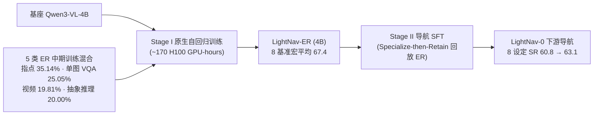

# LightNav-ER

**LightNav-ER** 是 **亮源新创（Light Origins）** 在 [LightNav-0（arXiv:2608.30935）](https://arxiv.org/abs/2608.30935)（[官方 Tech Blog](https://www.lightorigins.com/en/blog/lightnav-0)）中提出的第一阶段 **具身推理（Embodied Reasoning, ER）中期训练** 产物：在引入任何导航专用动作头之前，先用原生自回归多模态接口将 **Qwen3-VL-4B** 特化为具备空间指代、自由空间定位与多视角时序理解能力的 ER 检查点，再用于初始化下游导航 SFT 与在线 RL。

## 一句话定义

**LightNav-0 第一阶段具身推理中期训练产物（4B）：通过 5 类空间/指点/视频数据特化 Qwen3-VL-4B，在 8 项具身推理基准取得 67.4 平均分（4 项第一、4 项第二），并把下游 8 项单目导航平均 SR 从 60.8% 提升至 63.1%。**

## 英文缩写速查

| 缩写 | 英文全称 | 简要说明 |
|------|----------|----------|
| ER | Embodied Reasoning | 具身推理；Stage I 领域中期训练，负责在学动作前塑造空间表征 |
| VLM | Vision-Language Model | 视觉-语言多模态基座模型（本文基座为 Qwen3-VL-4B） |
| VLN | Vision-and-Language Navigation | 视觉-语言导航 |
| SFT | Supervised Fine-Tuning | Stage II 导航有监督微调（同时回放 ER 混合数据防遗忘） |
| SR / SPL | Success Rate / Success weighted by Path Length | 导航成功率与路径长度加权成功率 |

## 为什么重要

- **验证「先空间对齐、再学动作」范式：** 相比直接拿通用 VLM 微调导航动作，ER 中期训练在不增设导航动作头的情况下先打牢空间坐标与可行区域指代能力，对标 Molmo2-ER 与 Gemini Robotics-ER 路线。
- **以半数参数超越 8B 专门模型：** 4B 参数量的 LightNav-ER 在 8 项具身推理基准宏平均 **67.4**，不仅比初始化基座 Qwen3-VL-4B（63.1）高 **+4.3（+6.8%）**，还比 8B 的 Molmo2-ER（62.8）高 **+4.6（+7.3%）**。
- **可量化的下游导航增益：** Table IX 消融表明，改用 LightNav-ER 而非原始 Qwen3-VL-4B 初始化下游导航策略，8 项单目导航评测全部录得 SR 正增益（平均 SR **60.8 → 63.1**，+2.4 pt）。

## 核心信息

| 项 | 内容 |
|----|------|
| **机构** | 亮源新创（Light Origins） |
| **出处** | [LightNav-0 论文（arXiv:2608.30935 § IV-A / V-A / VI-B / VI-E）](https://arxiv.org/abs/2608.30935) |
| **基座模型** | Qwen3-VL-4B |
| **训练预算** | LR = 1×10⁻⁵、warmup = 0.01、global batch = 128、max seq = 10,240 tokens、约 **170 H100 GPU-hours** |
| **开源状态** | **未单独发布**（[lightorigins/LightNav-0](https://github.com/lightorigins/LightNav-0) 发布完整导航模型权重，未单独释出 Stage I LightNav-ER 权重） |

## 核心原理

### 1）五类 ER 中期训练数据混合（§ IV-A）

LightNav-ER 不针对单一基准刷题，而是将混合采样分配给多源合成与真实具身感知任务：

- **Pointing and Grounding（35.14%，13 个数据源）：** 包含 RefSpatial-2D/3D、PixMo Points、COCO Pointing、CoSyn Point、RefL4、RoboRefIt、RoboPoint、RoboAfford、HANDAL、FSD Free-Point / Visual-Trace；训练模型在图像平面直接输出可落脚自由空间与被指代物体的坐标点（下游实例化为 `<apos_i>` 与 `<opos_i>` 网格）。
- **Image Embodied QA（单图 VQA 占 25.05%，11 个数据源）：** 涵盖 SenseNova-SI、CLEVR Spatial、SAT Spatial 及 8 个 VSTP-SI/MI 子集，覆盖深度比较、距离估计、物体相对关系与相机运动。
- **Video Embodied QA（占 19.81%，9 个数据源，最长 64 帧）：** 涵盖 RoboVQA、RoboFAC Failure-VQA、VSI-590K、SIMS-VSI、ViCA-322K、LLaVA-Video-VQA、SQA3D 与 SpatialLadder，强化时序顺序、规划与失败归因。
- **Multi-image & Ego–Exo Correspondence：** 从 VSTP-MI 与视频池抽取跨视角样本，训练第一视角与第三视角对应关系及跨帧目标关联。
- **Abstract Embodied Reasoning（占 20.00%，3 个数据源）：** LLaVA-OneVision Spatial VQA、Euclid30K-Math 与 MMIF-23K-Instruct，防止特化过程中通用图文理解与组合推理退化。

### 2）Specialize-then-Retain 课程（§ V-A）

Stage I 仅通过原生自回归接口训练获得 **LightNav-ER**；进入 Stage II 导航 SFT 时，将重平衡后的 ER 混合数据与导航轨迹交错回放，在学习 RVQ 动作 token 的同时保留 Stage I 的指点与空间定位能力。

### 流程总览

### 评测与消融（arXiv:2608.30935 Table II & Table IX）

- **8 项具身推理基准（Table II）：** LightNav-ER 宏平均 **67.4**（Point-Bench **64.5**、RefSpatial **57.4**、RoboSpatial-POI **56.5**、RoboSpatial-VQA **71.9**、Where2Place **76.6**、CV-Bench **88.4**、ERQA **43.8**、EmbSpatial **79.8**）；其中 Where2Place（+12.6）与 RefSpatial（+11.9）相对 Qwen3-VL-4B 提升最显著。
- **下游导航初始化消融（Table IX）：** 相对原始 Qwen3-VL-4B 初始化，LightNav-ER 初始化在 8 个设定（R2R、RxR、HM3D v1/v2、MP3D、OVON Seen/Synonyms/Unseen）上 SR 全部提升，均值 **60.8 → 63.1（+2.4 pt）**，MP3D（+4.2）与 OVON Unseen（+4.0）收益最大。

## 工程实践

| 项 | 说明 |
|----|------|
| **源码运行时序图** | **不适用**（截至 2026-11-21 官方仅发布完整对齐后的 `lightorigins/LightNav-0` 模型与推理入口，Stage I LightNav-ER 独立检查点与中期训练脚本未单独公开） |
| **防遗忘机制** | 下游进入 SFT 阶段时须按 **Specialize-then-Retain** 策略保留一定比例 ER/VQA 回放样本，否则指点定位精度会被动作微调覆盖 |
| **计算成本参照** | 4B 规模下 Stage I 中期训练约 170 H100 GPU-hours（10,240 上下文长度），在同类具身基座改造成本中属中等轻量区间 |

## 局限与风险

- **独立权重未发布：** 无法直接下载 Stage I LightNav-ER 单独复现 Table II 具身推理评测或将其直接用于其他机器人任务初始化。
- **非所有子基准单项第一：** 在 Point-Bench（64.5 vs 8B Molmo2-ER 77.3）、RoboSpatial-POI（56.5 vs Qwen3-VL-4B 64.8）和 ERQA（43.8 vs Molmo2-ER 46.8）上仍落后于对应强项模型。
- **对路径效率 SPL 贡献有限：** Table IX 中 ER 初始化带来 +2.4 pt SR，但 SPL 仅微增 +1.0 pt（39.0 → 40.0），且 RxR / OVON-Synonyms 上 SPL 略低于基线（64.5 vs 64.9、29.3 vs 29.7），说明 ER 主要改善「去哪与找目标」，路径平滑与绕障效率仍依赖后续导航 SFT/RL。

## 结论

**LightNav-ER 证明了在导航动作微调之前，仅用约 170 H100 GPU-hours 的多源空间指点与视频推理中期训练，就能让 4B VLM 获得超越 8B 专用模型的空间先验并稳定转化为下游导航成功率。**

1. **状态：** 独立中期训练检查点 **未单独发布**（完整权重见 [LightNav-0](./paper-lightnav-0.md)）。
2. 核心增益来自 **35.14% 指点/定位数据** 与原生自回归接口统一，直接服务于下游 `<apos_i>` / `<opos_i>` 双通道指点预测。
3. 工程选型上，若追求路径效率（SPL）优化，不能仅靠 ER 中期训练，仍须配套导航 SFT 与在线 RL。

## 关联页面

- [LightNav-0](./paper-lightnav-0.md) — 依托本检查点完成 SFT 与在线 RL 的主导航模型
- [亮源新创（Light Origins）](./light-origins.md) — 研发机构与三段范式总览
- [INSIGHT-Bench](./insight-bench.md) — 同论文发布的 5×5 诊断式 OGN 评测基准
- [lightorigins-3blogs-technology-map](../overview/lightorigins-3blogs-technology-map.md) — 亮源新创三篇技术博客交叉技术地图
- [Light REACT](./light-react.md) — 同机构部署段全身韧性控制

## 参考来源

- [LightNav-ER 来源摘录（arXiv:2608.30935 § IV-A / V-A / VI-B / VI-E）](../../sources/papers/lightnav_er_lightorigins_2026.md)
- [LightNav-0 官方博客归档（2026-09-01）](../../sources/blogs/lightorigins_lightnav_0_2026-09-01.md)

## 推荐继续阅读

- [LightNav-0 论文（arXiv:2608.30935）](https://arxiv.org/abs/2608.30935)
- [LightNav-0 官方 Tech Blog](https://www.lightorigins.com/en/blog/lightnav-0)
- [3 篇技术地图](../overview/lightorigins-3blogs-technology-map.md)
