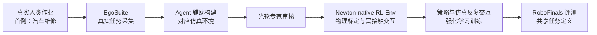

# RoboFinals RL Environments（光轮智能强化学习仿真训练环境）

## 一句话定义

**RoboFinals RL-Env** 是 [光轮智能 Lightwheel](./lightwheel.md) 于 **CoRL 2026 期间**介绍的机器人 **强化学习仿真训练环境**：将 [EgoSuite](./lightwheel-egosuite.md) 捕获的真实工作转成 Newton-native 可交互环境，面向长程、多阶段、可变形及富接触操作训练，并与 [RoboFinals 评测平台](./lightwheel-robofinals.md) **共享任务定义**。首个公开示例是**汽车维修**。产品目前提供早期访问申请。**本页完成状态仅指已公布的官方发布公告整理完整，不代表公开产品技术规格、SDK 或性能已全部核实。**

## 英文缩写速查

| 缩写 | 英文全称 | 简要说明 |
|------|----------|----------|
| RL | Reinforcement Learning | 强化学习，通过策略与环境交互来优化行为 |
| RL-Env | Reinforcement Learning Environment | 可供策略训练与交互反馈的仿真环境（产品简称） |
| EgoSuite | Lightwheel EgoSuite | 光轮采集真实人类作业的第一视角数据系统 |
| Real2Sim | Real-to-Simulation | 将真实任务与物理参数映射成仿真场景 |
| SR | Success Rate | 任务成功率；本产品尚无可核实的公开数值 |

## 为什么重要

- **任务定义由真实工作驱动：** 官方强调从真实人类执行的作业采集开始，而不是完全凭想象设计训练任务；首个公开任务为汽车维修。
- **物理标定与接触交互：** 官方强调物理经过标定、支持可变形和复杂接触，但**尚未提供**标定误差或独立的真机对照结果，不能把产品自述等同于实证。
- **训练评测统一任务定义：** RL-Env 负责训练；[RoboFinals](./lightwheel-robofinals.md) 负责评测。二者共享任务定义，不代表已证明训练后的真实部署成功率。

## 核心机制

| 环节 | 官方确认的信息 | 暂未公开／无法核实 |
|------|----------------|-------------------|
| 真实任务来源 | 人执行真实工作，通过 EgoSuite 捕捉；首个任务为汽车维修 | 采集规模、标注协议和任务具体分解算法 |
| 环境构建 | agent 辅助构建、人工专家审核 | 生成工具链内部模块与验收标准 |
| 仿真与交互 | Newton-native；长程、多阶段、可变形、接触丰富 | 求解器版本、状态／动作空间、奖励与终止条件 |
| 物理可信度 | 官方称物理经过标定 | 摩擦／刚度／阻尼等具体标定流程、误差指标 |
| 训练与评测 | 可训练策略，和 RoboFinals 共用任务定义 | RL 算法、训练配置、公开 baseline／benchmark 结果 |
| 获取 | early access / waitlist | 可下载环境包、公共 API、许可证 |

### 与既有 RoboFinals 的区别

| 产品 | 本页证实的定位 |
|------|----------------|
| [RoboFinals](./lightwheel-robofinals.md) | 工业级**策略评测**平台，早于 2026 年 RL-Env 发布 |
| **RoboFinals RL-Env** | 基于真实任务的**强化学习训练环境**，与评测平台共享任务定义 |
| [LW-BenchHub](./cn-os-lw-benchhub.md) | 另一个**已开源**的仿真训练／评测工程框架，不应视为 RL-Env 官方源码 |

## 流程总览

以下仅绘制光轮**官方发布帖明确描述**的主干，不添加未核实的环境重建、奖励函数或标定算法细节。

- **已核实关系：** 真实作业→EgoSuite、agent 构建→专家审核、Newton-native RL 环境、训练与评测共享任务定义。
- **不能从公告推出：** agent 是否自动生成奖励函数、是否有多种机器人本体、能否立即公共下载、单次训练可运行多少并行环境。
- **SimFoundry 说明：** 光轮过往文案使用过 SimFoundry 这个自研平台名，但本次能读到的 RL-Env 公告没有给出其与 Newton-native RL-Env 的明确模块关系，故没有把它画成必经节点。

## 源码运行时序图

**不适用（当前资料范围）。** 截至 2026-11-13，未获取 RoboFinals RL-Env 产品的公开可运行源码与训练入口。相关 [LW-BenchHub GitHub](https://github.com/LightwheelAI/LW-BenchHub) 与 [Newton GitHub](https://github.com/newton-physics/newton) 是独立开源基础设施，不能据其实现编造 RL-Env 的运行时调用图。若后续获得官方源码，应先读 README 与真实启动脚本后再补图。

## 工程实践

- **选型：** 如果要把真实制造／维修任务转成 RL 训练环境，可重点核对 early access 提供的机器人本体、状态／动作接口、奖励与重置逻辑、场景版本控制。
- **验收：** 要求展示任务定义与评测协议的确切对应关系，另外核验关键接触参数的测量记录，以及真实对象与模拟对象的误差。当前公告**尚未提供**这些实测数据。
- **公开可复现替代：** 若当前就要跑 RL，可另用 [LW-BenchHub](./cn-os-lw-benchhub.md) 的公开训练示例，但不应将跑通该仓库描述成复现了 RoboFinals RL-Env。
- **跟进：** 持续关注官网 [early access](https://lightwheel.ai/robofinals-rl-env) 是否开放任务包、评测基线、训练接口和许可。

## 局限与风险

1. **产品页抓取受阻：** 官方 LinkedIn 发布帖已通读，且与官方 X 发布文案交叉核对；官网独立产品页在当前工具中仍无法获取。产品技术规格与完整机制均需补核；**complete 只对应本节点官方公告的已知公开内容，PR 在补核前仍为草稿**。
2. **公开证据不足：** 官方尚未公布可独立验证的 RL 训练曲线、成功率、物理标定误差或 Sim2Real 关联数据。
3. **代码与许可未明：** 只见早期访问申请，未找到该产品单独的可运行仓库；不等于断言公司没有内部代码。
4. **概念不能混同：** 既有 RoboFinals（评测）、RoboFinals RL-Env（训练）和 LW-BenchHub（独立开源工程）不是同一产品。
5. **环境生成环节不透明：** 官方只确认 agent 构建与专家审核，未公开逐阶段输入输出或审核判定规则。

## 关联页面

- [Lightwheel（光轮智能）](./lightwheel.md)
- [RoboFinals 仿真评测](./lightwheel-robofinals.md)
- [EgoSuite 第一视角数据](./lightwheel-egosuite.md)
- [SimReady 物理资产](./lightwheel-simready.md)
- [Newton 物理引擎](./newton-physics.md)
- [LW-BenchHub 开源工程](./cn-os-lw-benchhub.md)
- [Isaac Lab-Arena](./isaac-lab-arena.md)

## 参考来源

**原文阅读范围：** 光轮官方 LinkedIn 发布公告（全文，2026-11-14 重核）；已追踪到对应官方 X 账号 2026-11-11 发布记录。**未读范围：** 当前仍无法直接打开的专属产品页及未公开实现细节；不将第三方总结当作技术原文。

- [官方公告与开放状态核对归档](../../sources/sites/lightwheel_robofinals_rl_env.md)（已读官方发布帖全文；产品页正文未能读取）
- [Lightwheel 官方 LinkedIn 动态](https://cn.linkedin.com/company/lightwheel2026)（RoboFinals RL Environments 公告）
- [RoboFinals RL-Env 产品页](https://lightwheel.ai/robofinals-rl-env)（**待全文核实**）
- [官方 X 发布链接](https://x.com/LightwheelAI/status/2120350216679493836)（当前抓取 403，**不作为直接证据**）

## 推荐继续阅读

- [RoboFinals 评测平台产品页](https://lightwheel.ai/robofinals)
- [LW-BenchHub 官方仓库](https://github.com/LightwheelAI/LW-BenchHub)
- [Newton 官方仓库](https://github.com/newton-physics/newton)
