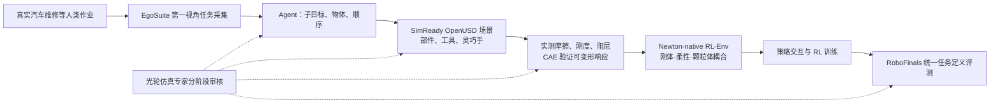

# RoboFinals RL Environments（光轮智能强化学习仿真训练环境）

## 一句话定义

**RoboFinals RL-Env** 是 [光轮智能（Lightwheel）](./lightwheel.md) 2026 年 11 月发布的 **真实任务驱动、实测物理标定、Newton-native 的机器人强化学习环境**：由 [EgoSuite](./lightwheel-egosuite.md) 采集人类实际工作，通过 Agent 任务解析、[SimReady](./lightwheel-simready.md) OpenUSD 场景重建和材料/可变形物理校准，最终供策略反复交互训练；与原有 [RoboFinals 评测平台](./lightwheel-robofinals.md) 共享任务、场景和物理定义。**官方独立产品技术页已于 2026-11-14 全文核实**，但专属训练代码、任务包及定量 Sim2Real 验证仍未公开，属于 Early Access 产品。

## 英文缩写速查

| 缩写 | 英文全称 | 简要说明 |
|------|----------|----------|
| RL / RL-Env | Reinforcement Learning / Environment | 强化学习及策略可交互训练环境 |
| EgoSuite | Lightwheel EgoSuite | 真实人类任务第一视角采集 |
| USD / OpenUSD | Universal Scene Description | SimReady 场景和资产格式 |
| CAE | Computer-Aided Engineering | 工业级工程仿真，用于验证可变形响应 |
| Real2Sim | Real-to-Simulation | 从真实任务和物理测量构建仿真 |
| SR | Success Rate | 任务成功率；RL-Env 尚未给出可复现公开成绩 |

## 为什么重要

- **任务定义来自真实工作：** 官网页以汽车维修为首发环境，而非从简单、虚构的抓取目标出发；长时域任务具有数分钟持续时间和阶段间依赖。
- **物理标定有清晰接口：** 摩擦、刚度、阻尼依据实测，软管、线缆与垫片响应由工业级 CAE 验证，再进入 Newton 耦合求解。**这属于厂商陈述**，不可将「实测」等同于已由第三方复现的真实误差。
- **训练—评测任务口径统一：** RL-Env 提供交互训练，RoboFinals 提供统一任务定义下的评测，减少训练任务与评测任务完全不一致的结构性障碍；但不保证无训练集/测试集泄漏，也不证明真机迁移。
- **环境分布随真实数据扩展：** EgoSuite 与环境库使用相同四轴分类，由 Agent 增量生成、专家审核，而非只维护静态人工选题列表。

## 核心机制

### 1. EgoSuite 捕获 → Agent 解析 → SimReady 场景

- **真实任务输入：** 人在真实场景使用自己的手与工具完成工业工作，EgoSuite 录制第一视角演示；官网首发任务为**汽车维修**。
- **任务结构：** Agent 提取子目标、物体、操作顺序；据此重建零件、工具和灵巧手本体，将场景表示为 SimReady OpenUSD 资产。
- **同一任务的三项挑战：** ① 多阶段、数分钟、依赖前一阶段的长时域流程；② **灵巧手**而非平行夹爪；③ 软管、线缆、垫片等**可变形物体**。
- **对照图：** 官网页 Figure 1/2 是人类演示与仿真重建配对示意；未公开可计算的 3D 重建误差或解析成功率。

### 2. 实测标定 → CAE → Newton 耦合

| 层 | 官网页明确内容 | 尚未公开 |
|---|---|---|
| 参数测量 | 摩擦、刚度、阻尼取自真实部件/材料测量 | 测量协议、误差统计和原始数据 |
| 可变形响应 | 软管、线缆、垫片经工业级 CAE 对照验证 | CAE 模型、拟合阈值、验收容差 |
| 混合物理 | 刚体、可变形、颗粒的接触力在**同一时间步**通过求解器耦合 | 求解器接口、迭代策略和吞吐 |
| 场景与求解器 | **SimReady OpenUSD + Newton-native** | 可复现环境包、solver 版本和依赖锁定 |

官网 Figure 4 显示**软管仿真响应与实测对照**，但正文未给出统一精度百分比。其他产品或独立演示中的误差数字不可移植到 RL-Env。

### 3. Agent 构建／人工专家分阶段审核

官网页不仅泛称「agents build, experts review」，还列出了可核对的四阶段分工：

| 阶段 | Agent | 仿真专家 |
|---|---|---|
| Human Demo / EgoSuite | 解析子目标、物体、操作次序 | 核对真实工作结构 |
| Scene / SimReady OpenUSD | 构建部件、工具与灵巧手本体 | 审查重建场景 |
| Calibration / Physics + CAE | 指定实测参数、执行可变形验证 | 审核物理保真度 |
| RL-Env + Eval / Newton · RoboFinals | 装配训练环境并评测 | 审批任务发布 |

表格描述的是**官方流程分工**；未说明 Agent 提示词/实现、专家验收阈值与自动化成功率。

## 流程总览

以下 Mermaid 由[官网原文和四阶段分工表](../../sources/sites/lightwheel_robofinals_rl_env.md)抽象而来。虚线表示人工复核，不代表未公开的内部调用接口。

环境库的扩展按同一分类体系连接 EgoSuite 数据与训练场景：**Scene → Operation and Difficulty → Asset Type → Task Horizon**（四条分类轴，而非严格的执行先后步骤）。Agent 从新增采集构建、标定环境；专家审核后纳入库。

## 任务与环境库

| 内容 | 官方披露 |
|---|---|
| 首发环境 | **Automotive Repair（汽车维修）** |
| 展示环境 | Cooking Rice（家庭、流体/颗粒、多阶段）；Assembling an Engine（工业、刚体/铰接、工具精密操作）；Organizing the Operating Room（医疗、刚体/可变形、长时域）；Buffer Installation（工业、对齐装配） |
| 场景类别 | Domestic / Industrial / Retail / Hospitality / Healthcare 等 |
| 操作与难度 | Pick-and-place、alignment、tool use、force regulation、precision work under sustained closed-loop control |
| 资产类别 | Rigid、articulated、deformable、fluid |
| 任务时域 | 不同长度与阶段依赖；汽车维修示例涉及分钟级流程 |

**注意：** 官网 Figure 6 给出展示场景与 pipeline 描述，**不等于全部已开放下载**。页面称「完整 RoboFinals benchmark 与公开排行榜 later this year」为 **2026 年剩余时间的发布计划**，不能记录成已上线事实。

## 训练—评测与访问方式

- **训练与评测：** 官网页明确称与 [RoboFinals](./lightwheel-robofinals.md) 共用任务、场景和物理定义，在 RL-Env 上训练的策略按相同任务定义评测。它不是与 RoboFinals 同名的又一个纯评测榜。
- **官方 [Early Access 申请入口](https://lightwheel.ai/robofinals-rl-env/early-access)：** 已核对其独立页面；需要姓名、邮箱、机构/实验室、使用目标、项目描述等。可选目标包括 RL 策略训练、已有策略评测、Sim2Real 迁移、Real2Sim2Real 研究、环境/任务探索。
- **任务共建：** 官网页提供 Partner 入口，面向工厂、医疗、零售、物流和机器人制造商。
- **产品实际开放状态：** 官网当前提供申请而非公开下载；**未列 RL-Env 专属 GitHub/SDK、环境包、任务列表或训练脚本**。官方 [Newton GitHub](https://github.com/newton-physics/newton) 与 [LW-BenchHub GitHub](https://github.com/LightwheelAI/LW-BenchHub) 不能视为本产品专属源码。

## 源码运行时序图

**不适用。** 官网没有可公开审阅的 RL-Env 训练／推理／仿真入口，无法核实其 runtime 调用顺序；如日后开放 SDK/任务包，再按 README、实际入口和代码添加 Mermaid `sequenceDiagram`。**上面的主流程图是产品公开流程，不冒充源码时序图。**

## 工程实践

- **对接训练接口前：** 向 Early Access 团队询问 Gymnasium/Isaac Lab 兼容性、obs/action/reward/reset 接口、可训练机器人配置、并行实例上限和是否支持自定义任务，官网暂未公布这些参数。
- **物理精度验收：** 索取 Figure 4 的软管实测/仿真误差与统计区间、CAE 验收阈值、摩擦/刚度/阻尼标定数据和求解器版本；不能仅凭图示宣称可迁移。
- **训练和评测分离：** 即使任务定义一致，也要核实 train/test 环境版本、随机种子、资产与任务拆分、评测成功标准，避免同场景记忆被误读成泛化。
- **工程替代：** 有立即复现需求时可查 [LW-BenchHub](./cn-os-lw-benchhub.md)、[Isaac Lab-Arena](./isaac-lab-arena.md)、[Newton](./newton-physics.md)，但不能将其示例运行称作 RoboFinals RL-Env 原版复现。

## 局限与风险

1. **无公开训练实现：** 尽管官方产品页全文已核验，仍未见可下载的 RL-Env 任务包、训练 SDK、源码或许可；Early Access 不等于开源。
2. **缺基线与可独立验证的量化结果：** 官网未公布 RL 算法细节、奖励配置、训练曲线、任务成功率或独立 Sim2Real 对照。
3. **物理可信度仍是厂商主张：** 官网对测量、CAE、同时间步求解有具体描述和软管对照图，但缺可直接复现的误差数据与测试协议；不能断言所有场景达到统一工业精度。
4. **环境示例不等于公开可用：** 汽车维修明确是首发环境；官网另列四个场景示例，访问权限需向官方确认。
5. **SimFoundry 的关系尚未明示：** 光轮官方其他动态介绍 SimFoundry 用于 Agent 场景生成、求解器与材料参数库，但**RL-Env 这份产品页未点名其模块关系**；不推断内部实现调用图。
6. **完成含义：** 这里的 `status: complete` 表示**官方公开产品页已完整通读、并明确写出仍未公开的实现与性能边界**，不等于开源复现或第三方实证完成。

## 关联页面

- [光轮智能（Lightwheel）](./lightwheel.md)
- [RoboFinals 工业仿真评测平台](./lightwheel-robofinals.md)
- [EgoSuite 第一视角人类数据](./lightwheel-egosuite.md)
- [SimReady 物理资产](./lightwheel-simready.md)
- [Newton 物理引擎](./newton-physics.md)
- [LW-BenchHub](./cn-os-lw-benchhub.md)
- [Isaac Lab-Arena](./isaac-lab-arena.md)

## 参考来源

- [官方独立产品页：Introducing RoboFinals RL-Env](https://lightwheel.ai/robofinals-rl-env)（**2026-11-14 全文通读：含产品机制、四阶段 Agent/Expert 表、Figure 1–6 图注与产品接入方式**）
- [Early Access 独立申请页](https://lightwheel.ai/robofinals-rl-env/early-access)（已核对实际申请字段）
- [产品技术页全文核验归档](../../sources/sites/lightwheel_robofinals_rl_env.md)
- [官方 LinkedIn 发布公告](https://cn.linkedin.com/company/lightwheel2026)
- [官方 X 发布](https://x.com/LightwheelAI/status/2120350216679493836)

## 推荐继续阅读

- [RoboFinals 基础评测产品页](https://lightwheel.ai/robofinals)
- [Newton-native RoboFinals 全栈技术解读](https://lightwheel.ai/media/lightwheel-launches-robofinals-full-stack-robot-evaluation-benchmark-newton)
- [LW-BenchHub 官方仓库](https://github.com/LightwheelAI/LW-BenchHub)
