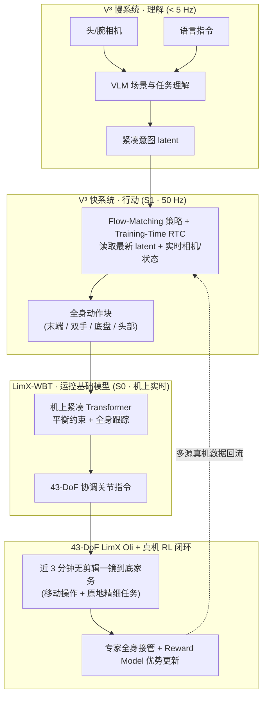

# LimX COSA（人形大脑操作系统）

**LimX COSA**（**C**ognitive **OS** of **A**gents）是 **逐际动力（LimX Dynamics）** 面向全尺寸人形的 **物理世界原生 Agent 操作系统**：把 **认知与任务调度（S2）**、**VLA 工具层 V³（S1，含 V³-0 快慢双系统）** 与 **全身运控基础模型（S0，LimX-WBT）** 组织成可在真实身体上 **连续、长程、无遥操** 运转的整体。2026-07 发布的 **COSA 0.5** 重点升级 **人形 VLA V³-0 的全身移动操作能力**，并在 **43-DoF LimX Oli** 上给出近 3 分钟 **一镜到底家庭整理** 实录与人类在环真机强化学习闭环。

## 一句话定义

**COSA 不是单个 VLA checkpoint，而是调度记忆、推理与多频率技能/运控层的 OS——让「模型当技能、系统当大脑」在 Oli 上跑通长程移动操作。**

## 英文缩写速查

| 缩写 | 英文全称 | 简要说明 |
|------|----------|----------|
| COSA | Cognitive OS of Agents | 逐际动力人形大脑操作系统 |
| VLA | Vision-Language-Action | S1 层视觉–语言–动作技能之一 |
| WBT | Whole-Body Tracking | S0 LimX WBT 的全身运动跟踪基础能力 |
| VLM | Vision-Language Model | S2 认知层多模态理解组件 |
| LLM | Large Language Model | S2 任务推理与调度组件 |
| MPJPE | Mean Per Joint Position Error | 关节位置跟踪误差，LimX 用以对标 SONIC |
| WAM | World Action Model | 可与 VLA 并列的 S1 技能类型（世界–动作生成） |

## 为什么重要

- **路线对照：** 发布材料明确反对「**更大单一模型 = 大脑**」，主张 **OS 层** 负责记忆、调度、技能组合与进度判断——与 [行为树 × VLA 编排](../concepts/behavior-tree-vla-orchestration.md) 中「编排 vs 语义技能」分层同构，但 COSA 覆盖 **全身运控频率与认知 Agent** 全栈。
- **长程 loco-manipulation 产业证据：** 无剪辑、无遥操、**连续家务**（晾衣、搬箱、深弯腰、清理等）把评估从「单技能成功率」推到 **跨任务状态保持 + 全身平衡**——对齐 [Loco-Manipulation](../tasks/loco-manipulation.md) 任务页的工程瓶颈。
- **三层频率分工：** S2 ~1 Hz / S1 ~50 Hz / S0 **1000 Hz** 给出可落地的 **慢思考–中频技能–快反射** 参考切分，便于与 Figure Helix 02、Flexion Reflect、[DeepInsight](../entities/deepinsight.md) System 2/1/0 叙事对照。
- **软硬一体：** 同公司 **Oli 本体 + COSA + LimX WBT + V³-0 VLA**，可做纯软件公司难以实现的 **跨层联合优化**；并借 [FluxVLA Engine](./fluxvla-engine.md) **开放 S1 工程底座**，与 Figure 全栈闭源形成差异。

## 核心原理

### 异步三层与快慢双系统 VLA（COSA 0.5 / V³-0）

COSA 0.5 技术报告将运行时分为 **异步双 GPU 架构**：**V³ 慢系统（理解）**、**V³ 快系统（行动）** 与 **LimX-WBT（S0，在平衡中执行）**，各层通过精简接口异步通信，下层始终读取上层最新输出，互不阻塞。

| 层 | 频率 | 输入 / 输出 | 典型组件 |
|----|------|-------------|----------|
| **S2 认知 / V³ 慢系统** | `< 5 Hz` | 头/腕相机 + 语言指令 → 紧凑意图 latent | 视觉语言模型（VLM），负责场景理解与规划 |
| **S1 技能 / V³ 快系统** | `50 Hz` | 最新意图 latent + 实时头/腕相机 + 状态 → **全身动作块**（末端 / 双手 / 底盘 / 头部） | 小型 **flow-matching** 策略 + **Training-Time RTC** 平滑衔接 chunk |
| **S0 运控（LimX-WBT）** | 机上实时控制 | 连续定长全身参考序列 → **43-DoF** 腿/腰/臂/头平衡协调关节指令 | 紧凑 Transformer 策略（**完全机上运行**，与具体任务无关、一次训练多用） |

- **为何拆分快慢系统：** 官方指出主要目的不是省算力，而是应对动态环境与机器人高速移动下的动力学失配——快系统每秒数十次依据实测状态重规划，避免慢系统决策间隙的过冲与抓取偏离；头部控制也实现主动视角跟随。
- **人类在环干预与真机强化学习：** 策略自主 rollout 时专家可沿同一全身运动接口平滑接管与交还；人工标注的失败片段训练 reward model 逐时刻估计任务进展并计算 action advantage，用于优势条件策略更新（Oli 上三个真机任务汇总失败率从 `39.65%` 降至 `11.33%`，其中 `basket cleanup` 成功率从 `18.01%` 升至 `74.00%`）。

### 流程总览（COSA 0.5 Demo 链路）

### LimX-WBT（S0）公开指标（对标 SONIC）

官方在 Oli 上用相同训练数据与算力复现 SONIC 作为基线，在内部参考运动集上的对比结果如下（数值越低越好）：

| 指标 | SONIC（对照） | LimX-WBT | 解读 |
|------|---------------|----------|------|
| 平均关节角误差（MPJAE） | 3.3° | **1.5°** | 降幅约 55% |
| MPJPE | 13.75 mm | **12.85 mm** | 降幅约 7% |
| 关节空间 jerk | 129.2 | **115.2** | 平滑度改善约 11% |
| 底盘朝向 jerk | 113.0 | **90.3** | 平滑度改善约 20% |

> 指标来自 2026-07-15 官方技术报告内部评测集；学术复现应以后续论文与开源权重为准。SONIC 背景见 [SONIC 运动跟踪](./nvidia-sonic.md)；LimX 跨机体 WBT 迁移见 [Any2Any](./paper-any2any-cross-embodiment-wbt.md)。

## 源码运行时序图

**不适用** — 截至 2026-11-21 核查，COSA 本体 OS（S2 认知调度、V³-0 权重、真机 RL reward model 与 LimX-WBT 运控基础模型）均为逐际动力商业闭源系统，官方未公开可运行的 COSA 仓库源码。S1 层的工程训练、评测与端侧推理底座已同步开源为 [FluxVLA Engine](./fluxvla-engine.md)（该页另附完整源码运行时序图）。

## 工程实践

| 层面 | 工程落地路径 |
|------|--------------|
| **复现 S1 VLA 工程栈** | 使用同步开源的 [FluxVLA Engine](./fluxvla-engine.md)（以 GR00T 为参考 VLA 模型，支持 Training-Time RTC、ZMQ 远程推理与端侧部署） |
| **全身遥操作采数与接管** | 统一通过 S0 `LimX-WBT` 固定长度参考接口完成「遥操作示范采集 + 专家真机接管 + 上游 VLA 执行」，避免双套底层接口切换冲击 |
| **Oli 平台开源最小路径** | 若在 Oli 上接入开源 VLA，可参考 FluxVLA 仓库 `docs/oli_whole_body.md`（ROS + WebSocket 最小全身移动操作路径） |
| **长程任务评估读法** | 官方强调长程可靠性为各环节成功率相乘；对移动任务重点检查深弯质心转移与行走-操作衔接，对原地任务重点检查毫米级抓取重试 |

## 局限与风险

- **误区：「COSA = 一个更大的 VLA」。** VLA（V³-0）只是 **S1 技能层**；长程任务依赖 **异步快慢解耦 + S0 机上平衡控制 + 真机接管 RL**，不能仅用单任务 VLA benchmark 替代系统评测。
- **误区：「FluxVLA = COSA」。** [FluxVLA Engine](./fluxvla-engine.md) 开源的是 **VLA 训练/推理工程栈**；**COSA 本体 OS、V³-0 权重与 LimX-WBT** 仍未开源，二者是「开放技能底座 vs 商业大脑系统」分工。
- **技术细节披露边界：** 技术报告未披露 V³-0 慢/快网络具体参数量、训练超参以及 S0 完整奖励函数；Oli 在早期媒体报道中被写为 31-DoF，而 2026-07-15 官方技术报告正文多次明确为 **43-DoF**（引用自由度时以技术报告为准并说明口径）。
- **Demo 与规模化差距：** 一镜到底 Demo 尚不能证明大规模商用部署成功率；官方在展望中也明确后续仍需解决长时程 S0 sim-to-real 残余差距，并在 S1→S0 接口加入显式力与阻抗控制以应对接触密集型任务。
- **与 Flexion Reflect 的相似与差异：** 分层范式相近；LimX 强调 **自研 Oli + LimX-WBT + 开源 FluxVLA**，Flexion 公开 Demo 多基于 **第三方 G1**（见 [Flexion Reflect v1.0 归档](../../sources/blogs/flexion_reflect_v1_0.md)）。

## 关联页面

- [FluxVLA Engine](./fluxvla-engine.md) — 同步开源的 S1 VLA 训练/评测/端侧推理工程底座
- [VLA 方法页](../methods/vla.md) — V³-0 在 **全身 loco-manipulation** 语境下的 S1 实例；FluxVLA 支持的 π0.5/GR00T 等训练入口
- [Whole-Body Tracking Pipeline](../concepts/whole-body-tracking-pipeline.md) — LimX-WBT 是 **产品化 S0** 锚点，与 SONIC / BeyondMimic 等 **研究预训练** 路线并列
- [FastStair](./paper-faststair-humanoid-stair-ascent.md)、[CWI](./paper-cwi-composite-humanoid-whole-body-imitation.md) — 同 **LimX Oli** 平台的学术/工程论文线，补全 **楼梯 / VR 遥操作** 等细分能力
- [市面知名机器人平台纵览](../overview/notable-commercial-robot-platforms.md) — LimX 商业平台索引

## 推荐继续阅读

- [COSA 0.5 技术报告：Introducing COSA 0.5 / V³-0（官方全文）](https://limxdynamics.com/cosa05v3/)
- [LimX COSA 0.5 官方新闻](https://www.limxdynamics.com/en/news/BK000067)
- [FluxVLA Engine 文档](https://fluxvla.limxdynamics.com/)
- [π₀.₅ 论文（OpenPI）](https://arxiv.org/abs/2504.16054) — FluxVLA 支持的 VLA 技能范例之一

## 参考来源

- [COSA 0.5 发布：人形 VLA V³-0 的全身能力升级（官方技术报告与新闻归档）](../../sources/blogs/limx_cosa_05_release_2026-07-15.md)
