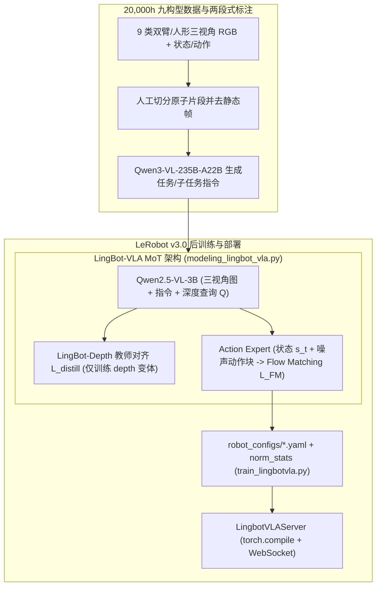
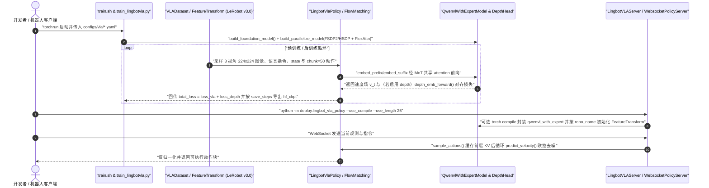

# LingBot-VLA

**LingBot-VLA**（*A Pragmatic VLA Foundation Model*，[arXiv:2601.18692v4](https://arxiv.org/abs/2601.18692)，[项目页](https://technology.robbyant.com/lingbot-vla)，[代码](https://github.com/robbyant/lingbot-vla)）是蚂蚁灵波科技（**Robbyant**）发布的 **务实 Vision-Language-Action 基础模型 1.0**：以 **Qwen2.5-VL-3B-Instruct** 与 **Action Expert** 组成 **Mixture-of-Transformers（MoT）** 流匹配策略，配合可选 **LingBot-Depth 深度查询蒸馏**，在 **约 20,000 小时**、覆盖 **9 种双臂与人形构型** 的真机遥操作数据上预训练；系统栈依托 **FSDP2/HSDP + FlexAttention + `torch.compile`** 在 8 卡达到 **261 samples/s**（相对 StarVLA / Dexbotic / OpenPI 提速 **1.5–2.8×**），并在 **GM-100 四平台真机** 与 **RoboTwin 2.0** 仿真均领先 π₀.₅。后继 **[LingBot-VLA 2.0](./lingbot-vla-v2.md)** 进一步扩至 6 万小时、6B MoE 与全身 55 维动作空间。

## 一句话定义

**4B 双臂务实 VLA 基座：约 2 万小时 9 构型真机预训练 + MoT 流匹配与深度查询蒸馏 + 高吞吐分布式训练栈，把 Qwen2.5-VL 语义能力接到可经 LeRobot v3.0 快速后训练与编译部署的真实操纵闭环。**

## 英文缩写速查

| 缩写 | 英文全称 | 简要说明 |
|------|----------|----------|
| VLA | Vision-Language-Action | 视觉-语言-动作多模态通用机器人策略 |
| MoT | Mixture of Transformers | 视觉语言专家与动作专家分离权重、共享自注意力的耦合结构 |
| FM | Flow Matching | 条件流匹配，学习从噪声线性插值到未来动作块的速度场 |
| GM-100 | The Great March 100 | 含 100 项精细操作任务的跨平台真机评测与数据集套件 |
| SR / PS | Success Rate / Progress Score | 3 分钟上限完整成功率和分阶段子任务进度分 |
| FSDP2 / HSDP | Fully / Hybrid Sharded Data Parallel | 按模块分组的分片数据并行，减少 Action Expert 通信开销 |

## 为什么重要

- **真机数据 Scaling Law 实证（§5.5 Fig. 5）：** 系统验证预训练数据从 **3,000 小时** 增至 **20,000 小时** 时，4 平台下游 SR 与 PS 持续单调上升且 **在 20,000 小时处仍未饱和**，且 AgiBot G1 上仅 **80 条演示**微调即可超过 130 条的 π₀.₅。
- **训练效率 1.5–2.8× 提速：** 自研分布式与算子融合栈（VeOmni 式 HSDP + FlexAttention + `torch.compile`）实现 **261 samples/s（8 GPU）→ 7356 samples/s（256 GPU）** 近线性扩展，并借助优化方案降低 **29.2%** 训练显存。
- **1.0 是后续生态与受控对比基线：** [HumanNet](./humannet.md)、[LingBot-VLA 2.0](./lingbot-vla-v2.md)、[Harness VLA](./paper-harness-vla.md) 与 [FlashVLA](./paper-flashvla.md) 均直接采用或对照本仓库代码与 4B 权重。
- **完整开源链：** Apache-2.0 协议开放源码、`lingbot-vla-4b` / `lingbot-vla-4b-depth` 预训练权重、RoboTwin 后训练权重、[GM-100 数据集](https://huggingface.co/datasets/robbyant/gm100) 与 LeRobot v3.0 部署服务。

## 核心原理

### 核心信息

| 项 | 原文 v4 与官方源码核定细节 |
|----|-----------------------------|
| **机构与发布** | Robbyant（蚂蚁灵波科技）；arXiv:2601.18692v4（2026-06-15）；Apache-2.0 开源 |
| **模型架构** | **Qwen2.5-VL-3B-Instruct**（Understanding Expert）+ 随机初始化 **Action Expert**（MoT 共享自注意力，可选 AdaRMSNorm 时间条件），分块因果掩码 `[I1_t, I2_t, I3_t, T_t]` → `[s_t]` → `[a_t..a_{t+49}]`，条件流匹配（`T=50`） |
| **深度蒸馏变体** | 通过三视角可学习查询 `[Q1_t, Q2_t, Q3_t]`（每视角 `num_task_tokens=8`）与 **LingBot-Depth** 教师（`MoGe-2-vitb-normal` + `morgbd`）在 L1 + 相似度矩阵上对齐（`depth_loss_weight=0.004`），部署时完全不依赖深度相机或教师 |
| **预训练数据（9 构型）** | 约 **20,000 小时** 真机遥操作数据：AgiBot G1、AgileX、Galaxea R1Lite、Galaxea R1Pro、Realman RS-2（16-DoF）、Leju KUAVO 4 Pro（双足）、Qinglong（双足）、ARX Lift2、Bimanual Franka；人工切分原子片段后由 **Qwen3-VL-235B-A22B** 自动标注任务与子任务指令 |
| **训练系统栈** | FSDP2 / HSDP（Action Expert 独立 shard group）、fp32 规约 / bf16 通信、FlexAttention 与 `torch.compile` |

### 流程总览

## 源码运行时序图

以下时序基于官方仓库 `robbyant/lingbot-vla`（commit `4eb34b76`）中 `train.sh`、`tasks/vla/train_lingbotvla.py`、`lingbotvla/models/vla/pi0/modeling_lingbot_vla.py` 与 `deploy/lingbot_vla_policy.py` 源码核对绘制：

## 工程实践

- **环境与依赖：** Python `3.12.3`、PyTorch `2.8.0`、CUDA `12.8`，执行 `bash install.sh`；除主模型外，`configs/vla/*_depth.yaml` 训练还需下载 `Qwen/Qwen2.5-VL-3B-Instruct`、`Ruicheng/moge-2-vitb-normal` 与 `robbyant/lingbot-depth-pretrain-vitl-14`。
- **LeRobot v3.0 后训练三步流程：**
  1. 将演示数据转为 LeRobot v3.0 格式（v2.1 可用官方转换脚本升级）；
  2. 在 `configs/robot_configs/<data_name>.yaml` 定义状态、动作与三视角相机键映射；
  3. 计算并保存归一化统计（如 RoboTwin 预设 `assets/norm_stats/robotwin_50.json`，或运行 `scripts/compute_norm.py`），真机推荐 `norm_type: meanstd`（`real_load20000h.yaml`），仿真使用 `bounds_99`。
- **推理配置与 v2.1→v3.0 兼容提示：**
  - `hf_ckpt` 目录须同时包含 `.safetensors`、`config.json` 与 `lingbotvla_cli.yaml`；若使用 **2026/05/01 前** 下载的旧权重加载报错 `DecodingError: ... are not valid for PI0Config`，需重下新版权重或从 `config.json` 删去旧字段并补充 `lingbotvla_cli.yaml` 的 `train` 节。
  - 真机部署推荐 `--use_compile --use_length 25`（可用 `--num_denoising_step 5` 加速去噪）。

## 评测

### 1. GM-100 真机四平台严格对照（arXiv v4 Table 1 & Tables S1–S8）

> 每项任务保留质量排序前 130 条轨迹微调（统一 `batch=256`、`epochs=20`），同一机器硬件-任务配对各测 15 trials（共 22,500 trials，3 分钟上限）；**注：** v4 论文补充了第 4 平台 **Leju KUAVO 4 Pro**（双足人形），4 平台均值如下，而仓库 README 旧表展示的是前 3 轮式平台均值（15.74% / 17.30% SR）。

| 平台 | WALL-OSS (SR / PS) | GR00T N1.6 (SR / PS) | π₀.₅ (SR / PS) | LingBot-VLA w/o depth | LingBot-VLA w/ depth |
|------|--------------------|----------------------|----------------|-----------------------|----------------------|
| **Agibot G1（轮式）** | 2.99% / 8.75% | 5.23% / 12.63% | 7.77% / 21.98% | **12.82%** / 30.04% | 11.98% / **30.47%** |
| **AgileX（轮式）** | 2.26% / 8.16% | 3.26% / 10.52% | 17.20% / 34.82% | 15.50% / 36.31% | **18.93%** / **40.36%** |
| **Galaxea R1Pro（轮式）** | 6.89% / 14.13% | 14.29% / 24.83% | 14.10% / 26.14% | 18.89% / 34.71% | **20.98%** / **35.40%** |
| **Leju KUAVO 4 Pro（双足）** | 3.26% / 11.75% | 6.45% / 18.66% | 12.91% / 26.35% | **17.59%** / **36.22%** | 15.60% / 34.40% |
| **四平台平均** | 3.85% / 10.70% | 7.31% / 16.66% | 13.00% / 27.32% | 16.20% / 34.32% | **16.87%** / **35.16%** |

### 2. RoboTwin 2.0 仿真 50 任务与吞吐扩展（Table 2, Table S9, Fig. 4）

| 评测维度 | 对照基线 | LingBot-VLA 表现 |
|----------|----------|------------------|
| **RoboTwin 2.0 Clean / Rand（50 任务）** | π₀.₅：**82.74% / 76.76%** | w/o depth：**86.50% / 85.34%**；w/ depth：**88.56% / 86.68%**（Rand 绝对领先 **+9.92 pt**） |
| **训练吞吐（`Qwen2.5-VL-3B-π`，local bs=32）** | StarVLA：8 GPU **90** / 256 GPU **2644** | Ours：8 GPU **261** → 16 GPU **506** → 32 GPU **975** → 128 GPU **3700** → 256 GPU **7356 samples/s** |
| **跨构型吞吐（`PaliGemma-3B-pt-224-π`）** | OpenPI 8 GPU **142** / 256 GPU **4166**；Dexbotic 8 GPU **129** | Ours：8 GPU **229** → 256 GPU **6411 samples/s**（较既有代码库整体提速 **1.5–2.8×**） |

## 结论

**LingBot-VLA 1.0 证明了在「约 2 万小时多构型真机预训练 + FSDP2/HSDP 高效训练栈 + MoT 深度查询蒸馏」三者齐备时，4B 级流匹配 VLA 在真机多任务操作与域随机仿真中均可稳定超越 π₀.₅，且未出现 2 万小时数据饱和拐点。**

1. **后训练优先用深度蒸馏权重但部署不必加深度传感器：** `lingbot-vla-4b-depth` 仅在训练侧经可学习查询对齐 LingBot-Depth 几何表示，平均指标优于无深度版（RoboTwin Rand +1.34 pt、GM-100 4 平台平均 +0.67 pt），而推理时完全不需深度相机输入。
2. **绝不跳过 `robot_config` 与 `norm_stats` 直接零样本上新本体：** 虽然预训练覆盖 9 类双臂与人形机器人，但在 GM-100 与 RoboTwin 中所有强结果均来自匹配 `norm_type` 与 80–130 条后训练微调。
3. **代际选型分水岭：** 做纯桌面双臂操纵或受控基线复现选 **1.0（4B）**；若需要 55 维全身移动操作、灵巧手或 6 万小时含人手视频先验，则切至 **[LingBot-VLA 2.0](./lingbot-vla-v2.md)（6B MoE）**。
4. **数据效率收益显著：** 在 2 万小时预训练底座上微调 **80 条演示** 即可反超使用 130 条演示微调的 π₀.₅，可直接缩短下游真机采集周期。
5. **留意 LeRobot v3.0 版本边界：** 确认所下载权重与最新 `config.json` / `lingbotvla_cli.yaml` 结构匹配，避免 2026-05-01 前旧格式字段冲突。

## 局限与风险

- **本体与形态聚焦桌面双臂：** 1.0 公开实验与 GM-100 均锁定固定底座的双臂桌面操作；全身移动操作与灵巧手 55 维动作空间由 [2.0](./lingbot-vla-v2.md) 承接。
- **跨本体零样本门槛：** 2 万小时预训练提供迁移效率而非免微调零样本上机，新硬件必须补齐 `robot_configs/*.yaml` 映射与归一化统计。
- **测试集动作分布差异下的绝对成功率仍偏低：** GM-100 测试集约 50% 原子动作未出现在训练高频前 100 动作中，四平台平均 SR 仍为 **16.87%**（PS **35.16%**），距高可靠商用仍有明显差距。
- **同名生态边界：** 与 [LingBot-Map](../methods/lingbot-map.md) 同属 Robbyant，但后者是流式 3D 重建模型而非策略 VLA。

## 与其他工作对比

| 对照 | LingBot-VLA 1.0 的定位与差异 |
|------|------------------------------|
| **[LingBot-VLA 2.0](./lingbot-vla-v2.md)** | 扩展至 6 万小时、Qwen3-VL-4B、稀疏 MoE 与 55 维全身动作；1.0（4B）是其直接受控基线 |
| **π₀.₅ / GR00T N1.6 / WALL-OSS** | GM-100 四平台同配微调对比：1.0 depth 版平均 SR/PS 16.87%/35.16%，领先 π₀.₅（13.00%/27.32%）、GR00T N1.6（7.31%/16.66%）与 WALL-OSS（3.85%/10.70%） |
| **[OpenLET](./openlet.md) 数据** | LET 为 Kuavo 真机 IL 数据；接入 1.0 需先转 LeRobot v3.0 格式并配 `robot_config` |
| **[LeTools](./letools.md)** | Learning 仓将 LingBot-VLA 列为外部策略模型，经 `kuavo_server` client 对接 Kuavo 部署 |

## 关联页面

- [Robbyant（蚂蚁灵波）](./robbyant.md) — 发布方公司页与 LingBot 全栈
- [VLA（Vision-Language-Action）](../methods/vla.md) — 方法总览与流匹配谱系
- [LingBot-VLA 2.0](./lingbot-vla-v2.md) — 6B MoE 全身升级版与对照基线
- [HumanNet](./humannet.md) — 同架构受控预训练实验
- [LeRobot](./lerobot.md) — v3.0 数据集与策略配置格式
- [LeTools](./letools.md) — Kuavo 官方外部模型接入路径
- [OpenLET](./openlet.md) — Kuavo 真机数据集生态
- [Manipulation](../tasks/manipulation.md) — GM-100 / RoboTwin 双臂操纵语境
- [LingBot-Map](../methods/lingbot-map.md) — 同组织流式 3D 重建系统
- [Harness VLA](./paper-harness-vla.md) — RoboTwin C2R 上将后训练 LingBot-VLA 作冻结 `vla_act` 后端
- [FlashVLA](./paper-flashvla.md) — 在 LingBot-VLA 上做流式解码；RoboTwin 异步 +3.5–4.1 pt（arXiv:2608.27384）

## 参考来源

- [lingbot_vla_arxiv_2601_18692.md](../../sources/papers/lingbot_vla_arxiv_2601_18692.md) — **主要一手来源**：`arXiv:2601.18692v4` 论文全文（含 Appendix Tables S1–S9）核对归档
- [lingbot-vla.md](../../sources/repos/lingbot-vla.md) — **主要一手来源**：官方仓 `robbyant/lingbot-vla`（`4eb34b76`）源码、训练配置与部署服务核对归档
- [lingbot-vla-technology-robbant.md](../../sources/sites/lingbot-vla-technology-robbant.md) — 官方项目页入口索引

## 推荐继续阅读

- 论文全文：[arXiv:2601.18692](https://arxiv.org/abs/2601.18692) / [仓库 PDF](https://github.com/robbyant/lingbot-vla/blob/main/assets/LingBot-VLA.pdf)
- 项目页：<https://technology.robbyant.com/lingbot-vla>
- GM-100 数据集：<https://huggingface.co/datasets/robbyant/gm100>
- 训练配置规范：[`configs/vla/Training_Config.md`](https://github.com/robbyant/lingbot-vla/blob/main/configs/vla/Training_Config.md)
