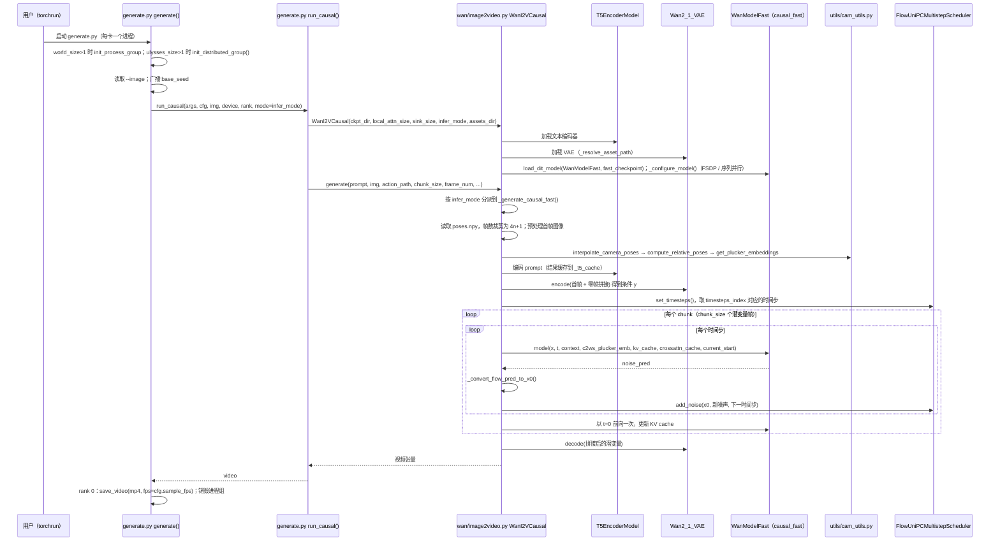

# LingBot-World

[**robbyant/lingbot-world**](https://github.com/robbyant/lingbot-world)（蚂蚁 **Robbyant / 灵波**）是 **开源世界模型** 主线仓库：从视频生成出发构建 **高保真、鲁棒动力学** 的交互式世界模拟器；后继版本见 [lingbot-world-v2](https://github.com/robbyant/lingbot-world-v2) 与论文 [Advancing Open-source World Models](./paper-sa-2601-20540-advancing-open-source-world-models-lingbot-world.md)。

## 一句话定义

**灵波世界模型代码入口** — 长时序视频–动作联合建模与开源世界模拟器；与 [LingBot-VLA](./lingbot-vla.md) 操纵基础模型分工。

## 英文缩写速查

| 缩写 | 英文全称 | 简要说明 |
|------|----------|----------|
| WM | World Model | 环境前向预测 / 模拟 |
| VLA | Vision-Language-Action | 姊妹线 LingBot-VLA |
| Physical AI | Physical Artificial Intelligence | 文内「具身大模型」语境 |
| MJCF | MuJoCo XML Format | 与机器人仿真资产可组合 |

## 为什么重要

- **微信清单校正：** 原文 `antgroup/lingbot` **404**；canonical 仓为 **robbyant** org 下 `lingbot-world` / `lingbot-world-v2`。
- **长时序任务：** 文章强调「长周期连续任务预测、视频–动作联合建模」，对应世界模型而非纯 VLA 推理。
- **与 VLA 栈并列：** 同一团队 [LingBot-VLA](./lingbot-vla.md) 负责操纵；World 负责 **预测 / 仿真**。

## 工程实践

1. 权重与推理脚本见 GitHub README 与 [HF 集合](https://huggingface.co/collections/robbyant/lingbot-world-v2)。
2. v2 栈依赖 torch≥2.4、flash-attn 等；按仓内 `requirements` 钉版本。
3. License 常为 **CC BY-NC-SA**（以 README 为准）。

## 局限与使用注意

- **非机器人低层控制器：** 不能直接替代 [rsl-rl](./rsl-rl.md) 步态训练。
- **org 易混：** 勿使用失效的 `antgroup/lingbot` 链接。

## 源码运行时序图

入口：`torchrun --nproc_per_node=8 generate.py --task i2v-A14B --ckpt_dir <权重目录> --image examples/03/image.jpg --action_path examples/03 ...`（或 `bash run_fast.sh <权重目录> <帧数>`）。`--infer_mode` 默认 `causal_fast`，图以该分支为例。

图依据：robbyant/lingbot-world-v2@1895d30，读过 `README.md`（Inference 段）、`run_fast.sh`（全文）、`generate.py`（`run_causal`、`generate`、`_parse_args` 中 `--infer_mode`、`--chunk_size`、`--assets_dir` 参数段）、`wan/__init__.py`、`wan/image2video.py`（`__init__` 中模型加载段、`generate` 分派段、`_generate_causal_fast` 的相机、编码、采样与 KV cache 段）。`wan/modules/model_fast.py`、`wan/utils/cam_utils.py` 的内部实现未读；`T5EncoderModel`、`Wan2_1_VAE` 未读。未运行代码（无权重与 GPU）。

## 关联页面

- [Robbyant（蚂蚁灵波）](./robbyant.md) — 发布方公司页与 LingBot 全栈
- [LingBot-VLA](./lingbot-vla.md)
- [Generative World Models](../methods/generative-world-models.md)
- [LingBot-World 论文索引](./paper-sa-2601-20540-advancing-open-source-world-models-lingbot-world.md)

## 参考来源

- [sources/repos/lingbot-world-v2.md](../../sources/repos/lingbot-world-v2.md)
- [wechat_robot_yanfa_opensource_algorithms_compendium.md](../../sources/blogs/wechat_robot_yanfa_opensource_algorithms_compendium.md)
- 源码核对（2026-11-02）：robbyant/lingbot-world-v2@1895d30，读过 README.md（Inference 段）、run_fast.sh、generate.py（run_causal、generate、_parse_args 相关参数段）、wan/__init__.py、wan/image2video.py（__init__ 模型加载段、generate 分派段、_generate_causal_fast 段）；时序图依据以上文件，未运行代码。

## 推荐继续阅读

- GitHub：<https://github.com/robbyant/lingbot-world>
- 技术页：<https://technology.robbyant.com/lingbot-world-v2>
