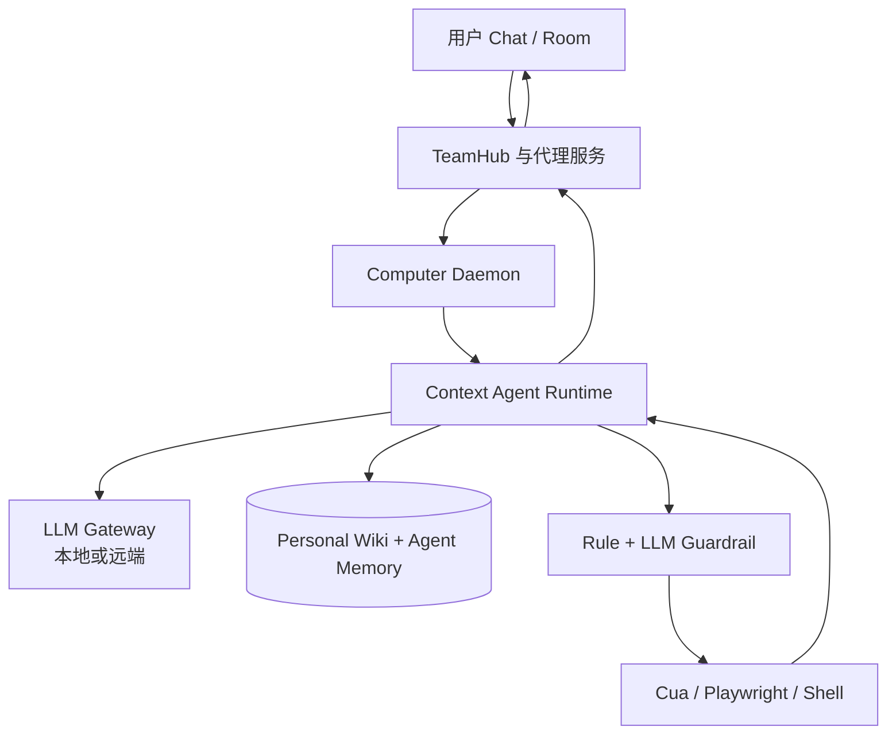
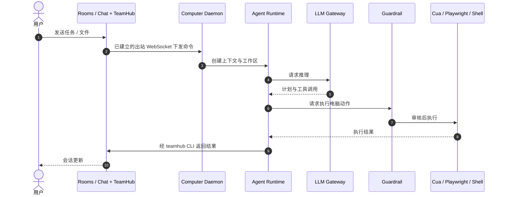

# Linger：有记忆和电脑操作能力的本地个人 Agent

官方：[simplexai-labs/linger](https://github.com/simplexai-labs/linger) · [技术文档](https://docs.heylinger.com/)。其 README 同时链接 PolyStrata 和 Niko Strata；不要将三者视为同一系统。

## 一句话定义

把个人聊天、知识 Wiki、任务执行和电脑/浏览器工具连成有权限控制的常驻代理运行时，本地模型服务只是可选的推理后端。
## 英文缩写速查

| 缩写 | 英文全称 | 简要说明 |
|---|---|---|
| LLM | Large Language Model | 运行时调用的语言模型 |
| MCP | Model Context Protocol | 计算机与浏览器扩展工具接口 |
| CLI | Command-Line Interface | Agent 向 TeamHub 发送消息与任务的接口 |
| API | Application Programming Interface | 运行时请求模型和业务服务的契约 |

## 主要结构

- **交互**：Room / Chat 接收消息、文件、日常任务；Computer Daemon 通过主动发起的 WebSocket 连接运行环境。
- **Agent runtime**：每上下文独立工作区，直接调用本地或远端 LLM Gateway；可使用 shell、浏览器和电脑操作工具。
- **权限闸门**：电脑动作通过规则与模型两级 Guardrail，TeamHub 还会审查 CLI 的服务器端权限。
- **长期知识**：Personal Wiki 为客户、联系人、项目、主题、会话等类型 Markdown 页面；事实记录来源与修改日志；每个 Agent 的会话记忆另外隔离维护。
- **检索**：Wiki 概览与原始消息分开排行，原始资料用于核验精确细节；对可能变化的事实须查实时来源。

## 流程总览

## 源码运行时序图

官方 `docs/architecture.md` 提供的运行期模块及入口关系（具体内部调用顺序未逐函数运行核验）：

本图按官方架构文档核对模块数据流，尚未追踪所有实际服务函数，故不能当作已完成端到端代码测试。

## 工程实践与风险

- 先使用离线/低权限任务验证本地模型能力，再开通外部邮箱、文件或浏览器操作；应设置人工审批、凭据隔离和操作审计。
- README 提供桌面应用与 Docker Compose 两条部署路径；本次没有安装运行。
- 本地推理不等于**所有外部集成数据绝不离机**，用户主动接入在线服务后仍须核对真实数据流、权限和模型运行位置。
- 与机器人领域关系：可借鉴任务编排、长期知识图、工具安全闸门；它没有提供真机实时控制的验证。

## 关联页面

- [PolyStrata 本地推理](polystrata-local-inference.md) — 模型算力后端。
- [Strata 本地推理引擎](niko-strata-local-inference.md) — 部分模型的引擎来源。
- [Agent 记忆与 dreaming](../concepts/agent-memory-and-dreaming.md) — 从对话到持久知识更新。
- [Hermes Agent](hermes-agent.md) — 同类常驻个人代理的组件对照。

## 参考来源

- [官方 README 与技术文档归档](../../sources/repos/simplexai-labs-linger.md)

## 推荐继续阅读

- [Linger 官方源代码](https://github.com/simplexai-labs/linger) · [Architecture](https://github.com/simplexai-labs/linger/blob/main/docs/architecture.md) · [Wiki and Memory](https://github.com/simplexai-labs/linger/blob/main/docs/wiki-and-memory.md)。
