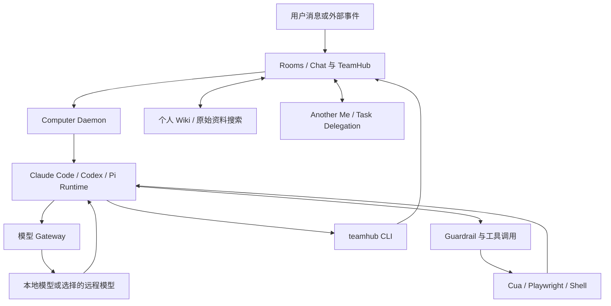
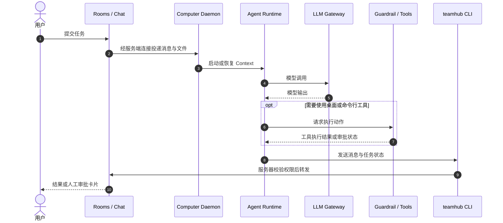

# Linger：本地个人智能体 / Local Personal Agent

## 一句话定义

**Linger** 是 [SimplexAI](https://heylinger.com/) 的本地个人 Agent 平台：把模型 Runtime、电脑执行权限、持续任务、个人 Wiki 与跨会话记忆结合起来，使代理能够在用户自己的电脑上处理和跟进多步骤事务。

## 英文缩写速查

| 缩写 | 英文全称 | 简要说明 |
|---|---|---|
| LLM | Large Language Model | 驱动代理推理，可本地或使用外部提供方 |
| CUA | Computer-Using Agent | 操作桌面应用的代理工具层；Linger 文档写作 Cua |
| BYOK | Bring Your Own Key | 使用自行配置的模型服务地址、密钥与模型 |
| RPC | Remote Procedure Call | Pi Runtime 的通信形态之一 |
| ASR | Automatic Speech Recognition | 会议语音识别，接入时可能依赖外部服务 |

## 为什么重要

- **本地 Agent 系统选型：** [Hermes Agent](./hermes-agent.md) 强调消息网关、技能/记忆自改进；[Deep Agents](./deep-agents.md) 更偏 agent harness；Linger 重点是**个人电脑桌面 + 本机/混合模型 + 私人 wiki + 主动跟进**的一体化产品。
- **与本知识库的关系：** Linger 的 Client / Contact / Project / Topic / Session 类型化个人 Wiki 与 [LLM Wiki（Karpathy）](../concepts/llm-wiki-karpathy.md) 都把来源沉淀为可持续维护的页面；但 Linger 旨在服务个人工作信息，不是机器人的运动策略或实时控制器。
- **研究观察点：** 代理的长时记忆、可中断任务、工具权限、人工审批、机器资源预算，均可为机器人高层任务管理和工程知识助手提供系统设计参照（**应用推论，不是 Linger 已验证的机器人控制功能**）。

## 核心原理

| 层级 | 上游文档中的职责 |
|---|---|
| **Rooms / Chat + TeamHub** | Web 工作区、权限、任务、共享文档；TeamHub 使用 Go/PostgreSQL，node-services 使用 Node.js/Yjs |
| **Computer Daemon** | 用户电脑中的连接服务，经出站 WebSocket 接收任务/文件，管理 Context 队列与 Runtime adapter |
| **Agent Runtime** | Claude Code、Codex、Pi；访问 Agent workspace，向模型网关发请求，借 `teamhub CLI` 返回消息/任务 |
| **模型路径** | Local model（Pi + 本机 gateway）、Subscription（Claude Code/Codex）、BYOK（OpenAI/Anthropic 兼容接口） |
| **桌面工具** | Runtime → Guardrail → Cua、Playwright 或 Shell；权限/审批与系统平台相关 |
| **记忆层** | 共用个人 Wiki、原文搜索；各代理独立 memory，经提取/整理后跨 Room 回用 |
| **主动/委托** | Another Me 依据事件与规则主动提醒；Meta 将长期任务交给 AlterEgo，支持人工审批 |

### 与机器人开发的边界

本系统可作为机器人研发文档处理、Issue/PR 跟进、日程与复盘的**高层工作流参考**；不能把桌面自动化的 Guardrail 等同于机器人真机的急停、碰撞约束或毫秒级控制闭环。

## 流程总览

主干依 [Architecture](https://github.com/simplexai-labs/linger/blob/cd0e23af6cacbca311bfe1964e11ea6c73cc7562/docs/architecture.md)、[Local Inference](https://github.com/simplexai-labs/linger/blob/cd0e23af6cacbca311bfe1964e11ea6c73cc7562/docs/local-inference.md) 与 [Wiki and Memory](https://github.com/simplexai-labs/linger/blob/cd0e23af6cacbca311bfe1964e11ea6c73cc7562/docs/wiki-and-memory.md) 综合；箭头表示逻辑流，不代表所有 API 都经由同一进程。

## 源码运行时序图

运行依据是官方 `docs/self-hosting.md` 的 `docker compose up --build --detach --wait` → 创建 owner → localhost:3000 接入 Computer Daemon/Runtime，及 `docs/architecture.md` 的消息、模型与工具调用链；这是已公开运行入口的**架构级**时序图，本次未在真机实测或逐函数调用追踪。

## 工程实践

| 场景 | 官方路径与工程判据 |
|---|---|
| 桌面安装 | README 列出 Apple Silicon macOS、Windows x64、Linux x64（glibc 2.35+）发行包；需核对对应 release 与 SHA256SUMS |
| 自托管 | Docker Compose 建服务和 PostgreSQL；创建 owner 后，在浏览器连接本机 Computer Daemon |
| 本地模型 | 选择 Local model / Pi，硬件需要足够显存或统一内存与 RAM；推理性能依模型、量化、KV cache 与具体平台 |
| 使用已有订阅 | 通过已安装并登录的 Claude Code 或 Codex Runtime，遵守服务商限额与计费；不能说全部 token 免费 |
| 长时记忆 | 个人 Wiki 为共享知识，代理私有 memory 另行维护；查询时分开检索汇总页面与原始记录 |
| 操作外部服务 | 工具调用的用户权限、写操作审批和第三方连接器应独立审计，不要直接赋予生产系统高权限 |

## 局限与风险

1. **隐私有条件。** 使用本地模型时模型推理可本机完成，但外部模型、连接器、会议 ASR 与实时语音可能传输数据至第三方；不能一概宣称绝对离线。
2. **许可不是无条件 Apache-2.0。** [上游 LICENSE](https://github.com/simplexai-labs/linger/blob/cd0e23af6cacbca311bfe1964e11ea6c73cc7562/LICENSE) 对面向组织外第三方的 hosted/managed service，以及移除或修改前端 LOGO/版权信息提出商业许可要求；复用前应核对条款。
3. **官网与部署入口不同。** [官网](https://heylinger.com/) 下载区仍展示 Coming soon，而 GitHub README 提供源码构建/发布版安装说明；应检查实际 Releases，不能仅凭宣传推断已广泛可用。
4. **性能数字属特定实验条件。** PolyStrata 的 tok/s、分数以及与 Claude 等模型的等效比喻来自上游自述，本次未复测；部署预算应自行 benchmark。
5. **真实机器人安全不适用。** Cua/Browser/Shell 自动化不是电机安全控制，不应作为安全关键控制闭环直接使用。

## 关联页面

- [Hermes Agent](./hermes-agent.md)：消息网关、技能/记忆改进与自主 Agent OS 对照。
- [Deep Agents](./deep-agents.md)：LangGraph 风格 harness 与多步任务执行对照。
- [OpenClaw](./openclaw.md)：个人代理/网关生态的另一种工程组织方式。
- [LLM Wiki（Karpathy）](../concepts/llm-wiki-karpathy.md)：持久 Markdown Wiki、来源编译和知识回写的知识层对照。

## 参考来源

- [Linger 官方源码与技术文档归档](../../sources/repos/linger-simplexai.md)
- [Linger 官网归档](../../sources/sites/linger-heylinger.md)
- [Linger 官方 GitHub](https://github.com/simplexai-labs/linger)
- [Linger 官方文档](https://docs.heylinger.com/)

## 推荐继续阅读

- [Architecture：Computer Daemon / Runtime / Guardrail](https://github.com/simplexai-labs/linger/blob/main/docs/architecture.md)
- [Wiki and Memory：个人知识图与跨会话记忆](https://github.com/simplexai-labs/linger/blob/main/docs/wiki-and-memory.md)
- [Local Inference：模型选择与硬件条件](https://github.com/simplexai-labs/linger/blob/main/docs/local-inference.md)
