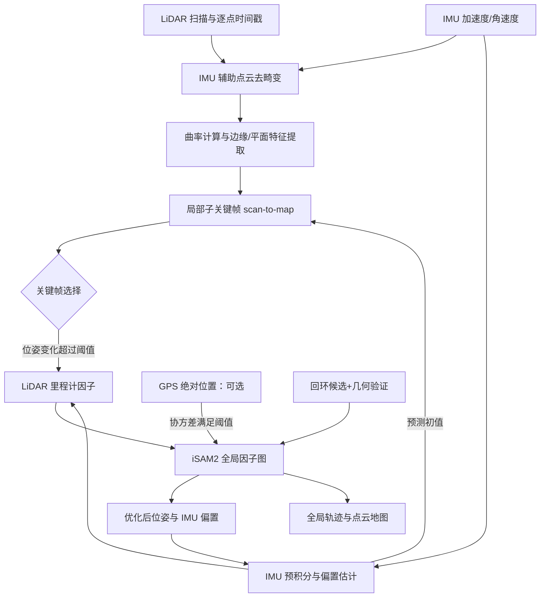
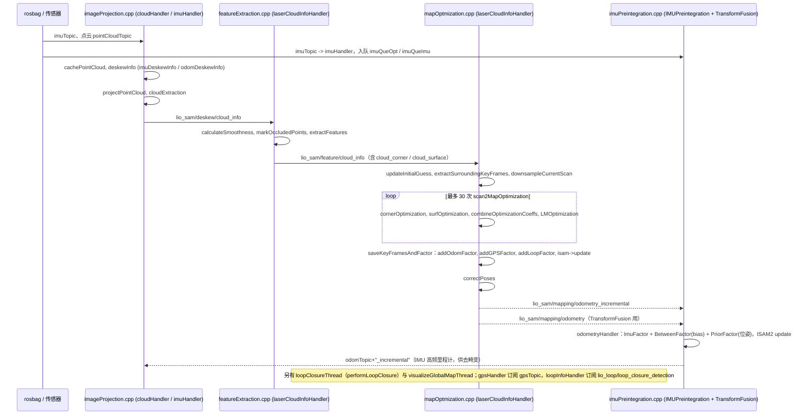

# LIO-SAM

## 一句话定义

**LIO-SAM**（Lidar Inertial Odometry via Smoothing and Mapping）将 **IMU 预积分、LiDAR 局部 scan-to-map、可选 GPS 和回环因子**纳入状态估计；论文中的长期因子图与源码中的短周期 IMU 因子图是不同优化层次。

## 英文缩写速查

| 缩写 | 英文全称 | 简要说明 |
|------|----------|----------|
| LIO | LiDAR-Inertial Odometry | 激光-惯性里程计 |
| LiDAR | Light Detection and Ranging | 激光雷达，地形感知与建图主传感器 |
| SLAM | Simultaneous Localization and Mapping | 同步定位与建图 |
| IMU | Inertial Measurement Unit | 惯性测量单元，提供加速度与角速度 |
| ROS 2 | Robot Operating System 2 | 机器人系统集成与通信的常用中间件 |
| VIO | Visual-Inertial Odometry | 视觉-惯性里程计，融合相机与 IMU 估计位姿 |

## 为什么重要

- **室外自动驾驶/巡检常见选型**。
- **GPS 融合**：全球一致性较纯 LIO 易扩展。

## 核心结构/机制

| 因子 | 说明 |
|------|------|
| **IMU preintegration** | 高频运动先验 |
| **Scan-to-map** | 激光匹配约束 |
| **Loop / GPS** | 全局约束 |

## 常见误区或局限

- **算力**：比 FAST-LIO 更重；实时性需硬件匹配。
- **ROS 版本**：注意 ROS1/ROS2 移植包选择。

## 核心原理与论文依据

**原论文**：[Shan et al., *LIO-SAM: Tightly-coupled Lidar Inertial Odometry via Smoothing and Mapping*](https://arxiv.org/abs/2007.00258)（arXiv v3，论文 Fig. 1、§III–IV；[原文通读档案](../../sources/papers/lio_sam_reading_arxiv_2007_00258_lslvs.md)）。

1. **IMU 预积分**：对角速度与加速度去偏差并进行预积分，形成相邻状态间的惯性约束；高频预测帮助每帧 LiDAR 去畸变及 scan-to-map 的初值计算。
2. **扫描匹配**：对点云提取边缘/平面特征，构建近期 **sub-keyframe** 体素特征图，用点到线与点到面的残差优化相对位姿；不是将所有扫描同全局地图逐帧匹配。
3. **关键帧与稀疏图**：原论文位置变化 1 m、旋转变化 10° 才选择新的 LiDAR 关键帧，取最近 25 帧作为局部地图（§III-C，论文设置，不是所有场景的推荐默认值）。
4. **全局约束**：可用 GPS 绝对位置约束与 ICP 回环约束改善长期漂移；GPS 只在位置估计协方差与 GPS 协方差满足条件时加入，非对每个 GPS 包强制添加因子。
5. **实现与理论区别**：官方 README 明确区分 `mapOptmization.cpp` 的持久化 LiDAR/GPS 图和 `imuPreintegration.cpp` 的周期性重置 IMU/LiDAR 图；后者用于 IMU 频率状态估计。不能把二者简单画成一个永不重置的大图。

## 流程总览（原论文 Fig. 1 与官方 README）

## 实验与评测（以论文 Table II–IV 为准）

| 数据集 / 量 | 比较基准 | 原论文报告 | 读法 |
|---|---|---:|---|
| Campus，回到起点的平移误差 | LOAM / LIO-odom / LIO-SAM | 192.43 / 9.44 / **0.12 m** | **起终点漂移**，不是全程 ATE |
| Park，回到起点的平移误差 | LIO-GPS / LIO-SAM | 2.93 / **0.04 m** | 回环对高程漂移很重要 |
| Park，GPS 轨迹水平位置 RMSE | LIO-GPS / LIO-SAM | 1.09 / **0.96 m** | GPS 作参考，且该评测不计 z 轴误差 |
| 单帧地图更新时间 | Rotation / Park | **41.9 / 100.5 ms** | 特定 Intel i7-10710U CPU、数据集及作者实现 |

作者用 Rotation、Walking、Campus、Park、Amsterdam 五组数据对比 LOAM/LIOM 等；表中 0.12m 等是终点误差，切勿转述为全路径绝对定位精度。Amsterdam 桥下缺少特征、阳光造成点云异常及 GPS 间歇缺失是明确局限（论文 §IV-E）。

## 结论

**工程选择重点不在“LiDAR 直接融合 IMU”这个名称，而在局部特征图、退化/观测条件与全局图约束的组合。**

- 先确认 `ring`、逐点 `time`（当前扫描内相对时间）、IMU 外参、方向与时间同步，否则点云去畸变不可信。
- 用局部 sub-keyframe 匹配避免全局地图越来越密时持续增长的配准计算。
- GPS 与回环是可选的绝对/非局部约束；不能在 GPS 不可用或回环错误时保证零漂移。
- 注意论文参数与 GitHub README 中的现行参数/设备限制可能不同，复现时应按所用 commit 及配置文件核对。
- 这份研究没有和所有较新 LIO 方法做统一评测，不宜据此断言总是优于 FAST-LIO。

## 工程实践

1. 优先测试作者 README 指定数据集：ROS1 `catkin_make` 构建，`roslaunch lio_sam run.launch`，再 `rosbag play your-bag.bag -r 3`。作者 README 说 `master` 是 ROS1 实现，ROS2 在独立 `ros2` 分支；不能直接宣称与 ROS2 Humble 完全兼容。
2. 原版要求点云包含 `ring` 和扫描内相对 `time` 字段；缺字段需要适配 LiDAR 驱动，否则去畸变会受影响。
3. 原 README 建议至少 200 Hz 的高质量 9 轴 IMU，并明确区分 `extrinsicRot`（加速度/角速度）与 `extrinsicRPY`（姿态）两组外参；具体 IMU 产品可能取值相同也可能不同。
4. 对回环与 GPS 分别检查 `loopClosureEnableFlag`、`gpsCovThreshold`、`poseCovThreshold` 等配置；源码对应独立 ROS 话题及因子图优化线程。
5. 可观测性验证以静止初始姿态、激烈转弯、低特征区、GPS 信号失联与回环误配作为重点，监控地图抖动和关键帧增量。

## 局限与风险

- **传感器格式**：原主线偏机械式旋转 LiDAR，官方 README 对固态 LiDAR 明确提醒尚未充分测试，并对 6 轴 Ouster 内置 IMU 有适用性限制。
- **错误回环**：默认回环只是作者用的 proof of concept，ICP 的速度与闭环候选准确性需要独立验证。
- **评测外推**：论文 CPU 单帧时延、终点误差都来自给定平台与数据，不代表任意机器性能。
- **代码审查范围**：已按 README、launch、`imageProjection.cpp`、`featureExtraction.cpp`、`mapOptmization.cpp`、`imuPreintegration.cpp` 的节点/话题/主回调核对；未做编译运行及完整数值优化单步验证。

## 源码运行时序图

入口：`roslaunch lio_sam run.launch`（`launch/run.launch` 加载 `config/params.yaml`，经 `module_loam.launch` 启动 4 个节点：`lio_sam_imuPreintegration`、`lio_sam_imageProjection`、`lio_sam_featureExtraction`、`lio_sam_mapOptmization`），另开终端 `rosbag play your-bag.bag -r 3`。

图依据：LIO-SAM@0be1fbe，`README.md`、`launch/run.launch`、`launch/include/module_loam.launch`、`src/imageProjection.cpp`、`src/featureExtraction.cpp`、`src/mapOptmization.cpp`、`src/imuPreintegration.cpp`（各 handler 与话题订阅/发布、主流程函数；函数内部数值细节未逐行读）。

## 参考来源

- [LIO-SAM 原论文通读归档](../../sources/papers/lio_sam_reading_arxiv_2007_00258_lslvs.md)（arXiv 2007.00258v3，全文方法、实验、局限）

- [sources/repos/lio_sam.md](../../sources/repos/lio_sam.md)
- [TixiaoShan/LIO-SAM](https://github.com/TixiaoShan/LIO-SAM)
- 源码核对（2026-11-02）：TixiaoShan/LIO-SAM@0be1fbe，读过 README.md、launch/run.launch、launch/include/module_loam.launch、src/imageProjection.cpp、src/featureExtraction.cpp、src/mapOptmization.cpp、src/imuPreintegration.cpp（主流程与话题连接，非逐行）；时序图依据以上文件，未运行代码。

## 关联页面

- [LVI-SAM：激光-视觉-IMU 双子系统](./paper-lvi-sam.md) — 在 LIO-SAM 之外增加 VIS/回环与退化场景互补
- [FAST-LIO](../entities/fast-lio.md)
- [LiDAR / LIO / VIO 选型](../comparisons/lidar-slam-lio-vio-selection.md)

## 推荐继续阅读

- https://arxiv.org/abs/2007.00258
