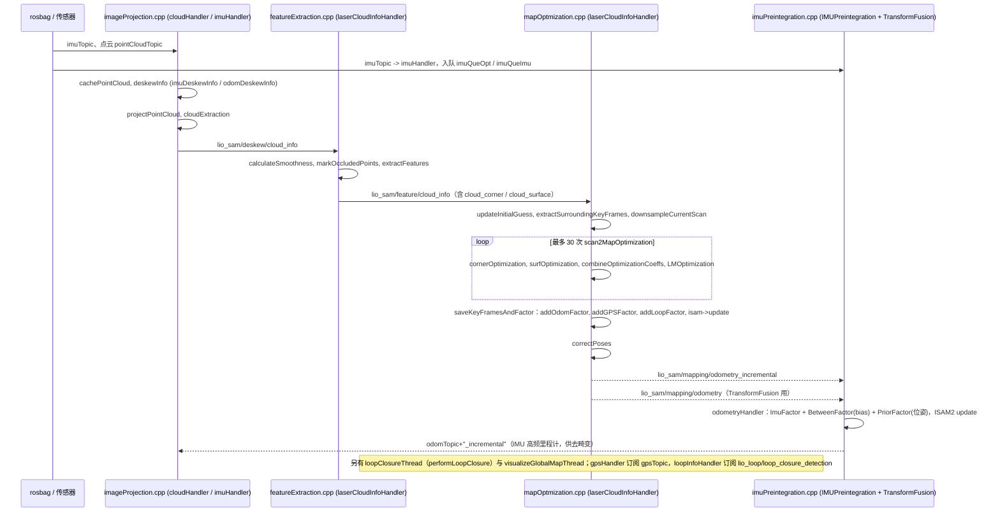

---

type: entity
tags: [repo, lidar, lio, gtsam, slam, gps, hku]
status: complete
updated: 2026-07-21
related:
  - ../entities/fast-lio.md
  - ../comparisons/lidar-slam-lio-vio-selection.md
sources:
  - ../../sources/repos/lio_sam.md
summary: "LIO-SAM 基于 GTSAM 因子图实现紧耦合 LiDAR-惯性 SLAM，支持回环与 GPS 融合，适合室外大场景。"
---

# LIO-SAM

**LIO-SAM** 将 **IMU 预积分、scan-to-map 与回环** 纳入统一因子图优化。

## 英文缩写速查

| 缩写 | 英文全称 | 简要说明 |
|------|----------|----------|
| LIO | LiDAR-Inertial Odometry | 激光-惯性里程计 |
| LiDAR | Light Detection and Ranging | 激光雷达，地形感知与建图主传感器 |
| SLAM | Simultaneous Localization and Mapping | 同步定位与建图 |
| IMU | Inertial Measurement Unit | 惯性测量单元，提供加速度与角速度 |
| ROS 2 | Robot Operating System 2 | 机器人系统集成与通信的常用中间件 |
| VIO | Visual-Inertial Odometry | 视觉-惯性里程计，融合相机与 IMU 估计位姿 |

## 为什么重要

- **室外自动驾驶/巡检常见选型**。
- **GPS 融合**：全球一致性较纯 LIO 易扩展。

## 核心结构/机制

| 因子 | 说明 |
|------|------|
| **IMU preintegration** | 高频运动先验 |
| **Scan-to-map** | 激光匹配约束 |
| **Loop / GPS** | 全局约束 |

## 常见误区或局限

- **算力**：比 FAST-LIO 更重；实时性需硬件匹配。
- **ROS 版本**：注意 ROS1/ROS2 移植包选择。

## 源码运行时序图

入口：`roslaunch lio_sam run.launch`（`launch/run.launch` 加载 `config/params.yaml`，经 `module_loam.launch` 启动 4 个节点：`lio_sam_imuPreintegration`、`lio_sam_imageProjection`、`lio_sam_featureExtraction`、`lio_sam_mapOptmization`），另开终端 `rosbag play your-bag.bag -r 3`。

图依据：LIO-SAM@0be1fbe，`README.md`、`launch/run.launch`、`launch/include/module_loam.launch`、`src/imageProjection.cpp`、`src/featureExtraction.cpp`、`src/mapOptmization.cpp`、`src/imuPreintegration.cpp`（各 handler 与话题订阅/发布、主流程函数；函数内部数值细节未逐行读）。

## 参考来源

- [sources/repos/lio_sam.md](../../sources/repos/lio_sam.md)
- [TixiaoShan/LIO-SAM](https://github.com/TixiaoShan/LIO-SAM)
- 源码核对（2026-11-02）：TixiaoShan/LIO-SAM@0be1fbe，读过 README.md、launch/run.launch、launch/include/module_loam.launch、src/imageProjection.cpp、src/featureExtraction.cpp、src/mapOptmization.cpp、src/imuPreintegration.cpp（主流程与话题连接，非逐行）；时序图依据以上文件，未运行代码。

## 关联页面

- [FAST-LIO](../entities/fast-lio.md)
- [LiDAR / LIO / VIO 选型](../comparisons/lidar-slam-lio-vio-selection.md)

## 推荐继续阅读

- https://arxiv.org/abs/2007.00258
