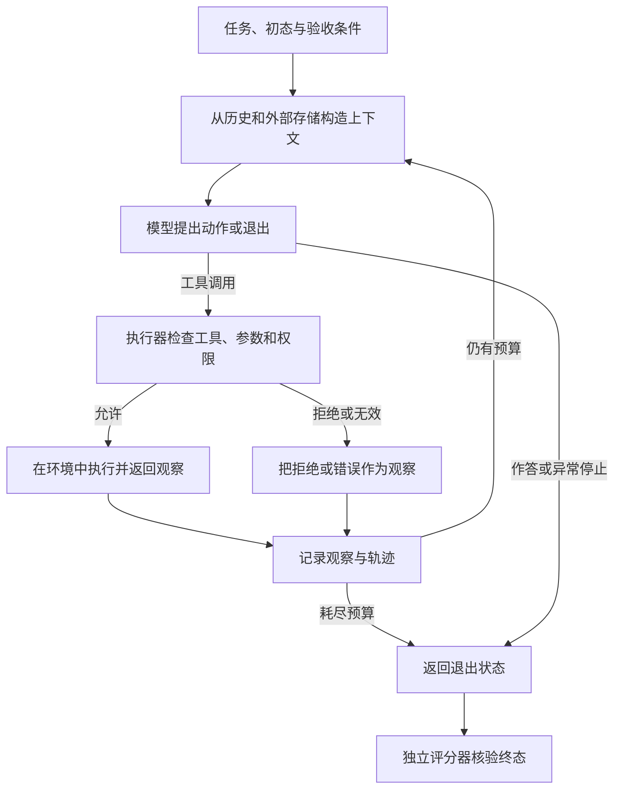

# Agent 工程小书 / The Little Book of Agent Engineering

## 一句话定义

Gappy + Agents 的 11 章教学书将 Agent 拆成随机决策的模型与可测试的运行框架：模型选择下一步，程序决定它能看到什么、可以做什么，以及怎样核实任务完成。

## 英文缩写速查

| 缩写 | 英文全称 | 简要说明 |
| --- | --- | --- |
| LLM | Large Language Model | 根据当前上下文采样下一步动作 |
| MCP | Model Context Protocol | 发现和调用外部工具的接口协议，不授予权限 |
| RAG | Retrieval-Augmented Generation | 把外部资料检索到模型上下文 |
| RRF | Reciprocal Rank Fusion | 按排名融合词法和向量检索结果 |
| MRR | Mean Reciprocal Rank | 衡量首个相关结果通常排在多前 |

## 为什么重要

同一次演示能修好 bug，不代表同一套 Agent 能稳定修好其他仓库的 bug。全书以 `trailing_mean` 错误地向前取窗为例：先读失败测试，再修代码并重测，最后用未被改动的测试及独立评分检查终态。它把失败定位到可更换的部件：模型、数据、工具、运行框架，或评测本身。

## 核心原理

| 章 | 内容 | 工程取舍 |
| --- | --- | --- |
| 1–3 | 自主性、模型适配层、观察—行动循环 | 路径已知优先用代码或固定工作流；需要选择下一步才加 Agent。处理至少三种退出：正常作答、预算耗尽、异常停止。退出不是通过。 |
| 4–6 | 类型化工具、上下文选择、检索与记忆 | 工具输出应有界且能指导下一步；优先限制、折叠或卸载后用引用重新读取。读路径做权限过滤和来源追溯，写入记忆保留来源、日期和可撤销性。 |
| 7–9 | 长任务、并行委派、执行权限 | 用验收里程碑和持久记录恢复；只读调查可隔离并行，共享写入按职责分开或串行。外部资料作为数据，工具权限由程序和沙箱执行。 |
| 10–11 | 评测、可观测性、系统集成 | 每次试验从隔离初态开始，由独立判分器检查终态；保留任务版本与轨迹，用同一组任务做配对比较。 |

### 流程总览

## 工程实践

1. **从验收定义倒推工具。** 在修复案例里，脚本模型的离线轨迹是先跑失败测试、读源码、做最小改动、复跑测试、再作答。这验证循环和工具接口如何配合，不能测出真实模型的成功率。应用到机器人软件时，可先给修复任务配独立的仿真验收脚本，保留原测试与关键指标；真机动作需另行授权和独立安全联锁。
2. **把恢复结果与外部提交分开。** 发出写请求后超时，不代表操作失败。书中建议先记录待执行状态；恢复时查询目标的实际状态，或使用服务端承认的同一个幂等键，避免重复发布。
3. **按使用方式报告评测。** 若每次独立成功概率为 0.7，三次至少成功一次的 `pass@3` 是 97.3%，三次都成功的 `pass^3` 是 34.3%。前者还需要有可靠办法从多个结果中挑出正确结果。对每次都要达标的工作流，不能用多次尝试的最好结果代表可靠性。

## 局限与风险

- 单步 95% 连续 50 步约 7.7%、检测并修复 90% 错误后约 77.8%，来自书中的独立步、未检出错误即失败等模型假设，不是实测增益。
- Prompt 能指导行为，但不能作为权限边界；工具安全依赖最小权限、程序化判定及隔离。离线 fixture 过关也不等于生产部署或真机安全过关。
- **源码运行时序图：不适用。** PDF 有 `run`、`execute` 等节选及脚本模型的轨迹表，但未核实到可下载的完整配套项目。本页图只概括书中机制，不声称复现了代码。

## 关联页面

- [Coding Agent 验证闭环](../methods/coding-agent-verification-loops.md)：用外部证据定义完成。
- [Claude Code 动态工作流](../methods/claude-code-dynamic-workflows.md)：何时用任务专用编排和委派。
- [AI Agent 评测](../concepts/ai-agent-evaluation.md)：如何设计终态判分、重复试验与回归。
- [Agent 记忆与 Dreaming](../concepts/agent-memory-and-dreaming.md)：检索之外的长期写入策略。

## 参考来源

- [作者分享的英文原文及版本核对](../../sources/books/the_little_book_of_agent_engineering_2026-11-23.md)

## 推荐继续阅读

- [Stanford CS329Z：Engineering AI Agents](https://cs329z.stanford.edu/)：对照课程中的工程实践与项目。
- [Anthropic：Building Effective Agents](https://www.anthropic.com/research/building-effective-agents)：从程序化工作流到动态 Agent 的架构选择。
