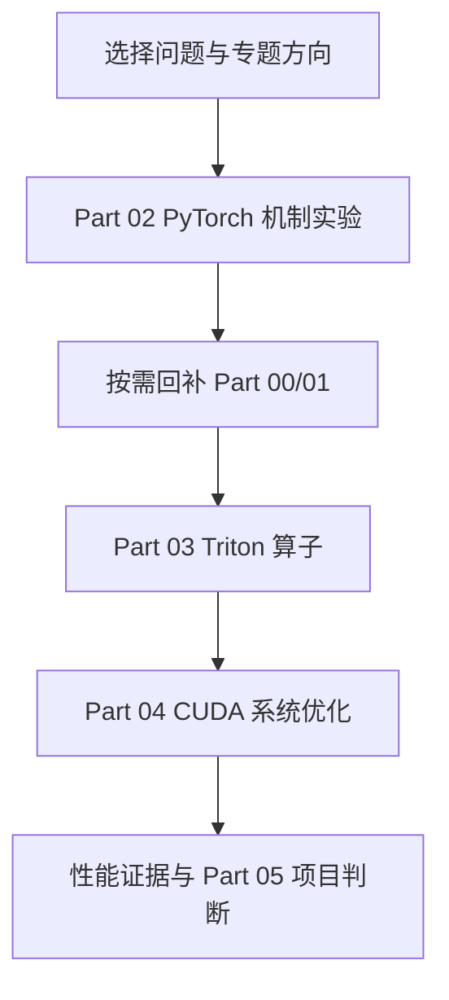
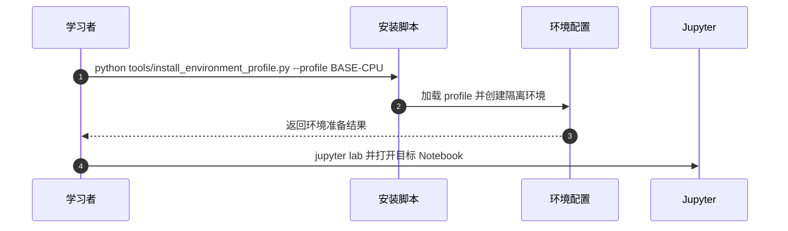

# llm-algo-leetcode：大模型算法与系统教程

## 一句话定义

同一个仓库提供多个专题入口：图片列出的推理优化、后训练、模型架构与算子优化**属于一个课程实体**，不重复创建四个节点。

## 英文缩写速查

| 缩写 | 英文全称 | 简要说明 |
|---|---|---|
| LLM | Large Language Model | 大语言模型 |
| CUDA | Compute Unified Device Architecture | NVIDIA 并行计算平台 |
| GPU | Graphics Processing Unit | 加速设备 |
| CPU | Central Processing Unit | 基础机制练习可使用的处理器 |

## 为什么重要

学习目标不是只记算法名称，而是对同一任务建立机制、正确性、性能和部署成本的证据链。先做 CPU/PyTorch 机制练习，再转向 Triton/CUDA 和真实后端，能减少将“能运行”误当“达到生产性能”的错误。

## 核心原理

README 的 Part 00/01 为基础和环境，Part 02 为 PyTorch 算法实践，Part 03 为 Triton kernel，Part 04 为 CUDA 系统优化，Part 05 是综合验证和项目收口。topic_discussion 则是跨 Part 的五条路线，不是与 Part 平行的另一套模型实现。

### 课程结构与验证路径

## 源码运行时序图

这里仅依据已核对的**实际入口**描述一条运行路径，不代表其他章节项目。

## 工程实践

官方 docs/guide.md 推荐先使用 BASE-CPU profile 运行 Notebook，再针对 GPU 或 Serving 专题采用独立 Profile。真实实验应先运行 environment_preflight，固定工作负载与版本，分别记录准确率、吞吐、延迟和显存。

## 局限与风险

不同执行栈与 GPU 型号下的性能不具自动可比性；README 的示意路线不代表所有 Notebook 都已在当前硬件验证。源码入口已核对为 tools/install_environment_profile.py，示例 sequenceDiagram 仅描述环境准备。

**健康度口径：** `original` 对应的是已完整阅读的官方 README **入口原文**，所以本页作为“课程总览”可以独立完结；不代表所有子章节、实验及应用源码已逐篇通读或成功运行。

## 关联页面

- [pytorch ](./pytorch.md) — 同领域的基础、工程或应用对照。
- [nvidia-cuda ](./nvidia-cuda.md) — 同领域的基础、工程或应用对照。
- [tensorrt-llm ](./tensorrt-llm.md) — 同领域的基础、工程或应用对照。

## 参考来源

- [2026-11-13 官方入口原文与核对范围](../../sources/repos/llm-algo-leetcode-course-overview-read-20261113.md)
- [课程资料总归档](../../sources/repos/llm-algo-leetcode.md)
- [官方 GitHub 仓库](https://github.com/datawhalechina/llm-algo-leetcode)

## 推荐继续阅读

- [官方教程与项目入口](https://datawhalechina.github.io/llm-algo-leetcode/)
