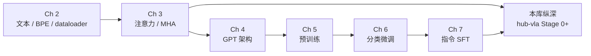
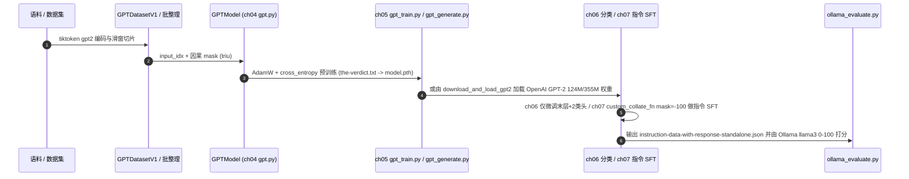

# Build a Large Language Model (From Scratch)（Raschka / LLMs-from-scratch）

## 一句话定义

**《Build a Large Language Model (From Scratch)》** 是 Sebastian Raschka 的 Manning 2024 教材与官方开源代码仓 [rasbt/LLMs-from-scratch](https://github.com/rasbt/LLMs-from-scratch)（Apache-2.0，2026-11-14 源码核查 HEAD `0311973e`，**已开源**），以纯 PyTorch（不依赖高层 LLM 框架）从零实现 BPE 分词、因果多头注意力、`GPTModel`、无标注预训练、分类头微调与指令 SFT 全链路，并配套免费 [YouTube 七章播放列表](https://www.youtube.com/playlist?list=PLTKMiZHVd_2IIEsoJrWACkIxLRdfMlw11) 与可选 Manning 17h+ 视频课；对本库而言，它是 [`roadmap/depth-vla.md`](../../roadmap/depth-vla.md) Stage 0 的序列建模前置底座。

## 英文缩写速查

| 缩写 | 英文全称 | 简要说明 |
|------|----------|----------|
| LLM | Large Language Model | 大语言模型；本书以小 GPT 复现其训练与微调全链路 |
| GPT | Generative Pre-trained Transformer | 自回归解码器语言模型；Ch 4–5 从零实现 |
| MHA | Multi-Head Attention | 多头注意力；Ch 3 纯 PyTorch 实现 |
| SFT | Supervised Fine-Tuning | 监督微调；Ch 6–7 覆盖分类头与指令微调 |
| LoRA | Low-Rank Adaptation | 低秩适配；附录 E 参数高效微调 |
| BPE | Byte Pair Encoding | 字节对编码分词；Ch 2 与 bonus 深入 |
| VLA | Vision-Language-Action | 视觉–语言–动作模型；本书提供其语言侧骨干直觉 |

## 为什么重要

1. **不依赖高层 LLM 框架**：主线不用 HuggingFace Transformers 等黑盒，读者亲手实现 tokenizer、dataloader、GPT block、训练环 —— 与 [Transformer](../concepts/transformer.md) 概念页和 [动作分词](../formalizations/vla-tokenization.md) 的「离散 token 接口」同构。
2. **全链路而非单点 demo**：预训练（Ch 5）→ 任务微调（Ch 6）→ 指令对齐（Ch 7） mirrors 工业基础模型管线，也对应 VLA 侧 **预训练 VLM + 机器人数据微调** 的常见阶段划分。
3. **三种学习形态互补**：书（系统阅读）+ Jupyter notebook（改代码）+ YouTube（跟讲节奏）；与 [Andrej Karpathy](./andrej-karpathy.md) *Zero to Hero*（micrograd / makemore / nanoGPT）形成 **结构化教材 vs 视频短课** 双轨，可按习惯二选一或交叉。

## 流程总览（学习路径与章节地图）

## 章节地图（与本知识库的对应）

| 教材部分 | 核心技能 | 本库相关页面 |
|---------|---------|-------------|
| Ch 2 文本数据 | BPE、embedding、batch 序列 | [动作分词](../formalizations/vla-tokenization.md)、[深度学习基础](../concepts/deep-learning-foundations.md) |
| Ch 3 注意力 | 缩放点积、MHA、因果 mask | [Transformer](../concepts/transformer.md) |
| Ch 4 GPT | Transformer block、生成解码 | [Transformer](../concepts/transformer.md)、[人形策略网络架构](../concepts/humanoid-policy-network-architecture.md) |
| Ch 5 预训练 | 语言建模损失、训练环、采样 | [Deep Learning Foundations](../concepts/deep-learning-foundations.md) |
| Ch 6 分类微调 | 任务头、迁移学习 | [Behavior Cloning](../methods/behavior-cloning.md)（监督微调类比） |
| Ch 7 指令微调 | 指令数据、对话格式、评估 | [VLA](../methods/vla.md)（语言条件策略） |
| 附录 E LoRA | 参数高效微调 | VLA/策略 **小数据适配** 常见手段 |
| Bonus DPO | 偏好对齐 | 与 RLHF/DPO 对齐文献衔接 |
| Bonus 架构族 | Qwen3/3.5、Gemma 3/4、DSA、MoE 等 from-scratch | 从教学 GPT 过渡到当前开源 LLM 族谱 |

## 源码运行时序图

主线可运行脚本流（经实读 `ch04/01_main-chapter-code/gpt.py`、`ch05/01_main-chapter-code/gpt_train.py` / `gpt_generate.py`、`ch06/01_main-chapter-code/gpt_class_finetune.py` 与 `ch07/01_main-chapter-code/gpt_instruction_finetuning.py` / `ollama_evaluate.py` 核对）：

**关键复现细节（源码核对）：**
- **预训练与大模型权重解耦：** `ch05/01_main-chapter-code/gpt_train.py` 在 `the-verdict.txt` 上从零训练缩减上下文的 `GPTModel`（`context_length=256`，保存 `model.pth`）；而 `ch05/01_main-chapter-code/gpt_generate.py`、`ch06/01_main-chapter-code/gpt_class_finetune.py`（默认 124M）与 `ch07/01_main-chapter-code/gpt_instruction_finetuning.py`（默认 355M）实际上通过 `download_and_load_gpt2` 拉取 OpenAI GPT-2 TensorFlow 权重映射到 `GPTModel` 再微调（加 `--test_mode` 可切换为 1 层小测试模型）。
- **分类 vs 指令 SFT 损失边界：** `gpt_class_finetune.py` 冻结主体参数，仅开放 `trf_blocks[-1]`、`final_norm` 与 2 类 `out_head`，且只对末 token logits 算分类损失；`gpt_instruction_finetuning.py` 则用 `custom_collate_fn` 把首个 `<|endoftext|>` 之后的 padding target 设为 `ignore_index=-100`。
- **PyPI 包与扩展入口：** `pkg/llms_from_scratch/` 提供 `pip install llms-from-scratch` 复用各章类及 `kv_cache` / `llama3` / `qwen3` 等变体。

## 三种学习形态

| 形态 | 入口 | 适用场景 |
|------|------|----------|
| 书 + notebook | [GitHub 仓库](https://github.com/rasbt/LLMs-from-scratch) | 系统学习、离线改代码、跑 exercise |
| YouTube 七章 | [播放列表](https://www.youtube.com/playlist?list=PLTKMiZHVd_2IIEsoJrWACkIxLRdfMlw11) | 需要讲解节奏；约 12.5 h |
| Manning 长视频 | [Manning LiveVideo](https://www.manning.com/livevideo/master-and-build-large-language-models) | 需要附录与 bonus 完整讲解（付费） |

**环境提示：** 仓库 `setup/` 提供 Python/uv/Docker 指南；主章节可在普通笔记本 GPU 上完成。PyTorch 新手可先读附录 A 或作者 [*PyTorch in One Hour*](https://sebastianraschka.com/teaching/pytorch-1h/)。

## 与 Karpathy Zero to Hero 的对照

| 维度 | LLMs-from-scratch（本书） | Zero to Hero（Karpathy） |
|------|---------------------------|--------------------------|
| 载体 | 书 + 长 notebook + 可选视频 | [10 集 YouTube](https://www.youtube.com/playlist?list=PLAqhIrjkxbuWI23v9cThsA9GvCAUhRvKZ) + [`nn-zero-to-hero`](../../sources/repos/nn-zero-to-hero.md) |
| 深度 | 七章 + 大量 bonus（Llama/Qwen/DPO…） | micrograd → makemore → GPT → Tokenizer → GPT-2 124M（~19 h） |
| 依赖 | 纯 PyTorch 主线 | 同样偏手写、极简依赖 |
| 机器人读者 | 更适合作 **VLA 前置系统课** | 更适合作 **视频驱动建立 NN/Transformer 直觉** |

二者可并行：Zero to Hero 建立「张量→反向传播→小 GPT」速度感，本书补齐 **分词、预训练环、微调与对齐** 的工程完整度。课程归档见 [`karpathy_zero_to_hero_youtube.md`](../../sources/courses/karpathy_zero_to_hero_youtube.md)。

**视频三角（VLA Stage 0 可选）**：若更偏好 **先听再写**，可在本书之前或并行观看 [Karpathy Intro + Deep Dive LLMs](../../sources/courses/karpathy_intro_llms_youtube.md)（[`andrej-karpathy`](./andrej-karpathy.md)）— 前者 ~1 h 全景与安全，后者 ~3.5 h 训练栈；本书/配套 YouTube 则负责 **动手实现**。

## 局限（相对机器人研究）

- **不涉及** 视觉编码、机器人动作空间或 sim 环境 —— 读完应接 [hub-vla](../../roadmap/depth-vla.md) 与 [LeRobot](./lerobot.md) 等具身栈。
- **不覆盖** 扩散策略、ACT、WBC 等本库运动控制主线。
- Bonus 中的 Llama/Qwen/Gemma from-scratch 用于 **架构直觉**，不等价于能在真机上部署 VLA。
- 续作 [*Build A Reasoning Model (From Scratch)*](https://github.com/rasbt/reasoning-from-scratch) 覆盖推理 scaling / GRPO，与本仓 bonus 交叉引用，但 **不替代** 本库具身/VLA 主线。

## 工程实践

1. **VLA 路线 Stage 0 前置**：读完 Ch 3–4 再打开 [Transformer](../concepts/transformer.md) 与 [VLM/VLA 分类学](../comparisons/vlm-vln-vla-vlx-world-model-taxonomy.md)。
2. **动作分词补课**：Ch 2 文本 token（`GPTDatasetV1` 滑窗）与 [动作分词](../formalizations/vla-tokenization.md) 对照阅读，理解「连续量 → 离散符号序列」接口；Ch 6–7 的末 token 分类头与 `-100` padding mask 写法也直接对应机器人策略微调的常见工程习惯。
3. **与蘑菇书对称**：RL 用 [动手学强化学习](./hands-on-rl-book.md)，LLM 骨干用本书 —— 再进入人形/操作学习纵深。
4. **本地快速验证技巧**：`ch06/01_main-chapter-code/gpt_class_finetune.py` 与 `ch07/01_main-chapter-code/gpt_instruction_finetuning.py` 均支持 `--test_mode` 跳过数百兆 GPT-2 权重下载、用 1 层微型 `GPTModel` 跑通数据管线与训练循环。

## 结论

`LLMs-from-scratch` 是当前从零手写 Transformer 解码器与训练/微调全链路最透明、代码测试最完整的纯 PyTorch 教学仓库之一，最适合作为机器人研究者的 LLM 机制底座而非真机策略代码模板。

- **定位清晰**：主线只依赖 PyTorch 与 `tiktoken` 实现 Tokenizer→MHA→GPT 预训练→分类/指令 SFT，极适合建立源码级直觉。
- **注意代码实际入口**：Ch 6/7 默认脚本直接通过 `gpt_download.py` 拉取 OpenAI GPT-2 权重进行微调，而非衔接 Ch 5 `the-verdict.txt` 的小语料 checkpoint；快速试跑应使用 `--test_mode`。
- **工程化复用**：需要复用模块或对照现代架构时，优先看 `pkg/llms_from_scratch/`、`ch04/03_kv-cache`–`10_kv-sharing` 及 `ch05/11_qwen3` 等 bonus，再衔接 [LeRobot](./lerobot.md) 与 [VLA](../methods/vla.md)。

## 关联页面

- [Transformer](../concepts/transformer.md)
- [深度学习基础](../concepts/deep-learning-foundations.md)
- [动作分词（Action Tokenization）](../formalizations/vla-tokenization.md)
- [VLA（方法）](../methods/vla.md)
- [Andrej Karpathy](./andrej-karpathy.md)
- [PyTorch](./pytorch.md)
- [VLA 纵深路线](../../roadmap/depth-vla.md)

## 参考来源

- [rasbt/LLMs-from-scratch 仓库归档](../../sources/repos/rasbt_llms_from_scratch.md)（主要原文：克隆源码实读核对）
- [YouTube 配套课归档](../../sources/courses/rasbt_llms_from_scratch_youtube.md)（补充视频课目录）

## 推荐继续阅读

- [rasbt/LLMs-from-scratch（GitHub）](https://github.com/rasbt/LLMs-from-scratch)
- [Build a Large Language Model (From Scratch) — Manning](http://mng.bz/orYv)
- [reasoning-from-scratch 续作仓库](https://github.com/rasbt/reasoning-from-scratch) — 推理时 scaling、GRPO 等
- [Karpathy Zero to Hero 播放列表](https://www.youtube.com/playlist?list=PLAqhIrjkxbuWI23v9cThsA9GvCAUhRvKZ)
- [nn-zero-to-hero 配套仓库](https://github.com/karpathy/nn-zero-to-hero)
- [Karpathy Intro to LLMs（YouTube）](https://www.youtube.com/watch?v=zjkBMFhNj_g)
- [Karpathy Deep Dive into LLMs（YouTube）](https://www.youtube.com/watch?v=7xTGNNLPyMI)
