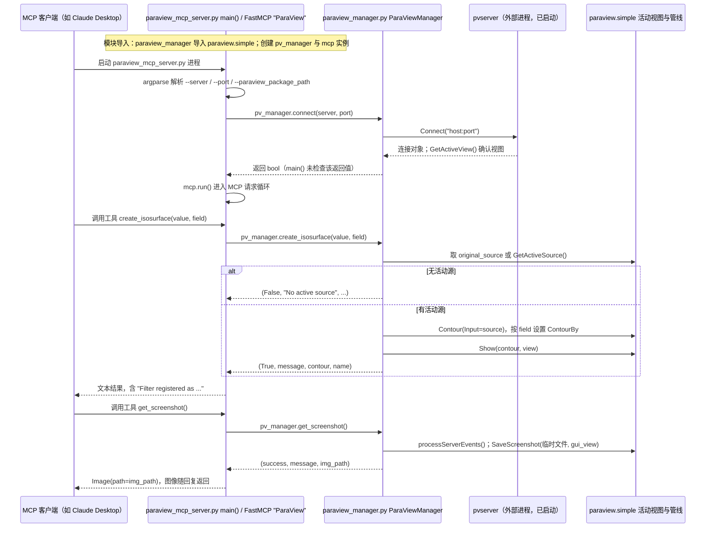

# ParaView MCP（llnl/paraview_mcp）

## 一句话定义

ParaView MCP（llnl/paraview_mcp）是LLNL 的多模态可视化 MCP：代理调用 ParaView 命令并观察渲染视口，形成“执行—观察—调整”反馈。

## 英文缩写速查

| 缩写 | 英文全称 | 简要说明 |
|------|----------|----------|
| CAD | Computer-Aided Design | 计算机辅助设计与几何建模 |
| MCP | Model Context Protocol | 代理调用 CAD/可视化工具的协议 |
| FEM | Finite Element Method | 结构有限元分析方法 |

## 为什么重要

对 CAE 自动化而言，代理能否稳定完成任务，取决于工程步骤是否清楚、工具边界是否明确、结果是否保留可审查证据。LLNL 的多模态可视化 MCP：代理调用 ParaView 命令并观察渲染视口，形成“执行—观察—调整”反馈；README 同时提示 pvserver/客户端同步机制变化可能影响显示稳定性。

## 核心原理

**项目自身范围：** Multimodal MCP for controlling ParaView with viewport feedback.

**工作流：** MCP 向 ParaView 发出可视化操作，代理读取视口图像判断是否达成目标，再迭代调整图层、视角或标注。

## 工程实践

1. 从目标问题识别所需的 Skill、MCP、CLI 或软件接口，不把指导文件当成求解器。
2. 依照仓库 README 检查安装前提、软件/许可证、输入文件和输出证据。
3. 小规模运行并逐项核对几何、网格、边界、求解状态和物理量，再决定是否扩大任务。

文章所述的项目特征：LLNL 的多模态可视化 MCP：代理调用 ParaView 命令并观察渲染视口，形成“执行—观察—调整”反馈；README 同时提示 pvserver/客户端同步机制变化可能影响显示稳定性。

## 局限与风险

视口反馈受 ParaView 版本及远程会话同步影响；结果图需人工检查单位、色标范围、视角和数据来源。

源码状态核验：该 GitHub 仓库于 2026-10-07 可公开访问。仓库 API 报告许可证为 BSD-3-Clause。 涉及商业软件时，安装包和有效许可证需由使用者自行提供。

## 源码运行时序图

入口：先在 ParaView 中启动 `python pvserver --multi-clients`，再由 MCP 客户端启动 `python paraview_mcp_server.py [--server HOST] [--port 11111]`

图依据：llnl/paraview_mcp@30242a0，实际读过 README.md、paraview_mcp_server.py、paraview_manager.py、requirements.txt；未运行代码。

## 关联页面

- [CAE / CFD 代理工具项目总览](../overview/cae-cfd-agent-skills-landscape.md)
- [viznoir](./kimimgo-viznoir.md)

## 参考来源

- [公众号文章原始资料归档](../../sources/blogs/wechat_cae_cfd_agent_skills_2026-10-07.md)
- [GitHub 仓库资料归档](../../sources/repos/llnl-paraview-mcp.md)
- [llnl/paraview_mcp 官方仓库](<https://github.com/llnl/paraview_mcp>)
- 源码核对（2026-11-02）：llnl/paraview_mcp@30242a0，读过 README.md、paraview_mcp_server.py、paraview_manager.py、requirements.txt；时序图依据以上文件，未运行代码。

## 推荐继续阅读

- [项目 README](<https://github.com/llnl/paraview_mcp/blob/main/README.md>)