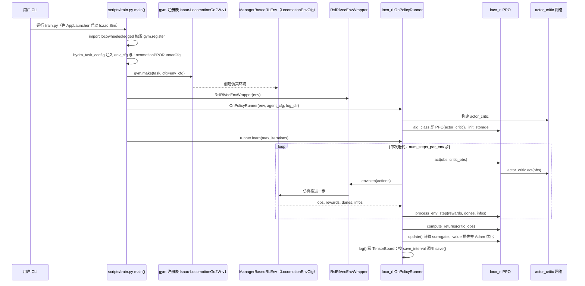
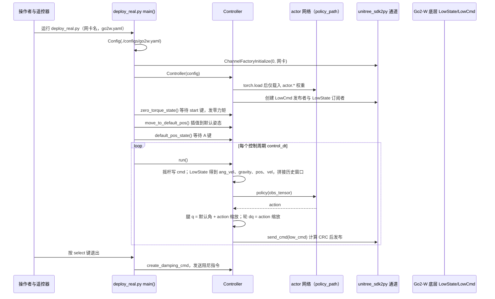

# LocoLeggedWheel

**LocoLeggedWheel**（[GitHub](https://github.com/zhaozijie2022/LocoLeggedWheel)）来自 [古月居转载的四足机器人开源项目综述](https://mp.weixin.qq.com/s/pRGoPm41qYCNyHPWR6Dl6A)，属「轮足机器人」组。

## 一句话定义

**LocoLeggedWheel（LocoWheeledLegged）是基于 NVIDIA Isaac Lab 的轮足机器人 RL 运动控制项目，重点优化奖励函数与训练稳定性，并提供宇树 Go2W 的 sim2real 部署接口与配置。**

## 英文缩写速查

| 缩写 | 英文全称 | 简要说明 |
|------|----------|----------|
| Go2W | Unitree Go2-W | 宇树轮足版 Go2（README 所称） |

## 为什么重要

- 综述把它放在「轮足机器人」这条技术路线下，作为可读源码的参照项目；横向对比见 [四足机器人开源项目技术地图：从极简运动学到研究级硬件（36 个 GitHub 项目）](../overview/quadruped-open-source-projects-technology-map.md)。
- 文中星标：115（文章表述，入库日未复核）。

## 核心信息

| 项 | 内容 |
|----|------|
| **仓库** | [zhaozijie2022/LocoLeggedWheel](https://github.com/zhaozijie2022/LocoLeggedWheel) |
| **最近提交** | 2026-07-09 |
| **可达性** | `git ls-remote` 可达（2026-11-01） |
| **文章归类** | 轮足机器人 |

## 文章说法核对

- **文章：** 文章称基于 Isaac Lab，强调 Sim-to-Real 迁移。
- **README / 核查：** README 指出 Isaac Gym 版本见 DreamWaQ_Go2W；安装需 Isaac Sim 5.x（README 同时出现 v5.5.1 与 5.1.0 两种写法）；无 LICENSE 文件。
- **差异与保留：** README 中 Isaac Sim 版本写法不一致，部署前以官方文档为准。

## 源码运行时序图

### 训练（仿真）

入口：`python locowheeledlegged/scripts/train.py --task Isaac-LocomotionGo2W-v1 --num_envs=4096 --headless`

图依据：LocoLeggedWheel@015b823，实际读过 README.md、locowheeledlegged/scripts/train.py、locowheeledlegged/config/go2w/__init__.py、loco_rl/runners/on_policy_runner.py、loco_rl/algorithms/ppo.py；未运行代码。

### 实机部署（Go2-W，sim2real）

入口（工作目录为 `deploy_real/`）：`python deploy_real/deploy_real.py <网卡名> go2w.yaml`

图依据：LocoLeggedWheel@015b823，实际读过 README.md、deploy_real/deploy_real.py、deploy_real/configs/go2w.yaml（检索关键字段）；未运行代码。

## 关联页面

- [isaac-lab](../entities/isaac-lab.md)
- [reinforcement-learning](../methods/reinforcement-learning.md)
- [sim2real](../concepts/sim2real.md)
- [locomotion](../tasks/locomotion.md)
- [quadruped-open-source-projects-technology-map](../overview/quadruped-open-source-projects-technology-map.md)

## 参考来源

- [locoleggedwheel.md](../../sources/repos/locoleggedwheel.md)
- [wechat_guyueju_quadruped_opensource_deep_dive_2026-11-01.md](../../sources/blogs/wechat_guyueju_quadruped_opensource_deep_dive_2026-11-01.md)
- [原文（微信公众号）](https://mp.weixin.qq.com/s/pRGoPm41qYCNyHPWR6Dl6A)
- 源码核对（2026-11-02）：LocoLeggedWheel@015b823，读过 README.md、locowheeledlegged/scripts/train.py、locowheeledlegged/scripts/play.py、locowheeledlegged/config/go2w/__init__.py、locowheeledlegged/config/go2w/locomotion_env_cfg.py、locowheeledlegged/config/go2w/agents/rsl_rl_ppo_cfg.py、loco_rl/runners/on_policy_runner.py、loco_rl/algorithms/ppo.py、deploy_real/deploy_real.py、deploy_real/configs/go2w.yaml；时序图依据以上文件，未运行代码。
