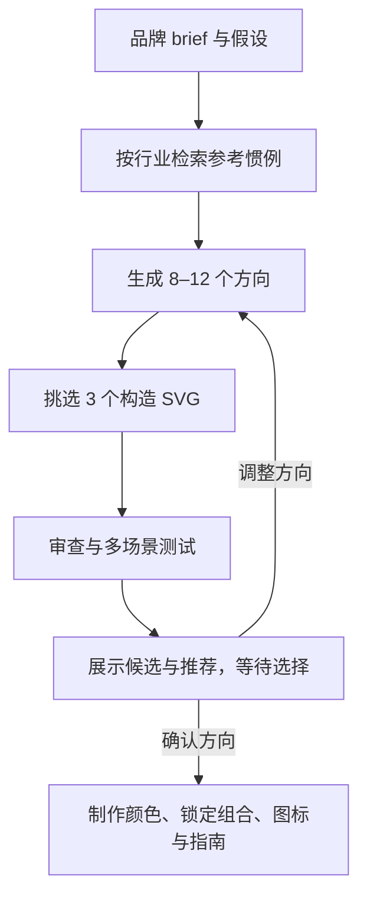

# Logo Design Skill

## 一句话定义

**Logo Design Skill** 是一个跨 Claude、Gemini CLI、Codex 等支持 Agent Skills 的 Logo 设计技能：它把品牌发现、概念发散、SVG 构造与实用性检查串成可审查流程，先交付候选方向供用户选择，再按确认方向扩展品牌套件。

## 英文缩写速查

| 缩写 | 英文全称 | 简要说明 |
|------|----------|----------|
| SVG | Scalable Vector Graphics | 矢量图格式；该工具的主要 Logo 源文件格式 |
| CLI | Command-Line Interface | 命令行接口；用于搜索参考库、审查与导出 Logo |
| ICO | Icon file format | 常见图标容器；工具可据可用渲染器导出 favicon |
| MIT | Massachusetts Institute of Technology License | 开源许可名称；适用于技能文本、脚本、模板与目录数据 |

## 为什么重要

- **把设计过程变成有检查点的协作：** 技能先生成多个概念，再展示对比与推荐，并在制作整套资产前等待用户选方向。这有助于避免代理过早把一个未经确认的图形扩写成完整视觉系统。
- **将视觉原则连接到可运行检查：** SVG 审查和测试页覆盖路径复杂度、细小细节、角度偏差、居中、16 px 可读性、单色/反白和应用情境等方面，为 Logo 初稿提供可复现的机械检查。
- **对机器人项目的有限关联：** 它可用于机器人产品、实验室或开源项目的品牌草案与图标资产；它不生成机器人模型、仿真场景或控制策略。机械与机器人描述设计可参见 [CAD Skills](./cad-skills.md)，浏览器 3D 项目可参见 [Three.js Game Skills](./threejs-game-skills.md)。

## 核心结构

| 部分 | 职责 |
|------|------|
| `SKILL.md` | 设计流程、原则、风险提示、停等检查点及工具用法 |
| `references/` | 按需加载的 brief、标志类型、几何、颜色、字体、SVG、测试、交付和品牌系统指南 |
| `scripts/search_library.py` | 按行业、技术与分类查找参考库条目 |
| `scripts/svg_audit.py` | 检查 SVG 尺寸、颜色、锚点复杂度、近似角度、微小细节与居中等指标 |
| `scripts/concept_sheet.py` / `preview_sheet.py` | 生成概念总览与尺寸、背景、单色、反白、上下文测试页 |
| `scripts/presentation_board.py` | 为概念生成带行业场景模型图的演示板 |
| `scripts/render_png.py` / `export_variants.py` | 渲染位图并导出单色、反白、App 图标与 Web 图标资产 |
| `assets/library/` | 1,400 多份分类 SVG、目录数据和本地画廊；其中 Logo 受各自权利人商标权约束 |

## 流程总览

其核心设计决策是把「出概念」和「做完整品牌套件」分成两个阶段：检查点前提供可比较的 Logo 方案，完整资产只在选定方向后制作。

## 工程实践

- **安装：** README 示范将 `skills/logo-design/` 复制到目标代理的个人或项目 skills 目录；Codex CLI 示例为 `~/.codex/skills/logo-design`。
- **搜索参考：** `python3 scripts/search_library.py --industry payments-fintech --summary`；也可按技术筛选并只返回示例。
- **审查与测试：** 对 SVG 运行 `python3 scripts/svg_audit.py logo.svg`，并以 `preview_sheet.py` 生成尺寸和背景测试页。
- **导出：** 可用 `render_png.py` 输出指定尺寸 PNG，或用 `export_variants.py` 生成单色、方形图标、favicon 和网站图标集。
- **源代码状态：** 项目页面为公开 GitHub 仓库，README 声明技能文本、脚本、模板与目录数据使用 MIT。Logo SVG 参考库不包含在该 MIT 许可内；应把它当作学习素材，避免复制到产品中，并独立核对商标、近似性和字体许可。

## 局限与风险

- **视觉检查不等于法律审查：** 几何、对比度和尺寸通过检查，无法证明 Logo 有商标可注册性或不会与第三方标志近似。
- **参考库有许可边界：** 仓库 README 明确排除 `assets/library/svg/` 中的第三方 Logo 文件；上游 MIT 声明不能解释为对这些标志的再分发或商用授权。
- **结果仍需人工判断：** 行业分类与自动审查是辅助，不能替代对品牌语义、文化含义、实际媒介效果和商标检索的复核。
- **与机器人研发主线无直接集成：** 工具面向品牌视觉识别，不产出 CAD、URDF、仿真资产或机器人控制代码。

## 关联页面

- [CAD Skills](./cad-skills.md) — 面向机械结构、CAD 与机器人描述的垂直 Agent Skills
- [Three.js Game Skills](./threejs-game-skills.md) — 面向浏览器 3D 游戏开发的技能组与验证工具
- [Skills For Real Engineers（mattpocock）](./mattpocock-skills.md) — 通用软件工程习惯与编码代理技能
- [HumanLayer Skills](./humanlayer-skills.md) — harness、代理维护环与工程技能
- [Frontend Design Skill（Anthropic）](./anthropic-frontend-design-skill.md) — 面向前端界面实现的设计技能

## 参考来源

- [Logo Design Skill 仓库源归档（本站）](../../sources/repos/kaankiziltug-logo-design-skill.md)
- [kaankiziltug/logo-design-skill（GitHub）](https://github.com/kaankiziltug/logo-design-skill)

## 推荐继续阅读

- [上游 README：Logo Design Skill](https://github.com/kaankiziltug/logo-design-skill#readme) — 流程、脚本、参考库统计和安装说明
- [上游 TRADEMARKS.md](https://github.com/kaankiziltug/logo-design-skill/blob/main/TRADEMARKS.md) — 参考库内第三方标志的权利声明
- [Agent Skills 规范](https://agentskills.io/) — `SKILL.md` 技能目录约定
