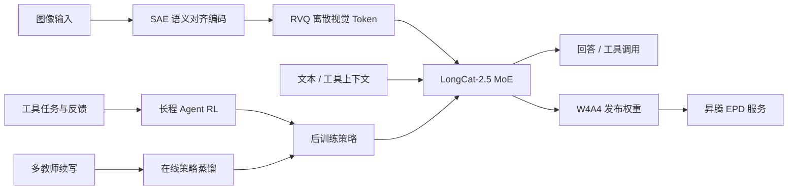
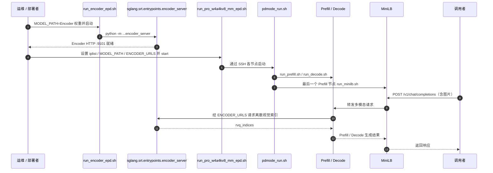

# LongCat-2.5（美团原生多模态与 Agent 基座）

## 一句话定义

**LongCat-2.5** 是美团发布的原生多模态 MoE 基座，合并离散视觉表示、长程 Agent 强化学习、多教师在线策略蒸馏与大规模推理部署：**总参数约 1.6T、每 token 激活约 48B**，不能将这两个口径混用。

## 英文缩写速查

| 缩写 | 英文全称 | 简要说明 |
|---|---|---|
| MoE | Mixture of Experts | 稀疏激活专家网络；1.6T 为总量，48B 为激活量 |
| SAE | Semantic-and-Aligned Encoder | 视觉 token 化前的语义对齐编码器 |
| RVQ | Residual Vector Quantization | 将连续视觉特征分层编码为离散索引 |
| RL | Reinforcement Learning | Agent 长轨迹任务的策略优化 |
| W4A4 | 4-bit Weights / 4-bit Activations | 低精度专家推理权重与激活配置 |
| EPD | Encoder–Prefill–Decode | 昇腾多模态推理的三阶段分离部署 |
| TTFT | Time to First Token | 首 token 延迟的测量口径 |
| TPOT | Time per Output Token | 输出每 token 延迟的测量口径 |

## 核心信息

| 字段 | 内容 |
|---|---|
| 机构 | 美团（Meituan）LongCat 团队 |
| 主技术资料 | [2026-11-02 官方博客](https://tech.meituan.com/2026/11/02/Meituan-LongCat-2.5.html) |
| 模型 | [LongCat-2.5](https://huggingface.co/meituan-longcat/LongCat-2.5) |
| 量化 | [LongCat-2.5-W4A4](https://huggingface.co/meituan-longcat/LongCat-2.5-W4A4) |
| 部署源码 | [SGLang-FluentLLM / longcat-2.5-npu](https://github.com/meituan-longcat/SGLang-FluentLLM/tree/longcat-2.5-npu) |
| API | [LongCat 开放平台](https://longcat.chat/platform/docs/) |
| 开源状态 | **权重、W4A4 及昇腾推理部署实现已公开**；不等同于完整预训练、RL 数据和代码全部公开 |

## 为什么重要

1. **模型与物理系统分层：** 视觉 token 统一表示、工具使用、长上下文是机器人上层任务规划可能利用的能力，但与真机运动控制、约束和闭环验证不同。
2. **模型工程的全链路：** 原生多模态编码、Agent RL、分布式训练、低精度量化和 EPD 是贯穿训练到服务化的例子。
3. **可核实的部署入口：** 公开的昇腾 194 卡样例包含可阅读的 Encoder、P/D 和负载均衡启动脚本，而非仅宣传架构图。

## 核心原理

### 离散视觉输入与 Agent 后训练

- 官方将语义对齐视觉特征通过 **SAE + RVQ** 映射为离散 token，降低训练时反复提取视觉特征的成本；具体的视觉离散化设计可交叉学习独立工作 [LongCat-Next](./paper-longcat-next.md)。
- **长程 Agent RL** 关注多步工具交互中的奖励对齐、部分轨迹异步收集与策略版本偏移，而非对人形关节动作直接做 RL。
- **多教师在线策略蒸馏** 使用分叉续写对齐教师分布，利用共享前缀/树状注意力减少重复计算，与机器人专家动作模仿学习的监督对象不同。
- 超长上下文训练涉及并行拓扑、数据传输与训练推理概率一致性；“训练支持 1M token”不代表每种线上运行配置都有相同的实测性能。

### 流程总览（依据官方技术博客）

图展示原始资料明确的模块与训练/部署关系；未把 LongCat-Next 的专用图像生成解码器移植到 LongCat-2.5。

## 实验与评测

| 官方报告项目 | 读法 |
|---|---|
| Terminal Bench 2.1、Vision2Web、3DCodeBench、LongCatClawBench | 软件工程、GUI 与 Agent 能力的不同测评，不能汇总成一个“机器人分数” |
| W4A4 对 W8A8：prefill 吞吐 +43.3% | 仅对应官方负载和硬件配置 |
| W4A4 对 W8A8：decode 吞吐 +42.77% | 不等于所有并发/输入长度相同增益 |
| TTFT -15.91%；TPOT -19.72% | 两种不同的延迟指标，不可与吞吐百分比相加 |
| Ascend EPD 样例 194 卡 | 2 Encoder + 64 Prefill + 128 Decode，描述部署规模而非模型能力 |

上述收益来自发布方一手披露，尚未在本仓库独立复测。

## 源码运行时序图

以下是从 [NPU 部署 README](../../sources/repos/longcat-2-5-sglang-npu.md) 与 `run_encoder_epd.sh`、`run_pro_w4a4kv8_mm_epd.sh`、`pdmode_run.sh` 核对出的启动和请求流程；请求中的角色交互以 README 的 EPD 说明为依据。

部署 README 给出 `DRY_RUN=1` 预览、`code` 同步、`start` 启动、`status` 查询，以及 Encoder HTTP 9101、MiniLB 8081 的健康检查和推理验证方法。

## 工程实践

1. **模型入口：** 先从两个 Hugging Face 模型卡区分原始权重与 W4A4 量化权重；核实部署框架所需格式。
2. **Ascend 环境：** 官方要求 Atlas A2、配套 CANN/ATB、torch_npu、flash 算子；Encoder 单独 2 卡，12 台 P/D 机器各 16 卡。
3. **启动顺序：** 先 `run_encoder_epd.sh`；然后在调度节点依次 `DRY_RUN=1 ... start`、`... code`、`... start`，用 `status` 与 `/health` 判断服务状态。
4. **接口入口：** [官方 API 文档](https://longcat.chat/platform/docs/) 提供 OpenAI 兼容与 Anthropic 兼容的示例；真实调用前核对密钥、限额、请求格式及模型标识。
5. **机器人集成边界：** 若用于具身智能高层规划，需在工具层增加动作白名单、仿真/真机安全校验和可追溯执行日志。

## 局限与风险

- **无训练全链路保证：** 可下载权重和推理脚本不等于完整数据、预训练及 Agent RL 训练流水线可复现。
- **资源门槛：** 此 Ascend 方案是 194 卡集群实例，不能据此声称单张 RTX GPU 可部署全模型。
- **量化测量可比性：** W4A4 相对 W8A8 数字是厂商基准；不同 batch、上下文、硬件、KV 压缩设置应重新测试。
- **领域错位：** Agent 的 PR/issue 任务完成率不等于机器人操作成功率或实时控制安全性。
- **业务案例：** 美团 [发布与经营分析资料](https://www.meituan.com/news/NN261102280001343) 是业务场景说明，非独立严谨技术 benchmark。

## 与其他工作对比

| 项 | LongCat-2.5 | LongCat-Next |
|---|---|---|
| 定位 | 1.6T/48B 大型原生多模态 + Agent | A3B/68.5B 总参数的离散统一多模态研究 |
| 视觉重点 | SAE/RVQ 与长上下文视觉输入 | dNaViT、离散表示语义完整性、理解/生成统一 |
| 工程发布 | 权重、W4A4、昇腾 EPD 示例 | 模型、tokenizer、SFT 代码及推理适配 |
| 不应混淆 | Agent RL 与底层控制 RL | 图像生成能力与机器人世界模型能力 |

## 关联页面

- [LongCat-Next：将模态离散成 Token](./paper-longcat-next.md)
- [GRPO（组相对策略优化）](../methods/grpo.md) — 大模型 RL 的另一种优化路线，不能等同于 LongCat-2.5 的全部训练方法
- [强化学习方法总览](../methods/reinforcement-learning.md)
- [Agentic RL Lab](./agentic-rl-lab.md)

## 参考来源

- [LongCat-2.5 官方博客归档](../../sources/blogs/longcat-2-5.md)
- [LongCat-2.5 和 W4A4 模型卡归档](../../sources/models/longcat-2-5-weights.md)
- [Ascend EPD 源码归档](../../sources/repos/longcat-2-5-sglang-npu.md)
- [官方 API 和发布资料](../../sources/sites/longcat-2-5-ecosystem.md)

## 推荐继续阅读

- [美团 LongCat-2.5 技术博客](https://tech.meituan.com/2026/11/02/Meituan-LongCat-2.5.html)
- [官方 NPU EPD README](https://github.com/meituan-longcat/SGLang-FluentLLM/blob/longcat-2.5-npu/npu_test/ReadMe.md)
- [LongCat-Next 原始论文](https://arxiv.org/abs/2603.27538v1)
