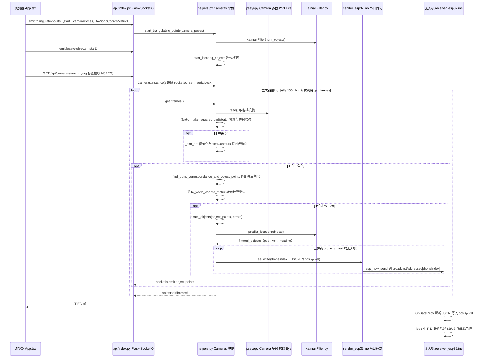

# Low Cost Mocap

**Low Cost Mocap** 是 Joshua Bird 开源的室内光学动捕系统：多台改装 PS3 Eye 相机跟踪无人机上的红外 LED，通过多视角几何获得房间坐标中的目标位置，并经 ESP32 链路用于自主飞行。

## 英文缩写速查

| 缩写 | 英文全称 | 简要说明 |
|------|----------|----------|
| MoCap | Motion Capture | 多相机观测并重建目标运动状态 |
| SFM | Structure from Motion | 从图像特征估计相机运动与场景结构 |
| IR | Infrared | 相机改装和机载 LED 使用的红外光 |
| PID | Proportional–Integral–Derivative | 无人机飞控使用的反馈控制器 |

## 为什么重要

- **把动捕门槛降到学生项目级别：** 作者估计相机追踪系统约 20 美元，展示了用消费级摄像头替代商业动捕硬件的可行路径。
- **覆盖从感知到控制的闭环：** 项目不仅三角化目标位置，还把状态传给微型无人机，演示定位、通信与飞控串联。
- **便于机器人实验复用：** outside-in 跟踪可用于室内无人机或移动机器人测试场地；同一相机系统也可作为控制算法的外部定位基准。

## 核心原理

### 1. 红外相机观察主动标记

PS3 Eye 移除红外截止滤镜并配合红外滤光片，观测安装在无人机上的红外 LED。作者的原镜头改造方式只适用于特定版本的相机；更换无红外截止滤镜的镜头是其博客提出的替代方案。

### 2. 多视角重建位置

多个外部相机从不同视角观测同一标记，利用相机几何恢复目标在房间坐标系中的位置。相机外参通过 SFM 与 bundle adjustment 估计，使安装相机时不必逐个手工测量位姿。

### 3. 状态经 ESP32 进入飞控回路

计算机处理相机流并估计位置，再通过无线链路发送给 ESP32。演示中的无人机 ESP32 模拟 RC 接收端，向飞控提供控制输入；飞控运行 PID 完成悬停和简单飞行动作。

## 工程实践

| 环节 | 实现与注意事项 |
|------|----------------|
| 相机 | 多台 PS3 Eye 配置高帧率采集；作者报告系统相机部分约 20 美元，实际采购和安装成本会因地区、线缆与镜头而变化 |
| 红外标记 | 使用无人机上的 IR LED；标记需要从不同相机视角可见 |
| 标定 | 仓库依赖 OpenCV 的 SFM 模块；README 指出该模块需要从源码构建 OpenCV |
| 主机软件 | Python 后端处理相机流和定位；Node/Yarn 启动 Web 前端；相机访问依赖 pseyepy |
| 无线控制 | ESP32 在主机与机载飞控之间传输状态/控制数据；需关注更新率、丢包和时延 |
| 复现边界 | 代码与 3D 文件已开源（MIT），但作者说明文档不完善；应从单相机观测、静态三角化、动态跟踪逐级验证，再进行飞行测试 |

## 局限与风险

- **遮挡仍是系统约束：** outside-in 多相机能提高可见性，但目标标记若同时被多台相机遮住，就无法可靠定位。
- **精度不等于闭环性能：** 博客报告 room-scale 毫米级定位；闭环飞行还取决于采集、图像处理、通信和飞控总时延，定位精度本身不能证明控制稳定。
- **成本口径需区分：** 约 20 美元是动捕相机系统估价；作者演示用无人机另约 50 美元。
- **复现门槛：** SFM 版 OpenCV 构建、摄像头型号差异和相机安装会增加配置工作；不要把单次演示直接视为现成的安全飞行产品。

## 源码运行时序图

入口：在 `computer_code/` 中先运行 `yarn install` 与 `yarn run dev`（前端，按终端给出的地址在浏览器打开），再运行 `python3 api/index.py`（Flask-SocketIO，端口 3001）

图依据：jyjblrd/Low-Cost-Mocap@8ac4d41，实际读过 README.md、computer_code/api/index.py、computer_code/api/helpers.py（Cameras 与处理链路）、computer_code/api/KalmanFilter.py（类与方法名）、computer_code/src/App.tsx（socket 事件名）、sender_esp32/sender_esp32.ino、receiver_esp32/receiver_esp32.ino；未运行代码。

## 关联页面

- [JE Motion Lab](./je-motion-lab.md) — 浏览器中的动捕记录查看与编辑工具。

- [状态估计](../concepts/state-estimation.md)
- [传感器融合](../concepts/sensor-fusion.md)
- [动捕到机器人动作重定向](./mocap-retarget.md)

## 参考来源

- [项目博客摘录](../../sources/sites/joshuabird-low-cost-mocap.md)
- [官方仓库归档](../../sources/repos/low-cost-mocap.md)
- 源码核对（2026-11-02）：jyjblrd/Low-Cost-Mocap@8ac4d41，读过 README.md、computer_code/api/index.py、computer_code/api/helpers.py、computer_code/api/KalmanFilter.py、computer_code/src/App.tsx、sender_esp32/sender_esp32.ino、receiver_esp32/receiver_esp32.ino；时序图依据以上文件，未运行代码。

## 推荐继续阅读

- [Joshua Bird 项目博客](https://joshuabird.com/blog/post/mocap-drones)
- [Low Cost Mocap GitHub 仓库](https://github.com/jyjblrd/Low-Cost-Mocap)
