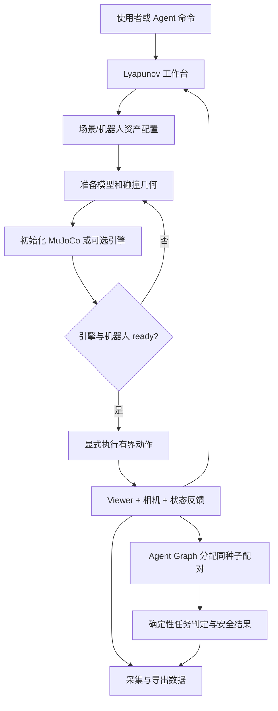
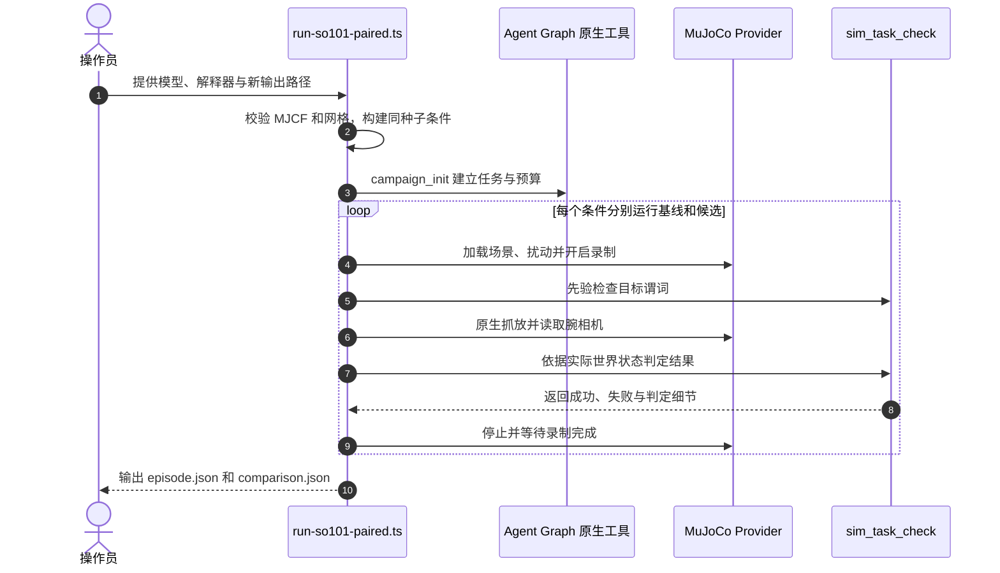

# Lyapunov：面向机器人与仿真的三维智能体工作台（Lyapunov: LLM-first 3D-native Robotics and Simulation Workspace）

## 一句话定义

由 Vorynel 开发的机器人桌面工作台，把对话、代码、文件、三维 Viewer、物理仿真和相机采集放进同一工作区。

## 英文缩写速查

| 缩写 | 英文全称 | 简要说明 |
|---|---|---|
| LLM | Large Language Model | 对话与工具编排层 |
| USD | Universal Scene Description | 三维场景与资产格式 |
| RGB-D | Red Green Blue + Depth | 相机彩色与深度数据 |
| WSL2 | Windows Subsystem for Linux 2 | Windows 上的 Linux 运行环境 |
| DSH | DeepSeek Harness | 工作区的 Agent 会话、工具与后台作业基础 |
| IBVS | Image-Based Visual Servoing | 用图像误差闭环修正机器人 |

## 为什么重要

从场景编辑到真实可控仿真，开发者要同时观察机器人状态、碰撞、相机和脚本；对话式 Agent 只有接到实际工具和物理引擎才可能闭环。

## 核心原理

| 项目 | 内容 |
| --- | --- |
| 机构 | 杭州奇异宇宙人工智能有限公司（Vorynel） |
| 核对版本 | 0.2.7 |
| 能力 | 桌面场景、机器人控制、引擎回执、录像导出和 Agent 工具编排 |

Lyapunov 沿用 DSH/Cordis 组合机制。三维模型可见不等于物理世界已初始化；通过引擎回执核对当前 Scene、world 代次和相机，再执行有界动作。0.2.7 的 `robotics-composition` 将双视角定位、Bi-RRT、资产审计、原生抓放和录制收在一个工作区；Agent Graph 可将调试与独立复现分开，任务真值由确定性谓词计算，不从模型自报得出。

## 流程总览

## 源码运行时序图

以 0.2.7 文档给出的 `script/gates/run-so101-paired.ts` 原生仿真评估路径为例。

离线 Playground 的不同入口 `run-policy.ts` 读取训练回执、提交 `playground_eval_so101` Job、等待结束，再通过 `job_output` 取回结果。两个入口的检查点、场景和成功条件不能混用。

## 工程实践

Linux x64 / WSL2（Ubuntu 24.04+）与 Apple Silicon（macOS 15+）的包均在发行通道提供，固定平台批次和清单后再核验下载；macOS 便携包应保持目录完整，当前未公证。默认 MuJoCo 路径与独立 Playground 环境分开，Isaac Sim/Newton 的支持按引擎和依赖核对。Guest 可用本地场景但没有默认模型。相机轴向深度、射线距离和 Viewer 画面不能互代，RGB-D 标注应绑定引擎真正采集的帧；无有效深度不补猜值。

| 0.2.7 仿真 | 官方结果 | 适用范围 |
| --- | --- | --- |
| SO-101 同种子配对 | 两组均为 5/10 次入盒 | 含 T0–T4 扰动；没有观察到整体完成次数提升 |
| YAM 六轴闭环 | 25 次关节命令后 RMS 39.60 → 0.92 px | 有色标记、真深度、指定单工位 |
| SO-101 Playground 独立评估 | 权重与零动作各 0/6 | 证明入口可运行是官方报告，不是任务成功或上机性能 |

## 局限与风险

未实际安装工作台、运行仿真或连接设备。官网手册仍混有旧 alpha 的命令、尺寸与校验值，不应照抄到 0.2.7；用发行清单核对具体平台及版本。公开提交与安装包清单的构建输入标识不同；不要将两者当作同一提交。论文式对照也应分开看闭环误差、任务成功和安全违规，不能把 YAM 特定仿真工位的像素误差当作 SO-101 或通用真机成功率。

## 与其他工作对比

| 项目 | 侧重 | 如何选 |
| --- | --- | --- |
| Lyapunov | 桌面场景、引擎反馈、录制与确定性任务验收 | 需要在同一工作区观察并配对比较策略 |
| [Robotics Antigravity Plugin](./google-deepmind-robotics-antigravity-plugin.md) | 给编码智能体提供机器人技能与脚本辅助 | 已有 IDE 和仿真工具，希望复用技能协议 |
| [RoboKit](./robokit-openrobokit.md) | ROS 2 真机集成、遥操作和策略服务 | 瓶颈是真机接口打通而非编排仿真实验 |

## 关联页面

- [google-deepmind-robotics-antigravity-plugin](./google-deepmind-robotics-antigravity-plugin.md)
- [robokit-openrobokit](./robokit-openrobokit.md)
- [paper-doppel](./paper-doppel.md)
- [manipulation](../tasks/manipulation.md)
- [model-predictive-control](../methods/model-predictive-control.md)
- [generative-world-models](../methods/generative-world-models.md)

## 参考来源

- [官方源码及运行流程归档](../../sources/repos/lyapunov-vorynel.md)

## 推荐继续阅读

- [官方网站](https://vorynel.com/lyapunov/)
- [GitHub 官方仓库](https://github.com/ManfredCh/Lyapunov)
