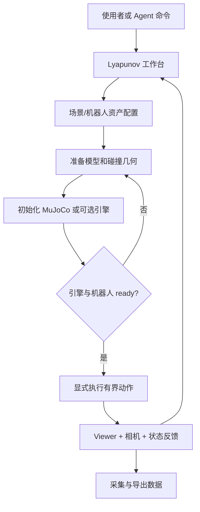
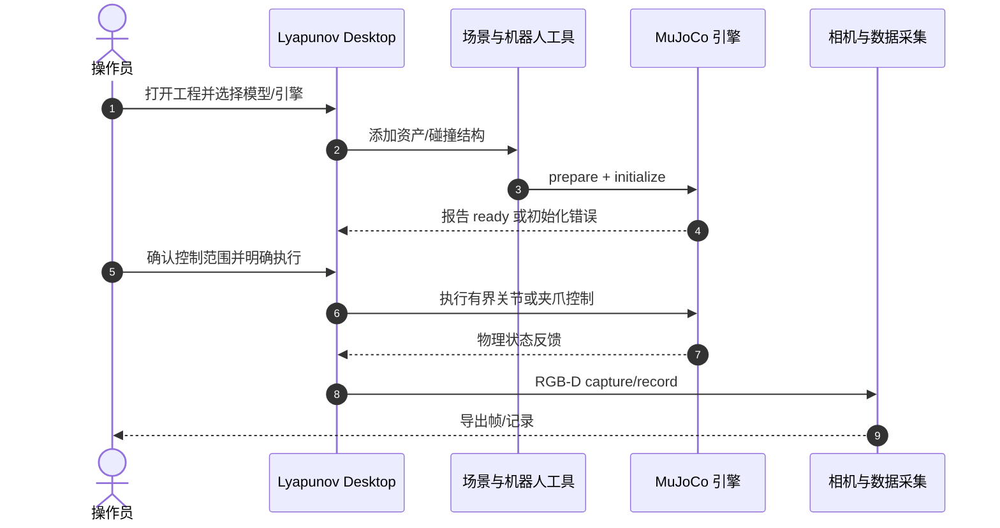

# Lyapunov：面向机器人与仿真的三维智能体工作台（Lyapunov: LLM-first 3D-native Robotics and Simulation Workspace）

## 一句话定义

由 Vorynel 开发的机器人桌面工作台，把对话、代码、文件、三维 Viewer、物理仿真和相机采集放进同一工作区。

## 英文缩写速查

| 缩写 | 英文全称 | 简要说明 |
|---|---|---|
| LLM | Large Language Model | 对话与工具编排层 |
| USD | Universal Scene Description | 三维场景与资产格式 |
| RGB-D | Red Green Blue + Depth | 相机彩色与深度数据 |
| WSL2 | Windows Subsystem for Linux 2 | Windows 上的 Linux 运行环境 |

## 为什么重要

从场景编辑到真实可控仿真，开发者要同时观察机器人状态、碰撞、相机和脚本；对话式 Agent 只有接到实际工具和物理引擎才可能闭环。

## 核心原理

仓库 README 解释插件架构沿用 DSH/Cordis 组合机制；桌面工作区支持 scene、robot、viewer、camera 与可选 MuJoCo/Isaac Sim/Newton。机器人必须按 **prepare → initialize → ready → 显式 execute** 的顺序检查，三维可视化不意味着物理世界已初始化。0.2.5 采用原生场景、文件、终端标签及物理引擎碰撞拓扑显示。

## 流程总览

## 源码运行时序图

以下为 README 已公开的**产品使用／工程运行路径**，不代表本次逐函数源码追踪或实际真机部署。

## 工程实践

官方 Linux x64 / WSL2 0.2.5：可先下载并审阅安装脚本，安装后运行 `$HOME/.local/bin/lyapunov`。默认准备 MuJoCo + Python；Isaac Sim/Newton 需另装。Guest 模式能独立使用本地工作区，但默认没有模型，必须由用户配置。场景颜色/渲染与碰撞几何需分别校验，RGB-D 相机拍摄要核对坐标系和输出格式。

## 局限与风险

**未实际安装或实机验证**；已通读 0.2.5 手册和官方 README，但未对大型 monorepo 每个源码包做逐函数审计。手册中仍保留部分 alpha 版安装参数，应以 0.2.5 发行清单为准。移动体/人形控制的支持不能等同于随意导入机器人模型即可稳定行走。0.2.5 对 Windows WSL2 的设备验收在官方 release note 中也写明未运行；远程模型与 credits 依用户登录和提供商，不能一概声称完全离线。

## 关联页面

- [google-deepmind-robotics-antigravity-plugin](./google-deepmind-robotics-antigravity-plugin.md)
- [robokit-openrobokit](./robokit-openrobokit.md)
- [paper-doppel](./paper-doppel.md)
- [manipulation](../tasks/manipulation.md)
- [model-predictive-control](../methods/model-predictive-control.md)
- [generative-world-models](../methods/generative-world-models.md)

## 参考来源

- [官方源码及运行流程归档](../../sources/repos/lyapunov-vorynel.md)

## 推荐继续阅读

- [官方网站](https://vorynel.com/lyapunov/)
- [GitHub 官方仓库](https://github.com/ManfredCh/Lyapunov)
