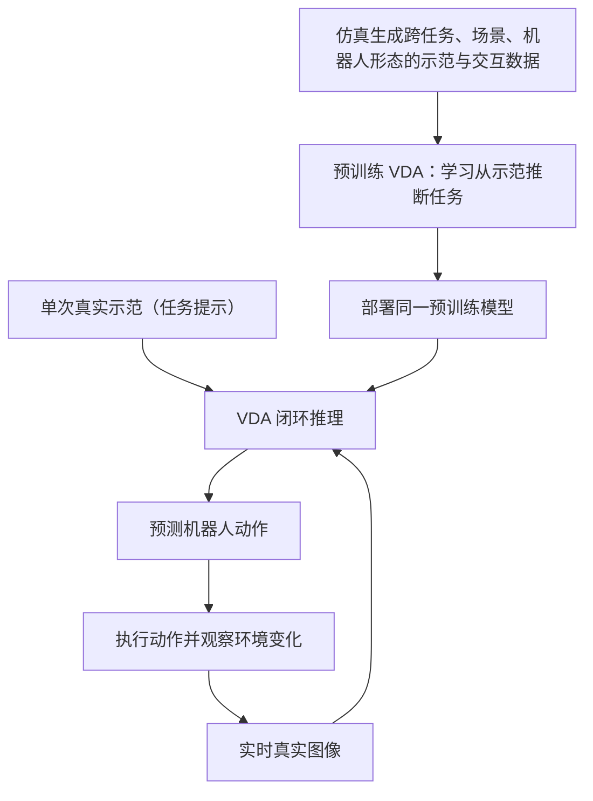

# Machenta 即时机器人学习（Instant Robot Learning）

## 一句话定义

Machenta 的 **即时机器人学习**将单次示范作为任务条件，结合实时图像生成动作；公司称模型仅在仿真中训练，新任务部署时不再进行任务专属训练。

## 为什么重要

任务切换若必须重复采集大量示范并微调策略，会抬高部署与换线成本。Machenta 的方向是把任务适应从**任务专属权重训练**转为**用真实示范作推理上下文**：展示一次，再由同一预训练模型根据实时视觉执行。此处的「即时」是**新任务部署时不做额外训练**，不等于整个基础模型不需要训练，也不保证所有新任务都能一次成功。

该方案对多种夹具、相机、机器人本体及人手示教有潜在价值；不过官网尚未给出独立复现实验，因此目前适合作为机器人上下文学习与纯仿真元学习的研究案例，而非已验证的量产交付承诺。

## 英文缩写速查

| 缩写 | 英文全称 | 简要说明 |
|------|----------|----------|
| VDA | Vision-Demo-Action | 以视觉和示范为条件预测动作 |
| VLA | Vision-Language-Action | 以视觉和语言为条件的动作模型 |
| ICL | In-Context Learning | 从上下文示范适应任务 |
| Sim2Real | Simulation to Real | 将仿真训练得到的能力迁移到真实环境 |

## 核心机制

训练时在仿真中生成跨任务和任务内变化，包括对象、环境、示范及机器人形态；训练目标是从示范中推断任务，而非只记住特定任务。部署时，同一模型接收真实示范与连续真实观测，端到端闭环输出动作，不更新任务专属权重。**真实数据不用于训练**是公司的训练声明，真实示范和实时观测仍是部署输入。

公司将它与常见的任务后训练流程对照；这不是所有 VLA 都必须逐任务重训的普遍结论。其研究脉络包括 Imperial College 的 Implicit Graph Alignment 和 Instant Policy，但博客未披露本模型的完整架构及训练配方。

### VDA 的概念级数据与控制流程

这是依据官方文章绘制的**概念流程**，不是已公开源码的训练或推理调用时序。原文没有披露网络模块、控制频率、动作接口与低层控制器实现，不能推定为具体 VLA/扩散策略架构。

## 公开演示与评测

- **跨形态与示教：** 公司称同一模型用于六种机器人，示教方式包括主从遥操作、VR 控制器、拖动示教及人手示范。人手和人形手实验被描述为初步结果。
- **装配线：** 三台具有不同夹具、相机和示教方式的机器人，演示中两分钟内完成示教并自动工作。
- **连续一小时测试：** 三个可自复位、相对简单的任务分别为放置积木 74/74、螺丝刀往返交接 78/78、瓶子扶正 97/99。数据为公司自报，不能外推到所有任务或长期生产。
- **交互扩展：** 多次示范可用于消歧或拼接子任务，因此“一次示范”不意味着复杂任务均只需一次。

## 工程实践

若要评估它在真实产线是否可用，应分层验收，而不是只看首次演示：

1. **示教和换线成本**：记录每次示教耗时、需要几次补充示范，及不同操作员/示教方式的一致性；官网的「两分钟装配线」仅为演示案例。
2. **任务与环境外推**：针对未见物体、相机位姿、夹具更换、目标物位置交换设计分层测试，单独统计成功率与重试次数。
3. **闭环恢复与安全**：注入中途干扰和可恢复失败，监控碰撞、运动学约束、复位与人工接管；官网瓶子扶正试验的两次失败分别发生在 0:46 与 0:52 附近，公司归因为潜在碰撞和运动学限制。
4. **可复现性**：截至 2026-11-17 官方介绍未提供模型权重、数据集或可运行代码，无法依据公开材料搭建同款 VDA 推理栈，不能伪造源码运行时序图。

## 局限与工程判断

截至 2026-11-17，官方文章未列公开代码、权重或训练数据链接，也未提供完整独立基准和训练细节，暂不能独立复现。部署评估应另行测量示教质量、未见物体、扰动恢复、失败率与安全边界。公司关于扩大仿真数据和算力可继续提升能力的表述是待验证假设。

与 [GEN-1.5](./generalist-gen15-one-shot.md) 的关键差别在训练数据路径：Machenta 声称纯仿真训练并以真实示范提示；GEN-1.5 报告基于真实物理交互预训练，也展示仿真示范提示真机。两者自报实验条件不同，不宜直接比较成功率。

## 关联页面

- [机器人上下文学习](../concepts/robot-in-context-learning.md)
- [模仿学习](../methods/imitation-learning.md)
- [机器人操作](../tasks/manipulation.md)
- [Foundation Policy](../concepts/foundation-policy.md)

## 参考来源

- [Machenta 官方介绍归档](../../sources/sites/machenta-instant-robot-learning.md)

## 推荐继续阅读

- [Machenta：Introducing Instant Robot Learning](https://machenta.com/blog/instant-robot-learning)
- [Instant Policy：In-Context Imitation Learning via Graph Diffusion](https://www.robot-learning.uk/instant-policy)
