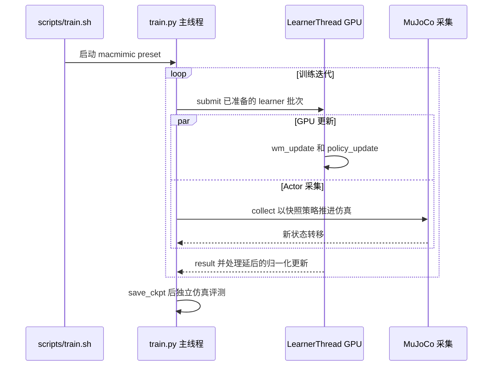

# MacMimic: Whole-Body Motion Tracking on Apple Silicon | Apple Silicon 上的人形全身动作跟踪

## 一句话定义

MacMimic 在 Apple Silicon 上本地训练模拟 Unitree G1 跟踪动捕参考，CPU 跑批量 MuJoCo，GPU 用 MLX 更新可微世界模型、策略和价值网络，无需 CUDA。项目及源码由 Jian Zhang 的个人账号 air23zj 发布；公开的一手材料没有将其标为 Meta 官方项目。

## 英文缩写速查

| 缩写 | 英文全称 | 简要说明 |
|---|---|---|
| MLX | Apple MLX | Apple Silicon 上的数组与机器学习框架 |
| BPTT | Backpropagation Through Time | 沿想象轨迹反传策略梯度 |
| WM | World Model | 从仿真经验学习状态转移的模型 |
| G1 | Unitree G1 | 实验使用其仿真模型 |

## 为什么重要

单台 Mac 可以学习并调试基于可微世界模型的全身跟踪，不必能访问 CUDA 机器。它最有价值的对照是同硬件训练后端和调度，不是硬件代际排名。

## 核心原理

继承 BlinkMimic 对 SuperMimic 的实践，并借鉴 XMimic 的采样与学习重叠。G1 参考动作经数据脚本下载；CPU 侧并行推进 4,096 个仿真环境，GPU 侧拟合状态转移；在 WM 的想象轨迹上用 BPTT 更新策略，并由价值函数处理展开末端。

## 工程实践

按作者 README 依次做 `uv sync`、`tools/download_data.sh` 和 `tools/urdf_to_mjcf.py`，由 `bash scripts/train.sh macmimic logs/macmimic_s0 --seed 0` 启动。下载资源需要网络，训练无需云算力；评测后用 `tools/time_to_target.py` 复核耗时。下面只描绘源码已开放的训练和仿真路径。

具体迭代有首次编译或切换 shape 等串行分支，不应假定每一轮都并行。

## 实验与评测

作者报告：M4 Pro 48 GB 三个种子达到 21.0 / 21.3 / 22.5 分钟，均值 21.6。阈值是 40 条 LAFAN1 **训练同集**片段，归一化 return ≥0.82 且零失败，连续三个间隔 100 次迭代的检查点达标，回记该序列第一个检查点。不是从训练开跑到第三个检查点全验完的耗时。

## 与其他工作对比

同一 Mac 的 BlinkMimic **MLX 移植**单次达标时间为 44 分钟；严格阈值下耗时约二分之一，但达到阈值时该对照回报 0.847、身体位置误差 3.94 cm，MacMimic seed 0 分别为 0.822、4.42 cm。没有测出新版 MacMimic 的等质量增益，也不能把该结果用于比较 RTX 上原始 BlinkMimic 或 XMimic 的时间。

## 局限与风险

无真机运行或跨分布泛化证据；未核实公开策略权重。本次只做来源和代码静态核查，未在 Mac 上重新训练。MIT 仅适用于代码，LAFAN1 及重定向数据须遵守相应许可。

## 关联页面

- [BlinkMimic](./blinkmimic.md)、[SuperMimic](./paper-supermimic.md) 和 [XMimic](./paper-xmimic-jax.md)
- [基于模型的强化学习](../methods/model-based-rl.md)：理解仿真采样和模型内策略更新的边界。
- [BeyondMimic](../methods/beyondmimic.md)：对照全身跟踪参考接口。
- [BFM 纵深路线](../../roadmap/depth-bfm.md)

## 推荐继续阅读

- [作者实验记录](https://github.com/air23zj/macmimic/blob/d9a9c745d1be5179ddb46dda424be3d819bf4823/RESULTS.md)
- [项目主页](https://air23zj.github.io/macmimic/)

## 参考来源

- [MacMimic 官方仓库与实验结果归档](../../sources/repos/macmimic.md)
