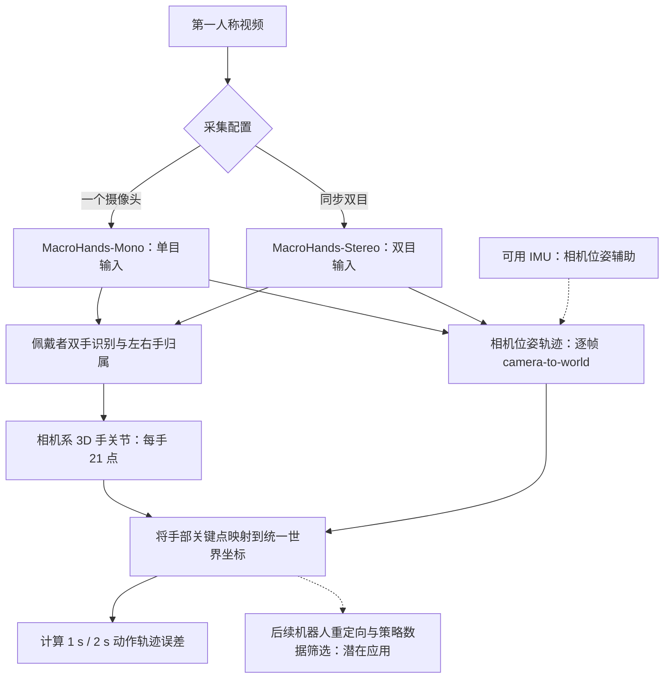

# MacroHands：从第一人称视频恢复三维手部与相机轨迹（3D Hands and Camera Pose from Egocentric Video）

## 一句话定义

**MacroHands** 是 **Macrodata Labs** 于 **2026 年 11 月 10 日**通过[官方技术博客](https://macrodata.co/blog/macrohands-3d-hands-and-camera-pose-from-egocentric-video)公布的一组单目（Mono）/双目（Stereo）第一人称视觉模型：估计佩戴者每只手的 3D 关节和逐帧相机位姿，以恢复对机器人示范数据有用的真实尺度手部运动；这是**项目技术发布，不是已公开论文或开源实现**。

## 英文缩写速查

| 缩写 | 英文全称 | 简要说明 |
|---|---|---|
| Ego | Egocentric | 头戴第一视角，与第三人称外部摄像头有别 |
| MPJPE | Mean Per-Joint Position Error | 预测 3D 手关节与真值之间的平均距离 |
| PA-MPJPE | Procrustes-Aligned MPJPE | 经尺度/旋转/平移最佳对齐后的关节误差，只看形状 |
| Cam-MPJPE | Camera-frame MPJPE | **不对齐**的相机系三维误差，包含深度偏差 |
| ATE | Absolute Trajectory Error | 整段相机轨迹的位置误差 |
| RPE | Relative Pose Error | 每 1 秒短时相机运动误差 |
| IMU | Inertial Measurement Unit | 惯性传感器；部分相机位姿评测使用 |
| HOI | Hand–Object Interaction | 手物交互数据，后续可用于机器人动作提取 |

## 为什么重要

- **机器人动作要的是世界系位移，而不只是好看的手形。** 单目相机深度尺度错几厘米，手腕目标也会跟着错；单看 root-relative 或 PA-MPJPE 无法发现。
- **实际示范数据有遮挡和干扰。** 操作者的手经常被工具遮住，镜头里还可能出现其他人的手、脚或手套，不能把它们错误当成操作者动作。
- **头戴镜头自身在动。** 仅恢复相机坐标中的手部关节，会混入头部移动；还需相机到世界的轨迹才能推导手在工作空间中的运动。

## 核心原理

### 任务边界、输入输出

- **输入：** 头戴单目视频（MacroHands-Mono）；或同步双目视频（MacroHands-Stereo）。在部分相机位姿设置中还可使用可用的 IMU 信号。
- **输出：** 每帧佩戴者左/右手的 3D 关键点（标准每手 21 点，在相机系中），相机的旋转/平移轨迹（camera-to-world）。
- **世界系组合：** 概念上以 `p_world(t) = T_world_camera(t) · p_camera(t)` 将相机系关键点放回统一世界系，再以动作块起始帧的相机为参考比较未来 1 秒/2 秒轨迹。这里是坐标变换与官方评估协议，**不是作者披露的神经网络层级结构**。

### 流程总览（公开资料可证实的数据流）

**边界说明：** 官方博客没有披露手部识别、3D 回归和相机轨迹之间的内部神经网络连接方式；图中的分支与箭头只表达官方明确的输入输出、评价和下游可能用途，并非复现代码。

### 评测方法：不要把对齐指标当作机器人动作误差

| 指标 | 怎么比较 | 会不会掩盖尺度/漂移 |
|---|---|---|
| Cam-MPJPE | 相机系预测与真值逐关节距离，**无对齐** | 不掩盖深度错误 |
| PA-MPJPE | 对每只手做最佳旋转/平移/尺度对齐后测形状 | 会掩盖真实位置与深度错误 |
| 检测 Recall / AP50 | 左右手身份正确、投影 2D 框与真值重叠度大于 0.5 | 会把漏检和误认他人手计入质量 |
| ATE / RPE | 相机全段漂移 / 1 秒局部增量；ATE 仅刚体对齐不拟合尺度 | 衡量轨迹漂移和尺度准确性 |
| Action MPJPE | 使用**各方法自己的**相机路径，将未来 1 s/2 s 手部轨迹统一到起始相机系，无对齐 | 同时计入手部和相机误差 |

### 作者公开评测结果

以下全为 **Macrodata Labs 作者报告**，未独立复测。比较须限定相同 benchmark、输入与指标。

| 测试与指标 | MacroHands | 对照方法 | 说明 |
|---|---|---|---|
| SHOW3D Cam-MPJPE（mm） | **Mono 32.2 / Stereo 13.1** | HaWoR mono 55.9；UmeTrack stereo 46.4 | 双目深度显著改善 |
| SHOW3D PA-MPJPE（mm） | Mono 8.4 / Stereo 8.5 | — | 校正后手形几乎无差异 |
| HOT3D Cam-MPJPE（mm） | Mono 12.2 / Stereo 10.6 | UmeTrack stereo 46.2 | 不应与 SHOW3D 直接跨集对比 |
| ARCTIC s05 Cam-MPJPE（mm） | Mono 19.4 | **ACE-Ego-Hand 18.7** | 该指标不是 MacroHands 最优；ACE 基线训练过 ARCTIC |
| Monado stereo+IMU ATE（cm） | 5.7 | DROID-SLAM 23.6 | 仅一次刚体对齐、不允许缩放 |
| Aria Gen 2 stereo+IMU ATE（cm） | 18.9 | DROID-SLAM 74.0 | 整段轨迹 |
| HOT3D stereo Action MPJPE @1s（mm） | **13.6** | HaWoR + 自有 SLAM/补帧 65.9 | 手 + 相机综合误差 |

内部手部检测 benchmark：整体 AP50 75.8%（HaWoR 43.3%）；其他人的手误识别占输出 0.2%（HaWoR 23.6%）；遮挡条件的佩戴者手检出 80%（基线最高 59%）；戴手套 79%（基线最高 48%）。**该内部基准未公开，无法独立复算。**

## 工程实践

| 环节 | 可执行的评估建议与公开状态 |
|---|---|
| 数据采集选型 | 新采集优先考虑已标定双目；现有单目素材可用于 MacroHands-Mono 的厂商试跑对照 |
| 数据标定 | 记录原始帧率、相机内参、双目外参、同步与 IMU 时间戳，避免位姿链无意义 |
| 手部质量门控 | 同时检查 3D 深度误差、左右手交换、他人手误认、遮挡下召回和无手帧误检 |
| 轨迹质量门控 | 测整段 ATE、1 秒 RPE、尺度误差，以及各方法自己相机路径上的 Action MPJPE |
| 对下游策略 | 将 3D 手部运动视为动作提取的上游候选；仍需 [动作重定向](../concepts/motion-retargeting.md)、接触可行性、动作空间映射与真机评估 |
| 获取模型 | 官方博客可提交视频由 Macrodata Labs 试标注；**截至 2026-11-15 未找到公开权重、源码、SDK、独立论文 PDF** |
| 源码运行时序图 | **不适用**：无官方可运行代码与可核实推理入口，不能虚构运行模块与时序 |

## 结论

**MacroHands 的主要价值是把第一视角视频中的“手的位置”与“头戴相机的位置”一起评估为世界系动作质量，而不是只提升对齐后的局部手形分数。**

1. 选评测标准时，优先 Cam-MPJPE 和 Action MPJPE，防止 PA-MPJPE 掩盖尺度问题。
2. 新设备的双目收益主要来自深度；单目仍需明确三维绝对尺度风险。
3. 手部跟踪器必须识别“佩戴者是谁”，遮挡、手套、多人/脚出现均需专门测试。
4. 相机轨迹应同时看长期 ATE 和动作块尺度的 RPE，尤其要检查 IMU 的输入公平性。
5. 公开 benchmark 显示若干优势，但**不能凭内部商业评测推断已改善机器人策略成功率**。

## 与其他工作对比

- [EgoMo3R](./paper-egomo3r.md) 同样涉及 egocentric 相机位姿，但核心是单目场景与 **SMPL-X 全身运动**的离线联合重建；MacroHands 聚焦 **手部 3D 关键点和相机位姿**，不宣称恢复完整场景或全身。
- HaWoR、WiLoR、HaMeR 等是官方对照基线；只能在相同 SHOW3D/HOT3D/ARCTIC 的协议与训练集条件下解释结果。
- UmeTrack 是双目基线，但官方披露其评测用 WiLoR 检测框；因此对照包含预处理差异。

## 局限与风险

- **尚不能独立复现。** 本次收录基于官方技术博客；未披露可运行模型、权重、训练配置或完整内部架构。
- **厂商自测。** 私有手部检测测试集不公开；公开 benchmark 比较也仅是作者按自选协议产生的数据，并非第三方复现。
- **不能推断下游真机效果。** 尚无真实机器人行为克隆成功率、接触质量、策略部署时延和故障恢复的完整验证。
- **跨数据集/训练公平性。** ARCTIC 的 ACE-Ego-Hand 18.7 mm 优于 MacroHands 19.4 mm，且部分基线使用了相同训练数据；HOT3D 与 SHOW3D 样本规模有限。
- **相机轨迹真值问题。** 作者因 SHOW3D 相机姿态在部分头转场景不正确而未在其上报告 Action MPJPE。

## 关联页面

- [Awesome Egocentric Vision](./awesome-egocentric-vision.md) — 第一人称视频技术谱系与学习导航。
- [EgoMo3R](./paper-egomo3r.md) — 全身人体与场景联合重建，比较输出范围与场景用途。
- [Motion Retargeting](../concepts/motion-retargeting.md) — 把人体手部运动变成机器人可用动作仍需的独立环节。
- [动作重定向纵深 Stage 2](../../roadmap/depth-motion-retargeting.md) — 视频参考动作的数据源与质量控制。

## 参考来源

- [MacroHands 官方技术博客原文归档](../../sources/sites/macrohands_macrodata_20261110.md)
- [Macrodata Labs 官方发布与详细评分规则](https://macrodata.co/blog/macrohands-3d-hands-and-camera-pose-from-egocentric-video)

## 推荐继续阅读

- [MacroHands 官方：Evaluating 3D hands](https://macrodata.co/blog/macrohands-3d-hands-and-camera-pose-from-egocentric-video#evaluating-3d-hands)
- [SHOW3D 原论文（3D 手部与物体真实值）](https://arxiv.org/abs/2603.28760)
