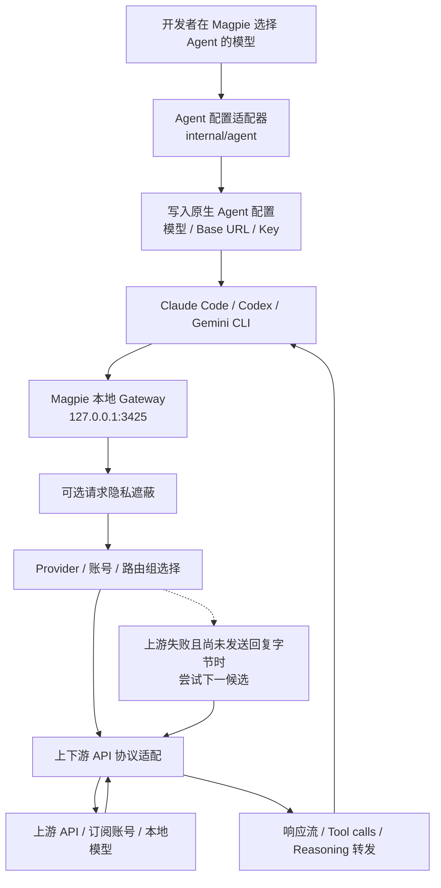
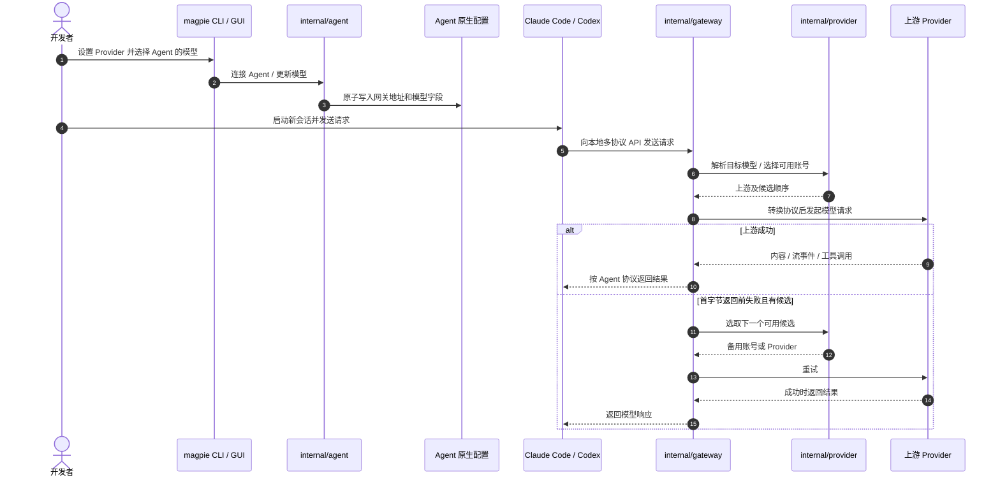

# Magpie：跨 Agent 的本地模型网关 / One Model Gateway for Coding Agents

## 一句话定义

**Magpie**（[yetone/magpie](https://github.com/yetone/magpie)）是面向 **多个 AI Coding Agent 的本地模型控制面**：统一管理 Provider、订阅账户、模型选择和本地 API Gateway，在不同 Agent 的原生配置与上游模型服务之间做路由和协议适配。

## 英文缩写速查

| 缩写 | 英文全称 | 简要说明 |
|------|----------|----------|
| LLM | Large Language Model | 供 Coding Agent 调用的模型推理服务 |
| API | Application Programming Interface | Agent 请求与上游 Provider 之间的接口协议 |
| CLI | Command-Line Interface | `magpie` 命令行及 Claude Code / Codex 等终端 Agent |
| TUI | Text User Interface | `magpie tui` 本地终端交互界面 |
| MCP | Model Context Protocol | 工具扩展生态的一层；不同于本页 LLM 协议网关 |
| SSE | Server-Sent Events | 上游/下游流式响应的事件承载形式 |

## 核心信息

| 字段 | 内容 |
|------|------|
| 作者 / 组织 | yetone / Magpie |
| 定位 | 跨 AI Agent 的模型切换、Provider 复用、本地请求网关 |
| 平台 | macOS、Windows、Linux；另有 Docker、Termux 使用方式 |
| 默认地址 | `http://127.0.0.1:3425`（本机 Gateway） |
| 入口 | GUI / 菜单栏、`magpie tui`、`magpie` CLI、`magpie web` |
| 代码 | https://github.com/yetone/magpie |
| 官网 | https://usemagpie.ai/ |
| 许可与开放程度 | **MIT，已开源**；不附带第三方大模型权重或订阅权益 |
| 原文核对 | 官方 README、项目官网、子系统架构文档与关键 Go 入口（见归档） |

## 为什么重要

- **统一模型面，不重做 Agent 环：** Claude Code、Codex、Gemini CLI 等各有原生配置与协议；Magpie 把模型和账号选择集中在一个本地 Gateway，保留各 Agent 自己的代码执行、审批和工具链。
- **多后端可切换：** 一个 Provider 可以供多个 Agent 使用；按单模型或路由组为不同任务选择不同上游，适合比较模型的编码、分析与修复表现。
- **配额与故障隔离：** 可为多个账号设置路由和故障转移，但依赖可用候选账户，不是无限额度。
- **机器人研发适用边界：** 它可承载编写 ROS2 节点、评审控制代码、定位 CI 失败等 *开发辅助请求*；不参与控制器的硬实时闭环。

## 核心原理

### 组件与责任分工

| 层 | 项目源码 / 官方文档依据 | 作用 |
|----|-------------------------|------|
| 启动与控制 | `main.go` → `internal/cli.Main` | CLI、GUI/TUI/Web 与服务管理入口 |
| Agent 适配 | `internal/agent`、`docs/subsystems/agent-wiring.md` | 识别 Agent 原生配置字段，写入/断开时还原模型及网关参数 |
| Provider 与账号 | `internal/provider` | 管理 API Key、订阅账号、Provider、路由组和候选顺序 |
| 统一网关 | `internal/gateway` | 接收 OpenAI Chat/Responses、Anthropic Messages、Gemini 请求，并转接上游 |
| 插件和隐私 | 内置插件 / Gateway middleware | 请求/响应扩展；本地敏感值遮蔽为**可选开启** |

### 流程总览

以下数据流依据 [README](https://github.com/yetone/magpie/blob/main/README.md)、[Agent wiring](https://github.com/yetone/magpie/blob/main/docs/subsystems/agent-wiring.md) 与 [Gateway routing](https://github.com/yetone/magpie/blob/main/docs/subsystems/gateway-routing.md) 归纳：

### 源码运行时序图

已核对可执行入口 `main.go` 的 `cli.Main(version)`、`internal/cli/start_cli.go` 对启动型 Agent 的环境注入、`internal/agent` 配置职责、`internal/provider/provider_order.go` 的候选顺序与 `internal/gateway/gateway_hooks.go` 响应捕获。完整 Gateway 大文件未逐行审计，以下限定于这些**已核实的模块边界**：

**最短复现：** 安装 `magpie` → `magpie provider add deepseek <API_KEY>` → `magpie claude deepseek/<model-id>` → 重启目标 Agent 会话并发起请求；观察 `magpie` 的 Routing / Usage 记录。按官方提示使用你实际有权限的 Provider/模型 ID，不复制 README 中不断变化的示例型号。

## 工程实践

| 场景 | 建议 |
|------|------|
| 多编码 Agent 统一后端 | 在 GUI、TUI 或 CLI 选择 Provider 和目标模型；区分原生订阅与 API Key 的实际授权 |
| 与机器人研发 CI 结合 | 将 Coding Agent 配置到 Magpie；改动仍在独立分支接受 lint、单测、仿真和人工审查 |
| 路由与故障转移 | 多个可用账户或路由组才有备用；上游已开始流式输出后不可保证无缝重试 |
| 敏感信息 | Settings → Privacy 的本地遮蔽需**显式开启**；示例配置不得记录真实 Token |
| 跨机部署 | 默认 loopback；对远程客户端按官方文档配置 Gateway Key、TLS/访问边界 |
| 复现实验 | 分别记录 Agent、模型 ID、供应商、路由、上下文与成本；对比时固定运行任务与评测脚本 |

## 局限与风险

- **不是 LLM 或机器人物理控制框架：** 不提供模型权重、具身策略、运动控制接口或硬实时控制周期。
- **隐私遮蔽默认关闭：** 仅声称“网关在本机”不能推出所有 Prompt 内容都留在本机；请求仍发送至选定上游。
- **订阅与模型跨 Agent 使用有条件：** 以各 Provider 的授权、可用性、协议能力及平台条款为准；跨协议适配并不保证所有特性语义无损。
- **故障转移有窗口：** 上游开始输出后，正在执行的流/Tool round 不承诺任意时间点透明切换。
- **未经本机实测：** 此页基于官方一手文档和关键入口阅读，不表示已经验证 Windows/Linux 各发行版的安装、性能或安全性。

## 与其他工作对比

| 项目 | 核心解决问题 | 与 Magpie 的边界 |
|------|-------------|-----------------|
| [Magpie](./magpie.md) | 多 Agent 复用模型、账号与本地 API 网关 | 模型连接控制面 |
| [DeepSeek Harness](./deepseek-harness.md) | 插件化 Agent loop、工具和 Session 执行 | Agent 宿主/执行面，可使用外部模型网关 |
| [Hermes Agent](./hermes-agent.md) | 持久 Agent 运行时、记忆、技能、消息入口 | Agent OS，可对照多后端接入 |
| [Codex CLI](./openai-codex-cli.md) | 代码仓库任务执行、审批、沙箱 | Magpie 连接的下游 Agent 之一 |

## 关联页面

- [DeepSeek Harness](./deepseek-harness.md) — Agent 运行时，对照路由层与执行层
- [Hermes Agent](./hermes-agent.md) — 长驻代理及模型选择的上层使用者
- [Codex CLI](./openai-codex-cli.md) — 官方源码型编码 Agent，Magpie 可适配其模型端点
- [OpenClaw](./openclaw.md) — 对照助手运行时与模型连接控制面
- [Coding Agent 验证闭环](../methods/coding-agent-verification-loops.md) — 将编程代理变更交给测试和工程证据验收
- [Agentic Manipulation Policies](../methods/agentic-manipulation-policies.md) — 具身 Agent Policy；与本工具的非实时开发辅助面保持边界
- [Model Context Protocol](../concepts/model-context-protocol.md) — Tool/Resource 协议与 LLM 推理请求协议的区别

## 参考来源

- [Magpie 官方仓库原文与源码核对](../../sources/repos/yetone-magpie.md)
- [Magpie 官方项目站点及开放情况](../../sources/sites/usemagpie-ai.md)

## 推荐继续阅读

- [官方英文 README](https://github.com/yetone/magpie/blob/main/README.md)
- [Agent wiring 架构说明](https://github.com/yetone/magpie/blob/main/docs/subsystems/agent-wiring.md)
- [Gateway routing 与 fallback 机制](https://github.com/yetone/magpie/blob/main/docs/subsystems/gateway-routing.md)
