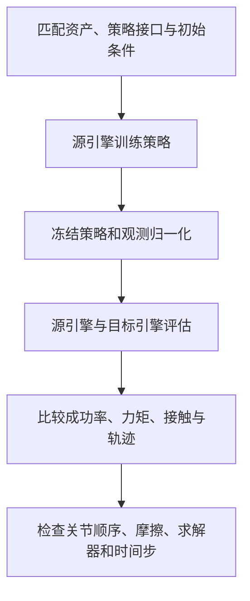

# Manda Robotics：机器人仿真物理引擎比较（2026-10-05）

这篇 Manda Robotics 文章通过逐步增加场景复杂度，比较**同一 Franka Panda、匹配资产与共同控制器**在四种物理实现中的行为。重点不是给引擎排一个“谁最准”的名次，而是说明同一成功/失败标签、相近的视觉轨迹可能掩盖不同接触力、运动路径、重复性和软体求解行为。

## 英文缩写速查

| 缩写 | 全称 | 含义 |
|---|---|---|
| TGS | Temporal Gauss-Seidel | PhysX 接触求解器路径之一 |
| GPU | Graphics Processing Unit | 图形处理器 |
| Sim2Real | Simulation to Real | 仿真到真实机器人迁移 |
| Panda | Franka Emika Panda | 文中用于跨引擎测试的机械臂 |

## 研究问题与范围

文章在共同场景规范、机器人模型、初始状态、控制器与资产条件下逐步增加接触复杂度。对照组为 PhysX、Newton 中的 MuJoCo-Warp、原生 MuJoCo CPU 和 Genesis。作者先审计导入后的质量/惯量、坐标、关节约束与碰撞模型，再进行滑动、碰撞、机械臂运动、堆叠/推挤、插入、软体抓取、控制器选择和运行速度实验。

### 配置不是“只换引擎”

| 实现 | 文章所测配置 | 接触/精度提示 |
|---|---|---|
| PhysX | Isaac Sim 6.1.0.0 · CPU TGS · float32 | 硬约束接触；与软接触实现存在接触族差异 |
| Newton + MuJoCo-Warp | Newton 1.5.2 / MuJoCo-Warp 3.11.0 / Warp 1.16.0 · GPU · float32 | 原生 MuJoCo-Warp 接触；文章配置 |
| MuJoCo CPU | MuJoCo 3.11.0 · CPU · float64 | 软接触；文章配置，不是真机真值 |
| Genesis | Genesis 1.4.1 · GPU · float64 | 原生刚体求解器；柔体另有耦合路径 |

所有实验运行于文章所述 RTX PRO 5000 实例；runtime 测试另注明 Ryzen 9 9900X 主机。CPU/GPU、float32/float64、接触族以及软体耦合差异都属于比较条件，结论应限定在这些版本和设置内。

## 方法：由简单控制到多接触操作

作者递增场景难度：单物体滑动/落下/铰链 → 多物体碰撞链 → Panda 无接触运动与关节跟踪 → 抓取、堆叠和多块推挤 → 拥挤场景与 peg insertion → 软体球抓取 → 控制器网格选择 → 批量吞吐量。多次 repeat、初始布局微扰和减半时间步用于部分场景的敏感性检查。

## 评测结果

- **总体运动相似，不代表接触等价。** 滑块停止端点只差约 0.05 mm，而部分接触力峰值最多约差 10 倍。视觉上相近的 rollout 仍可能有不同的力历史。
- **复杂接触放大路径差异。** 多物体碰撞、窄通道推挤中，相同任务成功/失败标签可对应不同物体端点；部分小布局扰动造成毫米至厘米级的路径变化。
- **成功分数会藏起控制误差。** 在 90 mm/80 mm 通道的推挤控制器比较中，各引擎的粗成功结果一致；按 effort 选出的控制器节省约 33–36% 手臂 effort，却可带来更大的手部高度偏差。成功率本身无法代表轨迹跟踪质量。
- **紧间隙插入对接触族敏感。** 文中 0.10 mm 径向间隙的特定倾斜场景里，软接触配置通过接触反馈能达到目标深度，而硬接触 PhysX 在该设置下仍触发过载停止；不应外推为所有 PhysX 配置都不能插入。
- **软体差异最大且尚未收敛。** 同名材料/抓取目标在不同求解器组合下得到不同的保持、下放或有效性结果；网格加密与步长缩小没有一致地消除差异。

## 跨引擎策略训练与迁移（2026-10-28）

系列第二篇从固定控制器转向**学习策略**：PPO 插入策略在 MuJoCo 训练、四种实现评估；ANYmal 行走与 Franka 抓取分别在 PhysX、Newton 训练并交叉测试；RoboLab 的 π0.5 在两个后端对比。插入实验中的 Newton 使用 MuJoCo-Warp，并非独立于 MuJoCo 的接触模型族。

- **插入**：五个种子在 MuJoCo 各成功 49–50/50 次，在 PhysX GPU 分别为 49、47、32、47、11/50；定义的过载停止计作失败。增加力惩罚使五种子 PhysX 均值从 74.4% 升至 84.0%，收益主要来自最弱种子。
- **求解器**：最脆弱种子在 25 个留出初始条件上，PhysX TGS 100/1 成功 5 次、PGS 21 次、TGS 4/0 19 次；较多迭代并不保证该策略迁移更稳健。
- **四足**：在 1 m/s 行走实验中，PhysX 训练的 ANYmal 在两种评测引擎中平均使用约高 35% 的关节力矩。默认配置 PhysX→Newton 跌倒 11/320，Newton→PhysX 2/320。按名称映射关节顺序并读回实际摩擦及接触配置后才能解释比较；实验主要为探索性。
- **抓取抬升**：标准条件下 Newton→Newton 88%、Newton→PhysX 68%；PhysX→PhysX 82%、PhysX→Newton 53%（各 512 episode）。每后端只有一个训练种子，初始状态并非逐 episode 配对，不能将全部差距归因于后端动力学。
- **通用策略**：π0.5 在部分 RoboLab 场景成功率相近时，失败抓取行为仍有差异。木铲任务使用 PhysX 中 104 条成功轨迹做 LoRA 监督微调：PhysX 从 22/50 升至 34/50；共同的 40 条噪声配对试验中，Newton 从 4/40 升至 12/40，增益统计不确定。Newton 中同一初始场景会重新落稳，训练场景与评估布局不同，无法分离这一差异与抓取动力学的影响。需同时检查接触事件、场景初始静止状态和轨迹。

两篇原文正文及第二篇附录已通读；软球 pilot 存在网格无效和不同观测归一化，不能将差异简单归因于物理引擎。抓取任务仅一个训练种子，恢复训练时重置课程和初始状态库，也不能将进步单独归因于增加迭代。

两篇文章没有通过真机 ground truth 建立引擎精度排名；跨引擎成功也不保证真机成功。

### 源码运行时序图

**待补充。** 第二篇公开了部分评测、导出脚本和数据，但本次读取环境无法获取 Python 脚本内容，尚未核实具体运行入口及模块调用关系；原始 checkpoint、冻结场景和完整原生轨迹未包含在下载导出中。不可将本文图示当成源码运行时序图。

## 性能与吞吐量

在文中无渲染、1 ms 步长的 Franka 测试里，单环境 MuJoCo CPU 约 0.17M steps/s；单环境 MuJoCo-Warp / Genesis GPU 路径约 0.006M / 0.002M steps/s。8,192 个并行 world 时，MuJoCo-Warp 与 Genesis 分别约 21.6M / 11.8M steps/s；131,072 world 时约 35.2M / 26.4M。文章没有批量测试 PhysX；MuJoCo CPU 也只测单 world。因此这些数字只适合说明**本文具体路径下单环境与大批量 GPU 的交叉点**，不是通用硬件排行榜。

## 结论与边界

文章最有用的实践结论是：**跨仿真比较应从导入审计开始，先做单物体 sanity check，再逐步进入机器人接触；评价时联合看成功/失败、接触力、轨迹、重复性和性能。** 仅凭同一 task success 率或视频外观，不足以判断策略鲁棒性或物理结果一致。

重要边界：本文比较的是特定引擎版本、特定 CPU/GPU 路径和有限场景；多数结果为单次运行，repeat 只覆盖部分场景；没有任何真机测量作为物理 ground truth。文章明确指出 MuJoCo CPU 只是方便的基线，不是现实真值。故它不能单独证明哪款引擎整体“物理最准”，也不能替代真实机器人上的 sim-to-real 验证。

## 可复核资产

文章的各场景提供 metrics、audit notes 与 replay。源归档列出碰撞链、推挤与 runtime protocol 示例；更多项目内链接见[原文可复现章节](https://mandarobotics.com/blog/comparing-physics-engines/index.html#reproducibility)。目前页面提供的是逐场景数据/回放/设置说明，不应误称为一个独立开源引擎或端到端代码仓库。

## 关联页面

- [仿真器选型指南](../queries/simulator-selection-guide.md) — 把跨引擎实证差异纳入机器人 RL 选型
- [机器人仿真三层分工](../concepts/robot-simulation-three-layers.md) · [仿真评测基础设施](../concepts/simulation-evaluation-infrastructure.md)
- [MuJoCo](./mujoco.md) · [Isaac Sim / PhysX](./isaac-sim.md) · [Newton Physics](./newton-physics.md) · [Genesis](./genesis-sim.md)
- [具身大模型评测基准选型闭环](../queries/embodied-eval-benchmark-selection-loop.md) — 本页对应其 ④ sim↔real 评测 gap 校准层：同一 success 标签下跨引擎接触力/轨迹差异，提醒仿真评测分数须限定在具体引擎配置内

## 参考来源

- [Do robot policies transfer between physics engines?](https://mandarobotics.com/blog/policy-transfer/index.html) · [来源归档](../../sources/blogs/mandarobotics_policy_transfer_2026-10-28.md)

- [Manda Robotics 原文](https://mandarobotics.com/blog/comparing-physics-engines/index.html)
- [配套背景文章：Comparing physics engines primer](https://mandarobotics.com/blog/comparing-physics-engines/primer.html)
- [论文来源归档与实验数据链接](../../sources/blogs/mandarobotics_comparing_physics_engines_2026-10-05.md)
