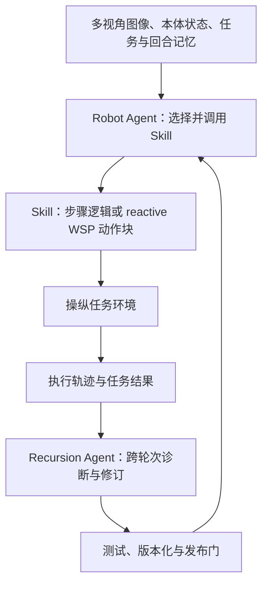

# WorldScape R²SI（Manifold AI）

**WorldScape R²SI**（*Recursive Robot Self-Improvement*，机器人递归自我改进）是 Manifold AI 在媒体报道中介绍的具身执行后改进系统：内层 Agent 调用技能执行操作，外层 Agent 根据跨轮次执行记录改写技能，必要时训练更新 WorldScape Policy（WSP），并在测试通过后版本化发布。当前公开细节来自报道，尚无 R²SI 独立论文或可复现实现。

## 一句话定义

**执行 Agent 完成任务，改进 Agent 从轨迹中定位问题、修订技能或动作模型；测试通过后才把更新纳入后续执行。**

## 英文缩写速查

| 缩写 | 英文全称 | 简要说明 |
|------|----------|----------|
| R²SI | Recursive Robot Self-Improvement | 报道对 Manifold AI 递归机器人自改进系统的称呼 |
| WSP | WorldScape Policy | 报道中可作为 Skill 调用、并可由外层 Agent 更新的动作模型 |
| RGB | Red, Green, Blue | Robot Agent 使用的多视角图像观测 |
| RoboDojo | RoboDojo Benchmark | 报道所称系统排名的机器人操纵评测基准 |

## 为什么重要

- **把持久技能修订与模型训练放进同一闭环：** 报道描述两条更新路径：直接修改可读写 Skill，或将执行轨迹整理为数据来训练 WSP。两者作用对象不同，阅读结果时应分清是 harness/技能改进还是权重改进。
- **强调改进门控：** 报道称更新须通过测试并进入版本管理，构成 propose–test–publish 的基本约束；公开材料尚未给出测试集隔离、随机种子、回滚机制或安全审计细节。
- **提供操作粒度的失败复盘案例：** push_T 例子将失败拆成抓持方向、平移与转向耦合、释放过程三个可修改环节。其数字目前属于媒体报道口径，不能替代公开 rollout 或基准记录。
- **补充 WorldScape Policy 路线：** [WorldScape Policy 2.0](./paper-worldscape-policy-2.md) 是与该系统相关的公开动作模型论文；R²SI 的外层改进框架没有在该论文中提出，勿将两者混为同一论文贡献。

## 核心原理

### 内外双层 Agent

| 层 | 输入 | 作用 | 输出 / 持久化 |
|----|------|------|---------------|
| **Robot Agent（内层）** | 多视角 RGB、本体状态、任务描述、回合记忆 | 决定当前步骤并调用 Skill；WSP 可作为一种 reactive Skill，输出动作块后返回控制权 | 执行轨迹、当前任务结果 |
| **Recursion Agent（外层）** | 跨轮次执行记录与任务结果 | 诊断失败或低效步骤，修改 Skill；对使用 WSP 的任务，可把轨迹整理成训练数据 | 经测试的 Skill 版本，或更新后的 WSP |

报道描述所有更新要通过测试后才发布并版本化；没有公开评测代码或门控配置可供核验。

### 改进闭环

## 实验与评测（报道口径）

### push_T：从超预算到报道中的 389 步

报道描述该任务要求在 **600 个原生动作步数**内将 T 形物体推入目标区域，同时满足位置、朝向与接触要求。首轮耗用 **723 步**，超过预算；外层 Agent 据称修改抓持方向、将平移和转向拆开、分阶段释放并检查偏移。更新后首次在 **596 步**完成，后续在同一布局上降至 **389 步**。冻结 Skill 后，三种随机布局据称以 **222、312、256 步**完成。

这组数字来自报道，未找到公开 rollout、提交记录或独立复现实验。尤其“同一布局”的优化不等于跨布局泛化；随机布局案例来自报道的后续描述，仍待原始材料核实。

### 排名主张与官方榜单

报道声称 WorldScape R²SI 在 RoboDojo 排名第一并超过 GPT-6 Astra、GR00T-N1.7。此说法尚未在本次检索到的官方榜单页面中独立确认。详见 [官方榜单核查归档](../../sources/sites/robodojo-leaderboard-r2si-check-2026-10-17.md)；榜单会变化，应按分区和提交日期复核。

## 工程实践与开放状态

| 项目 | 核查结果 |
|------|----------|
| R²SI 论文 | 本次未找到独立论文 |
| 官方代码 / 权重 | 本次未找到 R²SI 专属公开仓库或模型权重 |
| 许可证 | 未找到 R²SI 代码，不能推断许可 |
| 可复现入口 | 没有公开运行脚本、数据集或评测配置 |
| 可追溯技术来源 | 媒体报道；相关 WSP 论文另见 [WorldScape Policy 2.0](./paper-worldscape-policy-2.md) |

**源码运行时序图：不适用。** 当前没有可检查的 R²SI 可运行官方仓库或入口，本文 Mermaid 图仅概括报道中的系统数据流，不代表源码模块或复现步骤。

## 局限与风险

- **公开证据有限：** 系统细节、push_T 步数和榜单说法目前来自单篇媒体报道；公司主页可作机构入口，但没有找到 R²SI 专属技术文档。
- **排名未独立核实：** RoboDojo 官方页面中尚未检索到该条目；动态页面及搜索收录可能造成遗漏，不能把“未检索到”写成“从未参评”。
- **门控描述尚不完整：** 报道未说明测试集是否与开发任务隔离、如何处理随机性、谁拥有最终发布权限，以及失败版本如何回滚。
- **改进层级需拆开：** Skill 修改属于技能 / harness 层持久改进；训练 WSP 才涉及模型参数更新。当前没有证据证明系统改进了“改进机制本身”或实现 RSI ignition。
- **真机证据未明确：** 报道的 push_T / 装箱叙述没有给出硬件、真机 rollout 或 sim-to-real 设置，不能据此推断真实机器人部署结果。

## 结论

**WorldScape R²SI 值得作为“技能修订 + 动作模型更新”的具身自改进系统案例跟踪，但当前公开证据还不足以把媒体中的榜首说法当作已核实基准结果。**

1. 读方法时区分两种 artifact：外层改 Skill 的 harness 更新，与以轨迹训练 WSP 的权重更新。
2. 报道所述测试门和版本化是系统设计主张；公开资料尚未展示测试隔离、回滚或安全评估配置。
3. push_T 的 723→596→389 步以及随机布局结果均为报道数据，暂缺可下载 rollout 和代码。
4. “RoboDojo 第一、超过 GPT-6 Astra”需等待官方榜单条目、提交时间和评测分区得到确认。
5. 现阶段适合作为 RSI / WAM 交叉阅读案例，不是可直接复现的开源基线。

## 关联页面

- [WorldScape Policy 2.0](./paper-worldscape-policy-2.md) — R²SI 报道中被调用并更新的动作模型相关工作
- [Worldscape-MoE](./paper-worldscape-moe-heterogeneous-action.md) — Manifold AI 同路线的异构动作条件世界模型
- [Physical RSI 1.0](./physical-rsi.md) — RoboDojo 生态内另一套自我 Harness 改进系统
- [RoboDojo](./robodojo.md) — 评测基准与榜单规则
- [RSI 四层标准与五次边界推进](../queries/rsi-four-tier-five-pushes.md) — 区分持久改进、有界闭环与 ignition

## 参考来源

- [ZPotentials 报道摘录](../../sources/blogs/zpotentials-manifold-worldscape-r2si-2026-10-17.md)
- [Manifold AI 官方主页核查](../../sources/sites/manifoldai-r2si-official-check.md)
- [RoboDojo 官方榜单核查](../../sources/sites/robodojo-leaderboard-r2si-check-2026-10-17.md)

## 推荐继续阅读

- [WorldScape Policy 2.0 论文](https://arxiv.org/abs/2607.18840) — 上下文学习和记忆增强 WAM，非 R²SI 论文
- [RoboDojo 官方榜单](https://robodojo-benchmark.com/) — 核对滚动更新的基准排名
