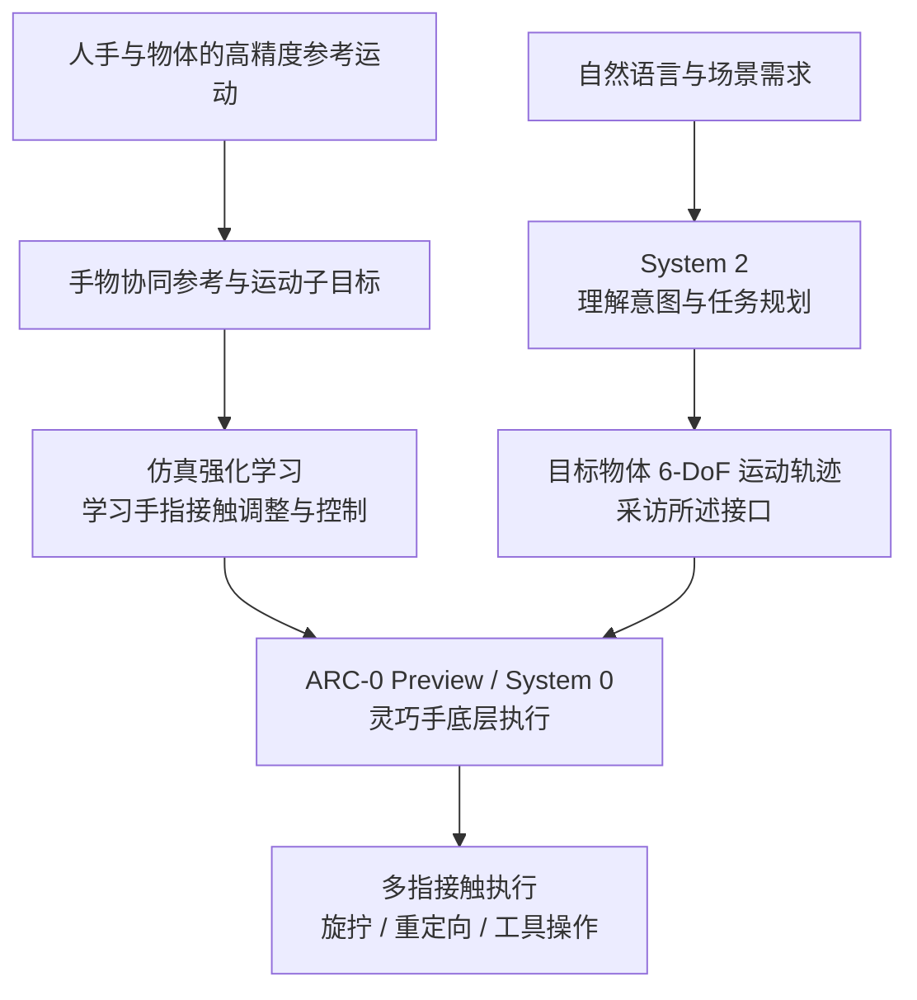

# ARC-0 Preview：从 TeleDexter 到机本智能 System 2→System 0 灵巧操作

## 一句话定义

**ARC-0 Preview** 是机本智能（ManuPrax Robotics）在 2026-11-17 预览的灵巧操作底层模型：上层规划做**什么**与物体如何运动，下层根据目标协调多指接触与运动来**执行**；当前公开证据以演示和访谈为主，不是已经开放复现的通用基准。

## 英文缩写速查

| 缩写 | 英文全称 | 简要说明 |
|------|----------|----------|
| S0 / S2 | System 0 / System 2 | 低层接触执行 / 高层任务理解与规划（团队命名） |
| HOI | Hand–Object Interaction | 人手–物体协同运动参考 |
| RL | Reinforcement Learning | 在仿真接触中学习低层控制动作 |
| SE(3) / 6-DoF | Special Euclidean Group / Six Degrees of Freedom | 刚体位置与朝向目标表示 |
| RGB-D | Red, Green, Blue + Depth | 报道提及的多相机参考运动采集输入 |
| Sim2Real | Simulation-to-Real Transfer | 从仿真接触策略转到物理灵巧手 |

## 核心信息

| 项 | 状态与证据 |
|---|---|
| 发布方 | 机本智能（ManuPrax Robotics） |
| 发布版本 | **ARC-0 Preview，2026-11-17**；未确认独立论文版本 |
| 官方确认 | System 2 理解/规划，System 0 控制手指运动、接触与发力；换灯泡、收桌面、切黄瓜演示 |
| 采访披露 | 320 个训练参考物体、80 小时参考动作、连续至少 50 个目标成功率 46.6%（**二手报道，未独立核验官方原始曲线和统计细节**） |
| 泛化边界 | 报道称新买的**同类别新实例**可操作；**不是**未经见过的全部类别、场景或硬件都可零样本成功 |
| 代码/模型 | 本次核查的官方公告未公布训练/推理仓库、权重或数据下载入口 |

## 为什么重要

传统的上层视觉语言动作模型擅长决定物体在哪里、应该怎样移动，**多指在手内旋转、换指、支撑与接触力变化**仍是不同时间尺度的控制难题。ARC-0 将这种能力作为可被高层目标调用的 S0 层，尝试从 TeleDexter 的单物体参考追踪走向对象实例泛化。

## 流程总览

下图依据 [官方预览](../../sources/sites/manuprax-arc0-preview.md) 的两层分工、[采访报道](../../sources/blogs/wechat_jushen_system0_arc0_2026-11-21.md) 的采集/目标接口和 [TeleDexter 原论文](./paper-teledexter.md) 的技术前身绘制；不表示 ARC-0 已公开网络结构或训练源码。

## 核心原理

### 1. 参考轨迹解决「目标」，不等于控制动作

人手–物体运动提供几何参考，但不同机械手的连杆、柔顺性、接触点和驱动器不同，无法直接把参考关节位姿当作力矩指令。前身 [TeleDexter](./paper-teledexter.md) 在原论文中用**指尖目标 + 物体位姿**的 co-tracking、连续子目标、仿真 RL 与 action masking 寻找可执行的接触序列。报道认为 ARC-0 的模型泛化能力在此基础上扩展，**不能据此假定 ARC-0 保留相同算法超参或网络结构**。

### 2. 对象泛化：多样性与训练框架鲁棒性

报道转述团队偏好自由交互的 play data，重点扩展形状、尺寸、摩擦与可动部件覆盖。高精度 MoCap 和固定式多相机 RGB-D 分别服务不同物体；仿真训练需让奖励权重、重置策略、样本筛选与难度分布不再只适用于单一物体。这是**工程选择的采访陈述**，未有相同规模下的公开消融证明各项贡献的因果大小。

### 3. 上下层接口：物体轨迹与接触控制解耦

报道给出的系统接口是物体或物体部件的 **6-DoF 位姿轨迹**：System 2 负责生成目标轨迹；System 0 根据手/物状态在高频控制环内调整接触关系，实现旋转、交接或放置。官方短公告确认分层职责，但未公开 ARC-0 的完整传感器向量、控制频率、低层动作张量或调用协议。

## 实验与评测

| 证据 | 可以得出的结论 | 不能据此推断 |
|---|---|---|
| 官方 2026-11-17 发布演示 | 三类有接触/工具使用的任务在展示系统中完成 | 未见公开重复试验次数、失败率或对照基线 |
| 采访：320 物体 / 80 h / K≥50、46.6% | 报道声称同类别新实例上的连续目标跟踪已有进展 | 未核对物体拆分、统计置信区间、各 K 曲线与真机测试协议 |
| [TeleDexter](./paper-teledexter.md) 论文：七任务平均 75.2% SR | 前身单物体 co-tracking 的真机遥操作证据 | **不是 ARC-0 的成功率**，也不与其连续目标指标横比 |

## 工程实践

- **模型接口验证：** 优先要求官方给出 `goal` 的物体参考系、目标频率、有效接触状态、反馈观测、动作输出及失败恢复协议；这些决定 S2/S0 能否被其他规划器调用。
- **训练数据审查：** 按物体类别、实例、形状、摩擦、动作模式拆分；同类未见实例与未见类别必须分开测，不用随机帧划分冒充泛化。
- **真机验收：** 对每类目标测试连续 K=10/30/50 到达率，另量化物体滑落、接触丢失、累计位姿误差、力过冲与任务完成率。
- **运行时序图：** **不适用**。截至 2026-11-21 核对的官方公告未给出可运行源码、README 或接口实现，不能把 TeleDexter 的代码/论文伪装为 ARC-0 的运行时模块。
- **开源状态：** **尚未确认公开可运行实现**（仅核对到官方发布帖；不是对整个互联网开源状态的绝对判断）。

## 局限与风险

1. **量化指标的来源层级：** 320/80/46.6% 属采访报道，未查到独立官方技术报告复核；本页不把它们当作可独立复现的论文实验。
2. **场景能力边界：** 文章将泛化聚焦于同类新物体实例，不意味着跨类别、透明柔性物、布料与工具组合普适。
3. **感知缺口：** 报道指出当前 S0 尚未接入视觉/触觉作为底层反馈，遇到滑动、未知接触参数时限制实际鲁棒性。
4. **可变形与接触仿真：** 仅靠 6-DoF 刚体轨迹难覆盖布料；快速且准确的柔性仿真仍是开放问题。
5. **复制门槛：** 无官方可运行入口、参数、控制频率和训练配置，读者暂不能实证检验宣传效果。

## 与其他工作对比

| 维度 | TeleDexter（论文） | ARC-0 Preview（官方+采访） |
|---|---|---|
| 核心任务 | 物体特定的实时灵巧遥操作 | 泛化灵巧低层能力 + 上层任务规划对接 |
| 低层目标 | 同步指尖 + 物体子目标 | 文章称主要以物体 6-DoF 轨迹为上层接口 |
| 泛化证据 | 七项操作任务的论文评测，换物体需新采样/新训练 | 采访称同类别新物体实例可连续操作 |
| 可见论文/源码 | [2607.11481](https://arxiv.org/abs/2607.11481)；官方实现未开放 | 本次未核实独立论文和官方可运行代码 |
| 主要局限 | 重型动捕与 object-specific | 评测协议、开放性、视觉/触觉与柔性物体 |

## 结论

**ARC-0 的关键值得跟踪的是「从物体几何目标到接触动作」的 S2/S0 接口与跨物体训练框架，而非把一次演示解释为全面通用。**

1. 评测从单物体成功率转向**按类别隔离的持出实例、连续目标达成率和失误恢复**。
2. 优先验证高频 S0 对 **接触、摩擦和实时反馈** 的有效闭环，而非只比较模型参数规模。
3. 等公开可运行代码后再补**源码运行时序图**与实机指标，不以演示描述虚构控制栈。
4. 区分本体专用能力、同类泛化和跨类别泛化三档范围。

## 关联页面

- [TeleDexter](./paper-teledexter.md) — 对照有论文实验证据的前身控制器。
- [Contact-Rich Manipulation](../concepts/contact-rich-manipulation.md) — 持续接触的力学问题。
- [In-hand Reorientation](../methods/in-hand-reorientation.md) — 换指和物体手内重定向。
- [Manipulation](../tasks/manipulation.md) / [Bimanual Manipulation](../tasks/bimanual-manipulation.md) — 单/双手任务。
- [Sim2Real](../concepts/sim2real.md) — 训练动力学与真机迁移。
- [接触丰富操作纵深](../../roadmap/depth-contact-manipulation.md) / [遥操作纵深](../../roadmap/depth-teleoperation.md)。

## 参考来源

- [ManuPrax 官方 ARC-0 Preview 发布资料归档](../../sources/sites/manuprax-arc0-preview.md)
- [具身纪元 2026-11-21 采访解读归档](../../sources/blogs/wechat_jushen_system0_arc0_2026-11-21.md)
- [TeleDexter 官方项目资料](../../sources/sites/teledexter-project.md)

## 推荐继续阅读

- [ManuPrax Robotics 官方 ARC-0 Preview 公告](https://x.com/ManuPraxRobo/status/2122567192994836693) — 核对发布范围与演示。
- [TeleDexter 官方技术博客](https://bigai-dex.github.io/blog/teledexter/) / [arXiv 论文](https://arxiv.org/abs/2607.11481) — 追溯 co-tracking + 子目标 RL 的论文级细节。
