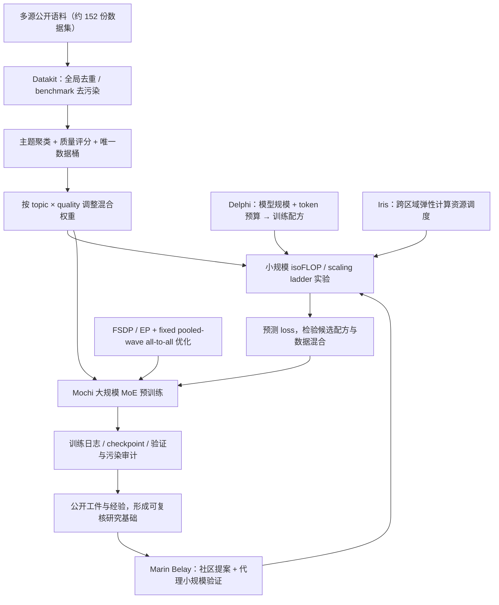
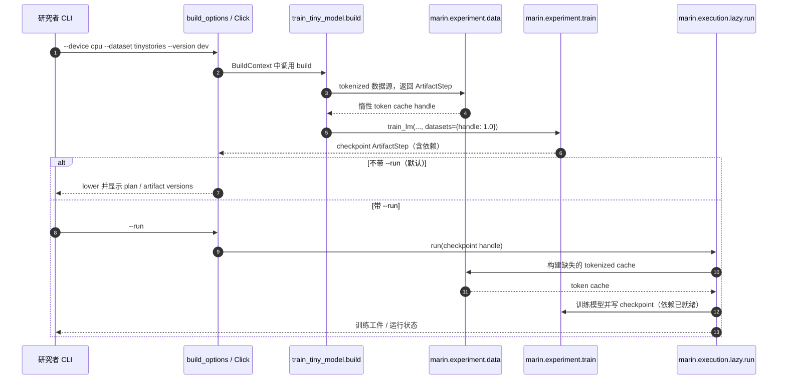

# Marin：开放式大模型预训练如何规模化（Scaling Marin's Open LLM Pre-Training）

## 一句话定义

**Marin** 是由 Stanford 项目发展至 Open Athena 主导的开放基础模型研发平台与社区；Will Held 的 [2026-11-05 技术长文](https://openathena.ai/blog/scaling-marins-open-llm-pre-training/) 解释如何把 **Delphi 可外推配方、Iris 弹性计算调度、MoE 高效训练、Datakit 大规模数据混配与 Belay 自动实验** 组合为可复核的 LLM 预训练体系，而不是只发布权重。

## 英文缩写速查

| 缩写 | 英文全称 | 简要说明 |
|------|----------|----------|
| LLM | Large Language Model | 训练对象为语言基础模型，不是直接控制机器人关节的策略 |
| MoE | Mixture of Experts | 稀疏专家网络；Mochi 535B 总参数中约 23B 激活 |
| FSDP | Fully Sharded Data Parallel | 逐层收集分片权重执行计算的模型并行训练方案 |
| EP | Expert Parallelism | 将稀疏专家分布到不同计算设备并通信路由 token |
| FLOPs | Floating-Point Operations | scaling law 中用于描述训练计算预算的运算量 |
| TPU | Tensor Processing Unit | Marin 早期主要使用的 Google 计算加速器 |
| VLA | Vision-Language-Action | 可借鉴实验方法论的具身模型，不能直接套用 LLM 损失曲线 |
| WAM | World-Action Model | 具身世界—动作模型，关注预测与行动的联合质量 |

## 为什么重要

- **开放研发的对象是完整过程：** 模型权重允许研究内部表示，但不足以解释数据和配方如何导致某种行为；Marin 公开实验记录、失败、训练数据来源和版本化 checkpoint，便于社区对因果解释提出可重复的假设。
- **训练模型前先训练「配方」：** 用小规模 isoFLOP 实验设计可迁移的超参数/数据配方，外推大规模 loss 后再以真实大规模运行检验。
- **对机器人研究的意义是方法迁移：** 类似的实验纪律可以借鉴到 VLA / WAM / BFM，但**语言模型预训练 loss 不等价于机器人闭环任务成功率或 Sim2Real 鲁棒性**。

## 核心原理

### 流程总览（依据 Will Held 原文）

**图的边界：** 表示原文的研究与数据依赖关系，不是声称所有组件构成一个已核验的单一生产执行 DAG；下方运行时序图使用**确实读过的公开教学代码**，也不冒充 Mochi 535B 的完整训练时序。

### 各系统解决的具体问题

| 环节 | 官方做法 | 可核验的边界 |
|---|---|---|
| **Delphi / scaling ladder** | 从模型规模、数据预算导出一整套训练 recipe；小模型拟合，再用更大训练运行验证预测 | 依赖 recipe 不因尺度变化失效；不是无条件的性能保证 |
| **Iris** | 在多区域、可抢占资源上管理实验任务 | 主要解决实验吞吐与计算可用性，不直接优化模型性能 |
| **MoE + EP** | 与 dense 基线比较实际墙钟时间；针对 NVL72 开发 pooled-wave all-to-all 通信 kernel | 原文报告**同 loss 的约 3.6× 墙钟效率**，仅针对当时内部对照方案 |
| **Datakit** | 去重、去污染、聚类、评分后按桶调配 | 原始约 25T tokens 不等于模型实训 tokens；含合成数据和污染审计风险 |
| **Marin Belay** | 社区提交想法，代理实现并进行小实验，优胜方案再扩大验证 | 文中最小实验为 8×H100 约 8 分钟，非完整模型训练时长 |

### 从 8B、32B 到 Mochi

早期 Marin 8B 使用持续续训的 **Tootsie** 方法减少算力浪费；32B 因 loss spike、优化器/架构和数据配比动态变更暴露了实验难以复现的问题。Open Athena 阶段引入统一 recipe 与基础设施后，推进至 **Marin Mochi 535B-A23B**（约 535B 总参数、23B 激活参数）的主预训练。

## 实验与证据（保留发表时间口径）

| 证据 / 量纲 | 官方报告 | 不能得出的结论 |
|---|---|---|
| 同 loss 墙钟效率 | MoE recipe 相对于当时 dense recipe **约 3.6×** | 不代表任意 MoE 在任意集群均有此提速 |
| 数据来源 | 约 **152 份** Hugging Face 数据集被纳入过；原始语料约 **25T**，全局去重约 **2T tokens** | 不是模型实际训练 token 数，也不是全部可直接再分发 |
| 训练窗口规划（原博客） | 允许约 **20T tokens** 的预算 | 不等于主预训练最终实际完成量 |
| Mochi 主预训练（11-17 官方更新） | **18.2T tokens**；**57** 个预训练 checkpoints（其中 10 个长上下文阶段） | 不是已经安全后训练、可直接部署的对话助手 |
| 数据污染 | 采用 benchmark 13-gram 去污染；后续官方公告发现遗漏的泄漏 | 不能用存在污染风险的 benchmark loss / score 作无条件公平排名 |
| 合成数据 | 作者称约 **25%** 数据为已知 AI 生成；未做通用 AI 生成文本过滤 | 不代表剩余 75% 可证明全由人类生成 |

以上数据来自 2026-11-05 [原始演讲博客](../../sources/blogs/openathena-scaling-marins-open-llm-pretraining-2026-11-05.md) 与 2026-11-17 [Mochi checkpoint 公告](https://marin.community/blog/2026/11/17/marin-mochi-pretraining-checkpoints/)，是不同时间与不同统计口径；本文**未进行独立指标复现**。

## 结论

**Marin 最值得借鉴的是将「可预测的小实验 → 大规模验证 → 公开失败与工件 → 社区改进」制度化，而非某一组模型性能排名。**

1. 先明确**配方的缩放规则**，再用小规模 sweep 比较候选方案，避免只追逐单个配置的最好结果。
2. 测量**端到端墙钟成本**，不要把理论 FLOP 节省直接解释成实际训练提速。
3. 保留语料来源、主题/质量桶、去重与去污染证据，使数据配比改动可审计。
4. 把异常 loss 下跌也当作潜在污染信号，谨慎评估 benchmark。
5. 将预训练中间 checkpoint 与 post-training / instruction-tuned 部署模型严格区分。
6. 迁移至机器人时应另外记录 action loss、任务成功率、闭环时延与真机泛化，不可只迁移文本 scaling 外推值。

## 源码运行时序图

以下**仅对应已检查的官方可运行教学入口** `experiments/tutorials/train_tiny_model.py`（不是 Mochi 535B 生产作业）。代码由 Click 命令入口进入 `build()`，以 lazy artifacts 连接 tokenizer 与 `train_lm()`；`build_options` 的 `--run` 决定打印计划还是实际构建。

**源码依据：** [教学训练脚本](https://github.com/marin-community/marin/blob/main/experiments/tutorials/train_tiny_model.py)、[CLI 的 `build_options` 实现](https://github.com/marin-community/marin/blob/main/lib/marin/src/marin/experiment/cli.py)、[首个训练实验教程](https://github.com/marin-community/marin/blob/main/docs/tutorials/first-experiment.md)。该图为程序逻辑的压缩表示；本次仅静态核查，未执行测试。

## 工程实践

- **最小入口：** 安装按 [官方教程](https://github.com/marin-community/marin/blob/main/docs/tutorials/installation.md) 操作，先运行 `uv run python -m experiments.tutorials.train_tiny_model --device cpu --dataset tinystories --version dev` 检查计划；追加 `--run` 才真正开始执行 100 步教学训练。
- **可观测项：** 小规模实验记录 tokens/step、训练 loss、验证 loss 与实耗时间，再修改数据混配并复用相同的验证协议。
- **机器人研究类比：** VLA/WAM 预训练若采用类似「数据桶 + ladder」，须固定机器人任务划分/轨迹去重/评测泄漏检查，且在闭环仿真与真机上重测，而不是照搬 Marin 的 3.6× 数字。
- **开放状态：** [Marin 代码仓库](https://github.com/marin-community/marin) **已公开**，并有可运行训练教学入口；[Mochi 预训练 checkpoint](https://huggingface.co/open-athena/Marin-Mochi-535B-A23B) **已发布**。数据和预训练权重的授权/完整性需按每项来源另核；并无证据表明所有 25T 原始数据都以单包提供。

## 局限与风险

- **非机器人动作策略：** Mochi 是通用语言模型，文中的预训练 loss、模型规模、效率不构成 VLA / BFM / WAM 的真机性能证据。
- **基准污染：** 11-17 官方披露去污染遗漏，需重审受影响评测；不能把可见训练曲线等同于无泄漏证据。
- **开放性是分层的：** 公开软件、训练数据来源与 checkpoint 不保证可在个人工作站重建同规模训练，也不意味着所有资产同许可证。
- **模型尚非部署助手：** 公开权重为未经指令/安全后训练的预训练 checkpoint，需单独完成后训练与安全评估。
- **scaling 假设可失败：** Delphi 论文/博客记录过第一版 recipe 的大尺度外推偏差；应使用 held-out scale 验证而不是只依赖小实验拟合。

## 关联页面

- [Scaling Laws for Neural Language Models（Kaplan）](./paper-scaling-laws-neural-language-models.md) — 语言建模 compute/data scaling 的原始方法论
- [Embodied Scaling Laws（具身规模法则）](../concepts/embodied-scaling-laws.md) — 将训练扩展问题转向机器人数据与泛化指标
- [karpathy/autoresearch](./karpathy-autoresearch.md) — 固定实验预算 + 自动实验环的轻量对照
- [AI Auto-Research](../concepts/ai-auto-research.md) — 代理参与科研流程的通用框架
- [数据飞轮](../concepts/data-flywheel.md) — 训练数据反馈循环，和 Datakit 数据分桶相互参照

## 参考来源

- [Will Held：Scaling Marin's Open LLM Pre-Training 原文归档](../../sources/blogs/openathena-scaling-marins-open-llm-pretraining-2026-11-05.md)
- [Marin 项目主页归档](../../sources/sites/marin-community.md)
- [Marin 官方代码与运行入口核查](../../sources/repos/marin-community-marin.md)
- [2026-11-17：Initial Pre-Training Checkpoints for Marin Mochi](https://marin.community/blog/2026/11/17/marin-mochi-pretraining-checkpoints/)

## 推荐继续阅读

- [Delphi：Scaling Laws That Extrapolate 300× past the Fit](https://openathena.ai/blog/delphi/)
- [Datakit：Curating 25 Trillion Tokens](https://openathena.ai/blog/marin-data-pipeline-overview/)
- [Iris：Cluster Scheduling](https://openathena.ai/blog/cluster-scheduling-with-iris/)
- [Marin 开源仓库 README](https://github.com/marin-community/marin)
