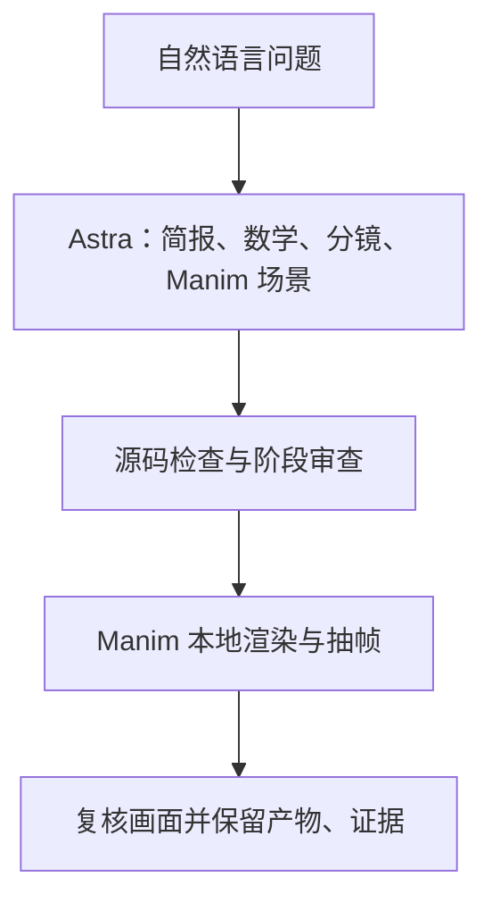

# Math To Manim

**Math To Manim** 是一个 MIT 开源的数学动画生成管线：它把自然语言问题拆成教学设计、数学说明、视觉分镜与 Manim 场景，再执行检查和渲染，留下可复核的源码与画面证据。

## 英文缩写速查

| 缩写 | 英文全称 | 简要说明 |
|------|----------|----------|
| MCP | Model Context Protocol | 让兼容的 Agent 宿主调用生成任务、查询运行状态与读取产物 |
| SDK | Software Development Kit | 当前 Astra 主流程通过 Codex SDK 调用模型与工具 |
| API | Application Programming Interface | 仓库旧版 Mythos 服务提供 REST API |
| CLI | Command-Line Interface | 本地启动生成、查询运行与检查工具链的命令入口 |

## 为什么对机器人研究与工程有用

机器人论文和系统常包含难以从静态公式理解的几何、控制与优化过程。Math To Manim 可把其中一个概念编排成逐步展开的动画，用于课程、组会、论文配套材料或项目演示。对本知识库来说，它补充的是**研究成果的解释与传播层**：Manim 场景能版本控制，生成流程也会保存检查记录。

它适合制作概念讲解，不等于把仿真结果自动变成可信视频。机器人轨迹、动力学和算法结论是否正确，仍需对照原始推导、真实仿真数据和生成画面逐项核验。

## 核心流程

当前上游默认主流程为 Astra 管线。它按阶段构建教学简报、核查数学、设计视觉论证、生成场景源码，然后渲染并审阅实际画面。静态检查、Astra 的证据审查和 Jev 的辅助评估各有作用；默认 Jev 评估为建议式，不会仅凭分数自动重做场景，严格门禁可另行启用。

输出目录按运行 ID 保存提示词、场景源码、候选稿、审查记录、渲染日志、抽样帧和完成清单。这使作者可以回看生成依据、调整场景并重新渲染。Jev 的评分是审查信号，**不是数学证明**；README 也说明 Astra 的自审和类型化评估都不能替代形式验证。

## 工程实践

| 环节 | 实际做法 |
|------|----------|
| 输入 | 用自然语言描述数学或物理主题；CLI 为主要本地入口，主 Astra 管线也可通过 MCP 使用 |
| 生成 | Astra 分阶段处理学习目标、数学依据、视觉论证与 Python 场景，而不是只输出一段动画代码 |
| 检查 | 核对源码与运行证据；查看被保留的场景、日志和抽样帧 |
| 渲染 | 由 [Manim](./manim.md) 执行动画渲染；复杂公式依赖 LaTeX / `dvisvgm` 和相应模板包 |
| 部署 | 使用上游 Astra bundle 或源码安装；源码路径还需 Python、Node.js / npm、FFmpeg 与 Manim 系统依赖 |

README 当前建议使用 Codex 登录运行 Astra；Jev 评审可用 `--review-mode off` 跳过并免除 Jev 单独的凭据要求。Astra 生成仍会调用模型，所以“源码开源”不代表默认流程完全离线或零成本。旧版 Mythos pipeline 另外保留 FastAPI REST API；它不是当前 Astra 默认管线的等价接口。

## 局限与风险

- **输出可信度需人工把关：** 生成模型可能写错公式、定义或推理；逐阶段审查能留证据，但不构成正确性保证。
- **并非机器人仿真工具：** Manim 场景表达的是讲解用几何与动画，不会自动提供物理一致的动力学、碰撞或硬件验证。
- **渲染环境较重：** Manim 的系统依赖、FFmpeg 与 TeX 组件会增加安装和 CI 配置成本；只有生成场景而不渲染时，可不安装完整渲染栈。
- **模型调用有条件：** Astra 主流程需要模型运行环境；Jev 可关闭，但这不会把 Astra 生成转成离线运行。

## 关联页面

- [Manim（程序化数学动画引擎）](./manim.md) — 实际生成视频的底层动画引擎
- [arXivisual](./arxivisual.md) — 在论文阅读流程中嵌入 Manim 动画的相邻应用
- [BotLab / MotionCanvas](./botlab-motioncanvas.md) — 面向浏览器交互仿真与策略演示，交付形态与离线讲解片不同

## 参考来源

- [Math To Manim 官方仓库归档](../../sources/repos/math-to-manim.md)
- [Math To Manim 上游 README](https://github.com/HarleyCoops/Math-To-Manim)
- [Astra 管线架构](https://github.com/HarleyCoops/Math-To-Manim/blob/main/docs/ASTRA_PIPELINE.md)
- [项目配置与依赖](https://github.com/HarleyCoops/Math-To-Manim/blob/main/pyproject.toml)

## 推荐继续阅读

- [Math To Manim 上游仓库](https://github.com/HarleyCoops/Math-To-Manim) — 安装、运行和示例
- [ManimCE 安装指南](https://docs.manim.community/en/stable/installation/uv.html) — 配置实际渲染依赖
