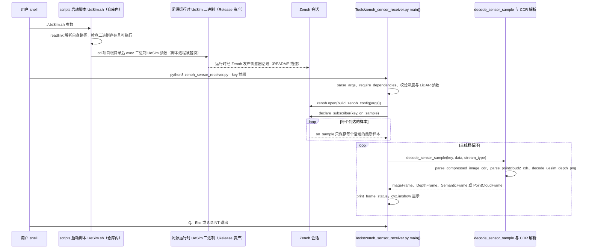

---

type: entity
tags: [simulation, quadruped, differentiable-physics, mujoco, unreal-engine, genisom, gpu-parallel, nvidia]
status: complete
updated: 2026-06-23
related:
  - ./unreal-engine-5.md
  - ./quadruped-control-curriculum.md
  - ./roamerx-navigation.md
  - ./mujoco.md
  - ./isaac-gym.md
  - ../concepts/differentiable-simulation.md
  - ../concepts/sim2real.md
  - ../methods/ppo.md
sources:
  - ../../sources/courses/quadruped_control_simulation_rl_curriculum.md
  - ../../sources/repos/matrix.md
summary: "MATRiX 是智身科技（GENISOM AI）开源的高保真联合仿真平台：MuJoCo 可微物理 + UE5 视觉渲染 + GPU 并行，支撑四足 SysID、PPO 训练与 Sim2Real 部署链。"
---

# MATRiX（智身科技联合仿真平台）

**MATRiX** 是 [智身科技 / GENISOM AI](https://github.com/zsibot) 开源的机器人 **联合仿真与训练平台**：将 **MuJoCo 高精度（可微）物理** 与 **Unreal Engine 5 高保真渲染** 集成，支持 **GPU 并行** 强化学习、系统辨识与 Sim2Real 验证。课程与 IROS 2025 四足挑战赛冠军队将其作为 **仿真—实机统一实验台**。

## 一句话定义

> **MuJoCo 物理真值 + UE5 视觉场景 + 并行 RL/SysID 工具链** 的一站式四足/人形研发平台，目标缩短「算法迭代 → 实机部署」周期。

## 英文缩写速查

| 缩写 | 英文全称 | 简要说明 |
|------|----------|----------|
| MATRiX | — | 智身科技开源联合仿真平台（MuJoCo + UE5） |
| UE5 | Unreal Engine 5 | 高保真视觉渲染与场景编辑 |
| MuJoCo | Multi-Joint dynamics with Contact | 接触丰富的刚体物理与可微后端 |
| GPU | Graphics Processing Unit | 并行环境 rollout 与梯度计算 |
| PPO | Proximal Policy Optimization | 平台内置/对接的主流 loco 训练算法 |
| SysID | System Identification | 可借助可微仿真做参数梯度拟合 |
| Sim2Real | Simulation to Real | 平台宣称完整仿真—部署工具链 |
| ZSL-1 | Zsibot Legged Platform | 智身四足机型，课程 Project 默认载体 |

## 为什么重要

1. **打破「物理仿真 vs 视觉仿真」割裂**：JSON 自定义场景自动生成 MuJoCo XML 与 UE 场景，视觉与碰撞体对齐（见 [Custom Scene Tutorial](https://github.com/zsibot/matrix/blob/main/docs/Custom_Scene_Tutorial_CN.md)）。
2. **可微 + 并行兼顾**：支持 `jax.grad` 类系统辨识与 **4096 并行** PPO 训练，课程强调 **不依赖 Isaac Gym** 也能完成 loco 训练。
3. **与 RoamerX 导航栈同生态**：同一厂商提供 [RoamerX](./roamerx-navigation.md) 导航框架，Project 4 可直接做「目标点 → 导航 → RL 步态」闭环。

## 核心能力

| 能力 | 说明 |
|------|------|
| 可微物理 | MuJoCo 后端支持梯度反传，用于 SysID 与可微控制研究 |
| GPU 并行 | 大规模并行环境，对标 Isaac Gym 训练吞吐 |
| 多机型 | ZSL-1、Unitree Go2 等四足模型与 SDK 对接 |
| 自定义场景 | JSON → MuJoCo XML + UE 场景；静态障碍、动态行人、多样地形 |
| Sim2Real | SDK 底层接口部署策略；课程含摩擦补偿与 DR 对比实验 |

## 与其他仿真器的关系

- **vs [Isaac Gym / Isaac Lab](./isaac-gym-isaac-lab.md)**：MATRiX 强调 MuJoCo 物理一致性与 UE 视觉；Isaac 侧 GPU 生态更广但物理内核不同。
- **vs [MuJoCo](./mujoco.md)**：MATRiX 在 MuJoCo 之上叠加 UE 渲染、并行训练封装与机型 SDK 链。
- **vs [Brax](./brax.md) / 纯 JAX 可微栈**：MATRiX 走「MuJoCo 真值 + 工程工具链」路线，而非纯 JAX 重写物理。

## 常见误区

- **误区：「MATRiX = 又一个 Isaac Gym」。** 核心是 **MuJoCo+UE 联合** 与智身硬件/SDK 闭环，而非 Omniverse 生态。
- **误区：「可微仿真可以跳过接触建模」。** 可微部分仍受接触平滑化/近似影响，复杂地形常需与 DR 联用。

## 源码运行时序图

入口：解压 Release 运行时后，在运行时目录执行 `./UeSim.sh`；另开终端执行 `python3 Tools/zenoh_sensor_receiver.py --key 'rt/**'`（仓库内 Python 工具，需 eclipse-zenoh、numpy、opencv-python）

仓库内只含启动脚本与 Python 工具。UE/MuJoCo 运行时二进制 `UeSim/Binaries/Linux/UeSim` 以 Release 资产分发、不在本仓库中，下图中标为「闭源运行时」，未读取其实现。

图依据：zsibot/matrix@55ad3fe，实际读过 README.md、scripts/runtime/UeSim.sh、Tools/zenoh_sensor_receiver.py（main 与订阅回调、解码入口）、docs/Getting_Started.md（启动与工具命令）；未运行代码。

## 关联页面

- [Quadruped Control Curriculum](./quadruped-control-curriculum.md) — 课程主线平台
- [Differentiable Simulation](../concepts/differentiable-simulation.md)
- [RoamerX Navigation](./roamerx-navigation.md)
- [Simulator Selection Guide](../queries/simulator-selection-guide.md)

## 推荐继续阅读

- GitHub：[zsibot/matrix](https://github.com/zsibot/matrix)
- 新闻：[MATRiX 开源报道](https://news.qq.com/rain/a/20251022A05Q9C00)
- IROS 2025 四足挑战赛冠军案例（曼彻斯特大学 × 智身钢镚）

## 参考来源

- [matrix 源码归档](../../sources/repos/matrix.md)（<https://github.com/zsibot/matrix>）
- 源码核对（2026-11-02）：zsibot/matrix@55ad3fe，读过 README.md、scripts/runtime/UeSim.sh、Tools/zenoh_sensor_receiver.py、docs/Getting_Started.md；时序图依据以上文件，未运行代码。

- [sources/courses/quadruped_control_simulation_rl_curriculum.md](../../sources/courses/quadruped_control_simulation_rl_curriculum.md) — 课程大纲与 Project 描述
