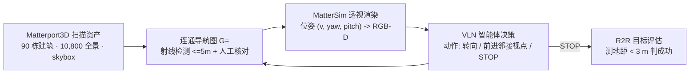
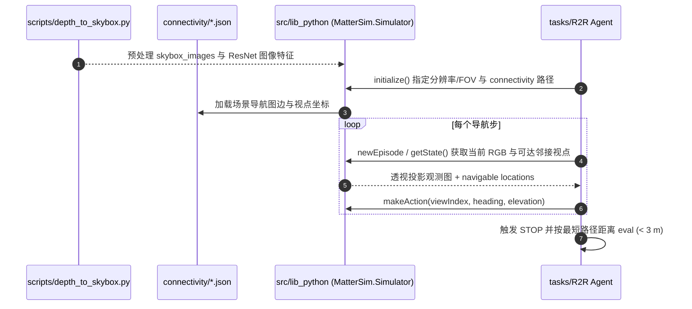

---

type: entity
tags: [entity, simulator, vln, navigation, matterport3d, rgb-d, princeton]
status: complete
updated: 2026-11-21
project_id: matterport3d-simulator
code: https://github.com/peteanderson80/Matterport3DSimulator
related:
  - ./paper-vln-01-r2r.md
  - ./habitat-sim.md
  - ./ai2-thor.md
  - ../tasks/vision-language-navigation.md
  - ../overview/sim-platforms-decade-technology-map.md
  - ../overview/vln-10-papers-technology-map.md
sources:
  - ../../sources/blogs/wechat_shenlan_sim_platforms_top8_decade.md
  - ../../sources/repos/habitat-sim.md
  - ../../sources/papers/matterport3d_arxiv_1709_06158.md
  - ../../sources/papers/vln_task_reading_arxiv_1711_07280_reading_vlntask.md
original:
  - ../../sources/papers/matterport3d_arxiv_1709_06158.md
  - ../../sources/papers/vln_task_reading_arxiv_1711_07280_reading_vlntask.md
summary: "基于 Matterport3D 真实建筑扫描（90 栋建筑、10,800 全景、194,400 RGB-D 图）与加权无向导航图的 VLN 仿真器（CVPR 2018），与 R2R 基准一并确立视觉–语言导航标准评估流程。"
---

# Matterport3D Simulator

**Matterport3D Simulator** 是 2018 年随 **Room-to-Room (R2R)** 基准（[arXiv:1711.07280](https://arxiv.org/abs/1711.07280)）发布的 **视觉–语言导航（VLN）仿真环境**，直接利用 **Matterport3D** 数据集（[arXiv:1709.06158](https://arxiv.org/abs/1709.06158)）真实建筑扫描的全景 RGB-D 数据进行第一人称视角渲染。

## 一句话定义

> Matterport3D Simulator 将 Matterport3D 真实室内全景扫描（90 栋建筑、10,800 视点）封装为基于连通导航图的离散动作渲染环境，配合 R2R 人类导航指令确立了早期 VLN 的标准评测范式。

## 英文缩写速查

| 缩写 | 英文全称 | 简要说明 |
|------|----------|----------|
| VLN | Vision-and-Language Navigation | 依据自然语言在环境中导航 |
| R2R | Room-to-Room | Matterport3D 上经典逐步导航指令数据集 |
| RGB-D | RGB + Depth | 彩色图与深度图联合观测 |
| MP3D | Matterport3D | 大规模真实室内 3D 扫描数据集（90 栋 / 46,561 m²） |

## 为什么重要

VLN 要求智能体在 **未知、逼真** 室内按语言导航。Matterport3D Simulator 的关键贡献：

1. **缩小 sim–real 视觉鸿沟**：全景图来自真实建筑扫描（全局配准典型误差 `< 1 cm`），而非纯程序生成。
2. **与 R2R 强绑定**：[R2R 论文实体](./paper-vln-01-r2r.md) 提供 7,189 条路径 / 21,567 条人类导航指令，形成可复现 leaderboard。
3. **基础设施地位**：后续 VLN-CE、REVERIE 等扩展仍常回溯 MP3D 场景资产；高速连续渲染见 [Habitat](./habitat-sim.md) 对 Gibson/MP3D 的加载。

## 核心机制与流程总览

- **离散导航图（`G = ⟨V, E⟩`）**：每栋建筑的平均视点数 117、平均度 4.1；边由网格射线检测剔除 `> 5 m` 后人工修正窗镜；相邻全景采集点平均间距约 **2.25 m**，智能体在相邻且视野可见的视点间确定性跳转。
- **全景立方体贴图投影**：每个视点包含 18 组 HDR 1280×1024 RGB-D（3 俯仰 × 6 方位），通过预计算 skybox 立方体贴图按位姿 `(v, ψ, θ)` 投影出第一人称视角观测。
- **评测耦合**：路径终点与目标在导航图最短路径距离 `< 3 m` 记为成功（必须主动触发 stop）。

## 源码运行时序图

[peteanderson80/Matterport3DSimulator](https://github.com/peteanderson80/Matterport3DSimulator) 提供 C++ 核心库（`src/driver/`、`src/lib/`）、pybind11 Python 绑定（`src/lib_python/`）与 R2R 任务脚本（`tasks/R2R/`），以及从原始深度图构建 skybox 的预处理脚本（`scripts/depth_to_skybox.py`、`scripts/precompute_img_features.py`）。

## 工程实践

- **数据许可与准备：** 运行需先签署 Matterport3D 学术协议获取全景图/skybox；若仅训练图上模型，可按 `scripts/precompute_img_features.py` 预提特征大幅降低 I/O。
- **环境构建成本：** 原仓依赖旧版 CMake / OpenCV / EGL 与 Python 2/3 旧编译链（仓库提供 `Dockerfile`）；现代复现或连续导航实验优先评估 [Habitat-Sim](./habitat-sim.md) 加载 MP3D `.glb` 网格。
- **跨基准切忌混用**：离散跳转下的 SR/SPL 不能直接与 Habitat 连续物理环境（如 [VLN-CE](./paper-vln-02-vln-ce.md)）横向对比。

## 常见误区或局限

- **误区：MP3D Simulator = Habitat** — Habitat 是 **另一套渲染引擎**，可加载 MP3D/Gibson 等资产但追求更高 FPS；本节点指 **原始 MP3D 仿真器 + R2R 离散图设定**。
- **局限：离散图跳转与采集偏差** — 动作被限制在固定采样点，忽略机器人碰撞、体积宽度及连续控制（连续化扩展见 [VLN-CE](../entities/paper-vln-02-vln-ce.md)）；此外 MP3D 场景偏整洁豪华室内且少人流动态障碍，视点偏高位采集视角。

## 关联页面

- [零样本目标导航（Zero-Shot Object Navigation）](../tasks/zero-shot-object-navigation.md) — 可对照同类室内场景中的物体目标与语言路线任务，观测离散化和成功条件必须分别定义。
- [paper-vln-01-r2r](./paper-vln-01-r2r.md) — 依托本仿真器定义的经典 VLN 任务基准
- [Habitat-Sim](./habitat-sim.md) — 高速加载 MP3D/Gibson 等扫描场景的主流宿主
- [VLN 10 篇技术地图](../overview/vln-10-papers-technology-map.md)
- [视觉–语言导航](../tasks/vision-language-navigation.md)

## 参考来源

- [Matterport3D 论文通读（arXiv:1709.06158）](../../sources/papers/matterport3d_arxiv_1709_06158.md)
- [R2R / Matterport3D Simulator 论文通读（arXiv:1711.07280）](../../sources/papers/vln_task_reading_arxiv_1711_07280_reading_vlntask.md)
- [sources/blogs/wechat_shenlan_sim_platforms_top8_decade.md](../../sources/blogs/wechat_shenlan_sim_platforms_top8_decade.md)
- Anderson et al., *Vision-and-Language Navigation: Interpreting visually-grounded navigation instructions in real environments* (CVPR 2018)
- Chang et al., *Matterport3D: Learning from RGB-D Data in Indoor Environments* (3DV 2017)

## 推荐继续阅读

- [Matterport3D 数据集主页](https://niessner.github.io/Matterport/)
- [Matterport3DSimulator 官方仓库](https://github.com/peteanderson80/Matterport3DSimulator)
- [VLN 四范式复现路径](../overview/vln-open-source-repro-paradigms.md)
