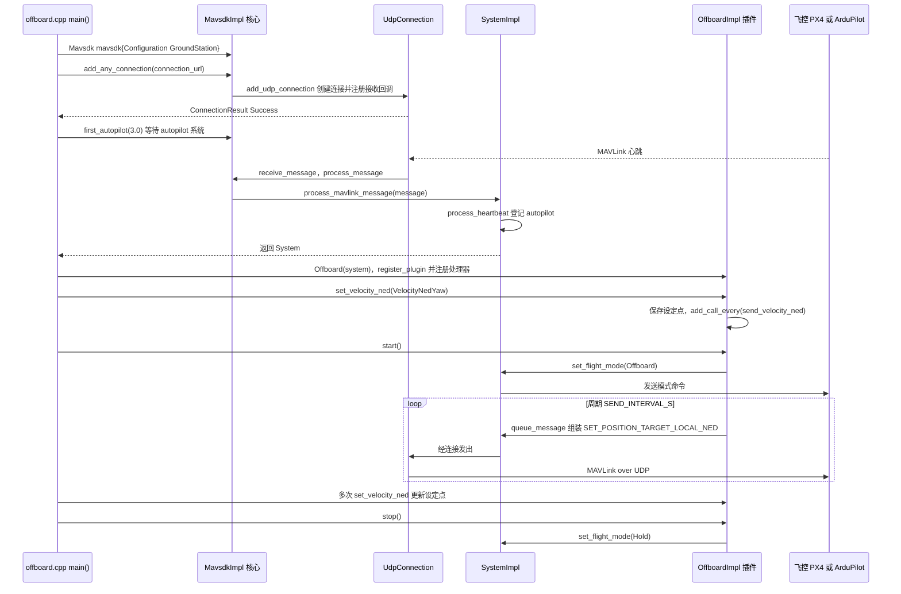

---

type: entity
tags: [repo, mavlink, px4, api, uav, offboard, companion-computer, linux-foundation]
status: complete
updated: 2026-09-05
related:
  - ../overview/multirotor-simulation-planning-control-stack.md
  - ./px4-autopilot.md
  - ./ego-planner-swarm.md
  - ./xtdrone.md
  - ./project-quiver.md
sources:
  - ../../sources/repos/mavsdk.md
summary: "MAVSDK 是 MAVLink 兼容飞控（PX4、ArduPilot）的 C++20 库与多语言绑定，提供 Action、Mission、Offboard、Telemetry 等高层 API，用于伴机自动化与规划器对接。"
---

# MAVSDK

**MAVSDK**（[mavlink/MAVSDK](https://github.com/mavlink/MAVSDK)）把 **MAVLink** 报文封装为可维护的 **插件式服务**，是伴机电脑、地面站原型与自动化测试里连接 [PX4 Autopilot](./px4-autopilot.md) 的主流 API 层之一。

## 英文缩写速查

| 缩写 | 英文全称 | 简要说明 |
|------|----------|----------|
| API | Application Programming Interface | 应用程序编程接口 |
| ROS 2 | Robot Operating System 2 | 机器人系统集成与通信的常用中间件 |

## 为什么重要

- **比裸 MAVLink 更安全**：类型化 API、连接状态机与常见模式（arm、takeoff、Offboard）开箱即用。
- **与规划栈解耦**：[EGO-Planner Swarm](./ego-planner-swarm.md) 等输出位置/速度设定点后，常经 MAVSDK **Offboard** 送入飞控。
- 与 [XTDrone](./xtdrone.md) 教程栈中的 MAVROS 为 **同层替代**（MAVSDK 更轻，MAVROS 与 ROS 生态绑定更深）。

## 核心结构/机制

| 插件/服务 | 典型用途 |
|-----------|----------|
| **Action** | 解锁、起飞、降落、返航 |
| **Offboard** | 周期性位置/速度/姿态设定点 |
| **Mission** | 航点任务上传与执行 |
| **Telemetry** | 姿态、GPS、电池订阅 |
| **Param** | 参数读写与校准辅助 |

连接方式：UDP（SITL 默认 `14540`）、串口或 TCP；支持 C++、Python、Swift 等绑定。

## 常见误区或局限

- **误区：MAVSDK 等于飞控** — 它只在伴机侧；闭环仍在 PX4 固件内。
- **局限：Offboard 超时** — 设定点中断需有 failsafe 策略（悬停/降落/返航）。
- **局限：与 ROS 深度集成** — 若全栈在 ROS2，有时仍选 MAVROS/`px4_ros_com`。

## 参考来源

- [sources/repos/mavsdk.md](../../sources/repos/mavsdk.md)
- [mavlink/MAVSDK](https://github.com/mavlink/MAVSDK)
- 源码核对（2026-11-02）：mavlink/MAVSDK@993f581，读过 cpp/examples/offboard/offboard.cpp、cpp/src/mavsdk/core/mavsdk.cpp、cpp/src/mavsdk/core/mavsdk_impl.cpp、cpp/src/mavsdk/core/system_impl.cpp、cpp/src/mavsdk/plugins/offboard/offboard_impl.cpp；时序图依据以上文件，未运行代码。

## 源码运行时序图

入口：编译 `cpp/examples/offboard` 后运行 `./offboard <connection_url>`（如 `udp://:14540`，示例 main 会先 hold、arm、takeoff，确认进入空中（InAir）后依次执行四段 Offboard 控制，最后 land）

图依据：mavlink/MAVSDK@993f581，实际读过 cpp/examples/offboard/offboard.cpp、cpp/src/mavsdk/core/mavsdk.cpp、cpp/src/mavsdk/core/mavsdk_impl.cpp（add_any_connection、add_udp_connection、receive_message、process_message 等）、cpp/src/mavsdk/core/system_impl.cpp（process_mavlink_message、add_call_every、set_flight_mode）、cpp/src/mavsdk/plugins/offboard/offboard_impl.cpp（start、stop、set_velocity_ned、send_velocity_ned）；未运行代码。

## 关联页面

- [多旋翼栈总览](../overview/multirotor-simulation-planning-control-stack.md)
- [PX4 Autopilot](./px4-autopilot.md)
- [EGO-Planner Swarm](./ego-planner-swarm.md)
- [Project Quiver](./project-quiver.md) — ArduPilot 真机机架，可用本 API 做 Mission / Offboard

## 推荐继续阅读

- [MAVSDK Guide — Offboard](https://mavsdk.mavlink.io/main/en/cpp/guide/offboard.html)
