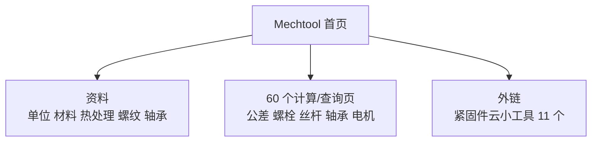

# Mechtool 在线机械设计工具

## 一句话定义

**Mechtool**（www.mechtool.cn）是中文机械设计资料导航与在线计算站，把设计手册式资料、标准对照和零部件计算器放在同一入口（站点自述，未核实运营方）。

## 英文缩写速查

| 缩写 | 含义 | 说明 |
|------|------|------|
| CAD / CAE | 计算机辅助设计 / 分析 | 站内有教程入口 |
| GB/T | 中国推荐性国家标准 | 站内标准对照表使用 |
| ISO | 国际标准化组织标准 | 与 GB/T 对照 |

## 为什么重要

- 机器人本体机械设计常要快速查公差配合、螺栓校核、丝杠和轴承选型；站内有现成入口，可作为粗算和查标准号的起点。
- 与 [螺纹基础](../concepts/screw-thread-basics.md)、[关节轴承选型](../concepts/robot-joint-bearing-selection.md)、[公差仿真](../concepts/structure-tolerance-simulation-toolchain.md) 互补。

## 核心原理

站点结构（实测首页与链接）：七大板块——机械设计基础资料、机械零部件设计、机械传动 / 润滑与密封、液压与气压传动、机械书籍、计算机辅助设计、机械资料。

## 工程实践

- 计算页结果只作粗算；站点未标注公式来源与手册版本，关键件按现行标准和供应商选型手册复核。
- 详细页面清单见[归档](../../sources/sites/mechtool_cn_catalog_2026-11-07.md)。

## 局限

- **通读未完成：** 已取回全部 186 页并读了其中大部分的文字（顶层索引、螺纹 / 紧固件 / 标准清单页、`/calculation/` 全部 60 页的界面与公式说明、`/formular/` 29 页的开头），**未读**：约 30 个短页、供应商清单页的大部分、各数据表的数值行、全部公式 / 示意图片；**未运行任何计算器、未读计算 JS、未核对任何公式或数据**（细目见[归档](../../sources/sites/mechtool_cn_catalog_2026-11-07.md)「核对范围」）。
- **读到的站点事实：** 计算页自述依据的标准 / 教材包括 GB/T 13575（V 带）、GB/T 18150（滚子链）、GB/T 11616 / 11362（同步带）、JB/T 5983（多楔带）、GB/T 3480-1997（齿轮承载）、GB/T 1800 / 1184（公差配合、形位公差）、GB/T 23935（圆柱螺旋弹簧）、滚动轴承额定寿命公式及西北工大《机械设计》第八版；`/formular/` 页给出公式、符号表和分段适用范围（如凸轮运动规律、纵向冲击动荷系数 Kd=1+√(1+2H·EA/(Q·l))）；多个「工具」页只是把供应商在线选型工具（THK、HIWIN、NSK、SMC、Festo、SEW、紧固云等）的链接汇总。这些均为站点自述，本库未核。
- **站点风险（页面可见）：** CAD / CAE 板块列有 AutoCAD、Solidworks、ANSYS、Matlab 等商业软件的下载页，CAD 索引页还出现「序列号和密钥」「永久激活补丁」条目；「侵权删除」页声明资源来自网络、版权争议与本站无关。会员功能（注册需邀请码、每日 50 个会员资源访问配额）见更新日志。使用这些软件资源有版权与安全风险，本库不收录。
- 实测有 1 个 404 链接（`/mechanicalmonograph/index.html`）。
- 运营方、更新频率、数据版权本次未核实。

## 关联页面

- [螺纹基础](../concepts/screw-thread-basics.md)
- [人形机械布局](../concepts/humanoid-mechanical-layout-design.md)
- [关节轴承选型](../concepts/robot-joint-bearing-selection.md)
- [公差仿真工具链](../concepts/structure-tolerance-simulation-toolchain.md)

## 参考来源

- [Mechtool 站点目录归档](../../sources/sites/mechtool_cn_catalog_2026-11-07.md)

## 继续阅读

- 站内各计算页的公式说明（本次未读）。
