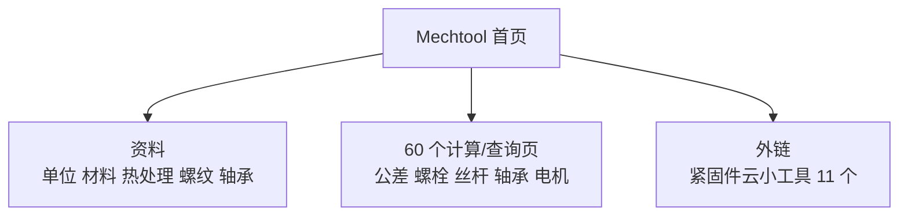

# Mechtool 在线机械设计工具

## 一句话定义

**Mechtool**（www.mechtool.cn）是中文机械设计资料导航与在线计算站，把设计手册式资料、标准对照和零部件计算器放在同一入口（站点自述，未核实运营方）。

## 英文缩写速查

| 缩写 | 含义 | 说明 |
|------|------|------|
| CAD / CAE | 计算机辅助设计 / 分析 | 站内有教程入口 |
| GB/T | 中国推荐性国家标准 | 站内标准对照表使用 |
| ISO | 国际标准化组织标准 | 与 GB/T 对照 |

## 为什么重要

- 机器人本体机械设计常要快速查公差配合、螺栓校核、丝杠和轴承选型；站内有现成入口，可作为粗算和查标准号的起点。
- 与 [螺纹基础](../concepts/screw-thread-basics.md)、[关节轴承选型](../concepts/robot-joint-bearing-selection.md)、[公差仿真](../concepts/structure-tolerance-simulation-toolchain.md) 互补。

## 核心原理

站点结构（实测首页与链接）：七大板块——机械设计基础资料、机械零部件设计、机械传动 / 润滑与密封、液压与气压传动、机械书籍、计算机辅助设计、机械资料。

## 工程实践

- 计算页结果只作粗算；站点未标注公式来源与手册版本，关键件按现行标准和供应商选型手册复核。
- 详细页面清单见[归档](../../sources/sites/mechtool_cn_catalog_2026-11-07.md)。

## 局限

- **通读未完成：** 只读了首页、链接目录和 `/thread/index.html`、紧固件计算工具两页；其余页面只记录标题，**未运行任何计算器、未核对公式**。
- 实测有 1 个 404 链接（`/mechanicalmonograph/index.html`）。
- 运营方、更新频率、数据版权本次未核实。

## 关联页面

- [螺纹基础](../concepts/screw-thread-basics.md)
- [人形机械布局](../concepts/humanoid-mechanical-layout-design.md)
- [关节轴承选型](../concepts/robot-joint-bearing-selection.md)
- [公差仿真工具链](../concepts/structure-tolerance-simulation-toolchain.md)

## 参考来源

- [Mechtool 站点目录归档](../../sources/sites/mechtool_cn_catalog_2026-11-07.md)

## 继续阅读

- 站内各计算页的公式说明（本次未读）。
