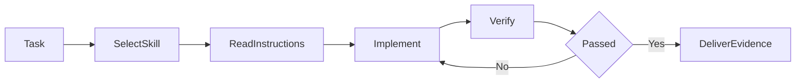
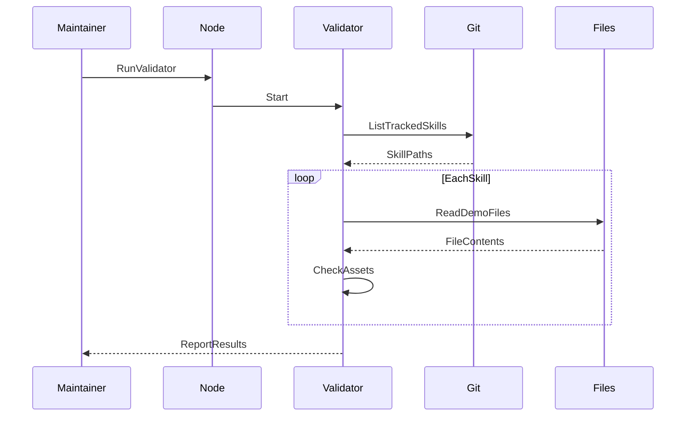

# MengTo/Skills｜设计师与开发者的 AI Agent 技能库（Agent Skills）

## 一句话定义

**MengTo/Skills** 是 Meng To 开源的可移植 Agent Skills 集合，把网页设计、Three.js、游戏、插画、媒体与质量验证流程做成 `SKILL.md` 规约，由 Codex、Claude、Cursor 等代理在具体任务中加载。

## 英文缩写速查

| 缩写 | 英文全称 | 简要说明 |
|---|---|---|
| AI | Artificial Intelligence | 运行工作流的代理技术 |
| UI | User Interface | 技能库着力构建和审查的交互界面 |
| QA | Quality Assurance | 借助截图、测试与校验的交付证据 |
| GLTF | GL Transmission Format | Three.js Skill 提及的 3D 资产加载格式 |
| CDP | Chrome DevTools Protocol | workflow 截图脚本连接浏览器所用协议 |
| CLI | Command-Line Interface | 配套脚本或代理执行入口 |

## 为什么重要

LLM 直接写代码时，常把「会生成」误当作「已验证」。这个库把设计参考、约束、实现步骤、截图、对比、回归等知识留存在可复用文件里。对机器人团队的仿真可视化、3D 数据展示和技术文档工作可借鉴这种拆分，但不能把 Web UI 检查当作真机安全测试。

## 核心原理

- **文件契约：** 每个 `agent-skills/<category>/<skill>/SKILL.md` 定义触发条件与实施步骤，按需附 `REFERENCES.md`、`ARTICLE.md`、`scripts/`、`assets/`、`demo/`。
- **分类：** 核对快照的官方 README 称 **176 skills / 9 类**，覆盖 Codex 操作流、Media、UI、Illustration、Game Combat、Game Development、Web Design、3D、Workflow；数量会更新。
- **样本 A — iterate-until-verified：** 锁定原始任务 → 定可观测门禁 → 分工 → 独立评审 → 循环修复 → 有证据后停止。
- **样本 B — web-design/threejs：** 管理 Scene/Camera/Renderer、glTF 加载、像素比及 resize，要求正确 dispose 和 reduced-motion 支持。
- **代码边界：** 大多数 skills 是运行者要阅读的 Markdown 操作流程；仓库 `scripts/validate-skill-demos.mjs` 是可运行的演示资源校验器，并不是全部技能的统一执行引擎。

## 流程总览

此图组合官方 README 的 Skill 加载约定和 `iterate-until-verified` 示例的验证循环，不表示仓库中存在独立的自动路由或统一任务调度服务。

## 源码运行时序图

选取仓库中确有可运行入口的 **demo 静态校验** 路径 `node scripts/validate-skill-demos.mjs`；`SKILL.md` 自身是代理提示规约，**没有统一可执行 runtime**。

## 工程实践

- 从 `agent-skills/` 选与你需求最匹配的技能目录，**先读 SKILL.md 再执行**；不要把 README 的用法推断成每个 agent 都自动安装。
- 可参考 `web-design/threejs` 处理机器人三维演示的 render loop、DPR、资源回收；可参考 `iterate-until-verified` 建质量证据链。
- 机器人团队应单独增加 URDF 关节一致性、动力学参数、仿真回归与真机安全门，不能照搬 Web 演示评分。
- 此仓库提供 MIT 许可的源文件与脚本；运行平台、浏览器依赖与 Demo 素材条件须分别验证。

## 局限与风险

README 的 skill 数量是快照；并非每一份技能都有可运行示例，也不能据此断言已跨所有 agent 宿主验证。质量审查流程帮助组织证据，但不会保证模型生成物正确或系统安全。

## 关联页面

- [Pascal Editor](./pascal-editor.md) — 提供 MCP 与自带 Agent Skill 的专用 3D 建筑编辑器。
- [Agent Skills（Addy Osmani）](./agent-skills-addyosmani.md) — 编码代理工程规范的另一组技能。
- [CAD Skills](./cad-skills.md) — 硬件/URDF/STEP 垂直 Agent Skills。
- [Skills For Real Engineers](./mattpocock-skills.md) — 通用软件工程技能。

- [Hallmark](./hallmark.md) — 以主题轮换、硬性设计底线和可运行 `sloplint` 改善 Agent 网页设计的专项 Skill。

## 参考来源

- [MengTo/Skills 官方 README、技能与源码归档](../../sources/repos/mengto-skills.md)

## 推荐继续阅读

- [官方 GitHub 仓库](https://github.com/MengTo/Skills)
- [iterate-until-verified 原文](https://github.com/MengTo/Skills/blob/5ea1661a0e05d82b054553daaa6baf6d0233c33c/agent-skills/codex/iterate-until-verified/SKILL.md)
- [Three.js Skill 原文](https://github.com/MengTo/Skills/blob/5ea1661a0e05d82b054553daaa6baf6d0233c33c/agent-skills/web-design/threejs/SKILL.md)
