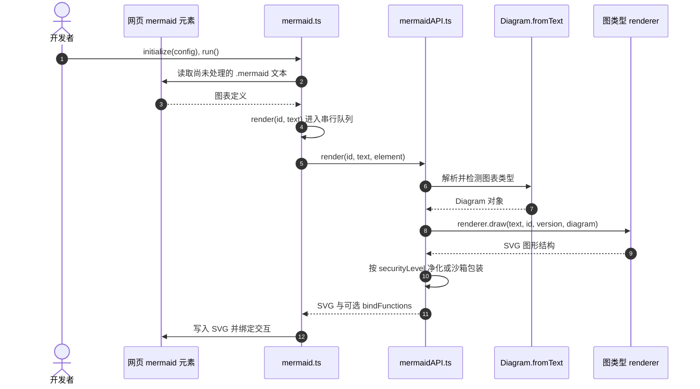

# Mermaid.js（文本定义图表）

**Mermaid.js**（[GitHub](https://github.com/mermaid-js/mermaid)）是一个 MIT 开源的 JavaScript 图表库：作者用接近 Markdown 的文本描述图表，解析器和渲染器将其输出为 SVG。官方配套有浏览器编辑器、命令行工具和多种宿主集成。

## 一句话定义

**用可版本管理的文本描述图表，再由 Mermaid 渲染成可嵌入文档的可视化结果。**

## 英文缩写速查

| 缩写 | 英文全称 | 简要说明 |
|------|----------|----------|
| SVG | Scalable Vector Graphics | Mermaid 网页渲染图表时使用的矢量图形格式 |
| CLI | Command-Line Interface | Mermaid CLI 通过脚本或构建任务批量生成图表 |
| API | Application Programming Interface | 通过 JavaScript API 将 Mermaid 集成到网页应用 |
| ESM | ECMAScript Module | 在现代网页中导入 Mermaid JavaScript 模块的方式 |

## 为什么重要

- **图与文档一起版本管理。** Mermaid 图以文本保存，便于 code review、diff 和后续编辑；结构变化时可与文档、代码同步维护。
- **覆盖常用的工程表达。** 官方语法包含 flowchart、sequence、state、class、ER、Gantt、mindmap、timeline 等类型，可表达流程、交互、状态、数据关系与计划。
- **从试写到自动化有连续工具链。** Live Editor 可用于即时预览；主库可嵌入网页产品；CLI 可用于流水线导出。
- **宿主平台支持广。** GitHub 等支持 Mermaid fenced code block；其它编辑器或知识库需核对集成方式与实际版本。

## 核心原理

Mermaid 图定义是文本；渲染器解析语法与图类型，再生成 SVG 图形。常见作者工作流如下：

最小流程图示例：

代码块首行的 Mermaid 是 Markdown 围栏的语言标记；下一行的 flowchart LR 才是 Mermaid 图表定义。节点 ID（如 A、B、C）用于连线，方括号内文本作为显示标签。

### 源码运行时序图

下图对照官方主库 `packages/mermaid/src/mermaid.ts`、`packages/mermaid/src/mermaidAPI.ts`，以网页 `mermaid.run()` 的执行路径为例；CLI 导出是独立项目的另一条入口。

在 `securityLevel=sandbox` 下，源码使用 sandboxed iframe；其它安全级别的净化策略不同，不应把来源不可信的图定义当成可信代码。<https://github.com/mermaid-js/mermaid/blob/develop/packages/mermaid/src/mermaidAPI.ts>

## 工程实践

| 工具 | 入口 | 适用场景 |
|------|------|----------|
| Mermaid 主库 | [GitHub](https://github.com/mermaid-js/mermaid) · [npm mermaid](https://www.npmjs.com/package/mermaid) | 网页或产品内渲染图表 |
| Live Editor | [网页](https://mermaid.live/) · [源码](https://github.com/mermaid-js/mermaid-live-editor) | 快速验证语法、预览与分享 |
| Mermaid CLI | [仓库](https://github.com/mermaid-js/mermaid-cli) · [npm 包](https://www.npmjs.com/package/@mermaid-js/mermaid-cli) | 批量渲染、CI 或文档构建 |
| Drawnix | [项目页](./drawnix.md) · [官网](https://drawnix.com/) | 将 Mermaid 流程图定义转换为可继续编辑的白板元素 |
| 官方文档 | [Mermaid Open Source](https://mermaid.ai/open-source/) | 查询图类型、语法、配置与集成 |
| 集成清单 | [Community Integrations](https://mermaid.ai/open-source/ecosystem/integrations-community.html) | 检查目标应用的支持方式 |

### 最小工程复现

1. **Markdown / GitHub：** 使用标准三反引号 `mermaid` 围栏；先用官方 Live Editor 或项目的 Mermaid lint 检查语法，再确认目标平台实际支持的版本。
2. **网页集成：** `npm install mermaid`，插入 `<pre class="mermaid">` 的定义，并通过 ESM 模块导入 Mermaid；按需调用 `mermaid.initialize()` 和 `mermaid.run()`。官方 Usage 文档说明新版包的运行环境约束，部署时需按安装版本检查。
3. **批量导出：** `npm install -g @mermaid-js/mermaid-cli` 后，运行 `mmdc -i input.mmd -o output.svg`；CLI 也支持 PNG/PDF 与 Markdown 内图表转换。
4. **机器人应用：** 用 `sequenceDiagram` 明确 ROS 2 传感器、状态估计、策略、执行器的消息顺序；用 `flowchart` 描述训练与 Sim2Real 发布环节。它是**人工建模的说明图**，不是运行时探针。

### 写图与排错建议

1. 先选图类型，再写最短的节点和连线；确认结构正确后再增加长标签、主题和样式。
2. 把节点标识符与可见标签分开；有空格或标点的标签用引号包住，例如 A["策略节点"]。
3. 将代码块复制到目标平台实测。平台支持的 Mermaid 版本和扩展不同，Live Editor 中可渲染不代表所有宿主都能渲染。
4. 在 CI 或静态站点中批量导出时用官方 CLI；网页端集成则按官方 Usage 文档初始化 Mermaid API。

## 局限与风险

- **源码运行与安全：** 浏览器入口 `mermaid.run()` 调度渲染并生成 SVG；低层 `mermaidAPI.render` 依赖实际图类型的解析器/renderer。根据 `securityLevel`，源码会采用 SVG 净化或 iframe 沙箱。不同版本和宿主的配置不可直接互换。

- **版本兼容：** 新图类型、形状语法或配置项可能不受旧版宿主支持；需以目标环境版本为准。
- **自动布局不是手工排版。** 节点较多或标签较长时，布局方向、换行和阅读顺序可能与预期不同，应在目标渲染器中验证。
- **代码块不等于每个平台都支持。** Markdown 平台需要集成 Mermaid 才会将围栏内容绘图；否则只显示代码。
- **用户输入安全：** 若产品渲染不可信 Mermaid 定义，应阅读官方安全文档并启用适当沙箱/安全配置，不要将其当作可信 HTML。
- **编辑器与开源库边界：** Live Editor 用来编写和分享；实际应用仍应检查主库、依赖版本及宿主集成实现。

## 关联页面

- [Diagram Design](./diagram-design.md) — 可读取 Mermaid 语义并重绘为独立 HTML/SVG 工件的 Agent Skill
- [Archify](./archify.md) — 用结构化 JSON IR 与校验器生成系统图的工具，可与 Mermaid 文本语法路线对照
- [Diagrams（Python）](./mingrammer-diagrams.md) — 使用 Python 和 Graphviz 组合云服务图标与连接关系；可在 Git 中审查拓扑描述
- [GitDiagram](./gitdiagram.md) — 从代码仓库证据生成可交互 Mermaid 架构图的工具
- [Drawnix](./drawnix.md) — 将 Mermaid 流程图转换为 Plait 画布元素，便于继续进行白板式编辑

## 参考来源

- [主库、Live Editor 与 CLI 归档](../../sources/repos/mermaid-js.md)
- [主仓核心浏览器入口（mermaid.ts）](https://github.com/mermaid-js/mermaid/blob/develop/packages/mermaid/src/mermaid.ts)
- [低层渲染 API（mermaidAPI.ts）](https://github.com/mermaid-js/mermaid/blob/develop/packages/mermaid/src/mermaidAPI.ts)
- [官方站点与文档核查](../../sources/sites/mermaid-ai-open-source.md)

## 推荐继续阅读

- [Mermaid Getting Started](https://mermaid.ai/open-source/intro/getting-started.html) — 首次使用与集成方式
- [Flowchart Syntax](https://mermaid.ai/open-source/syntax/flowchart.html) — 流程图语法
- [Sequence Diagram Syntax](https://mermaid.ai/open-source/syntax/sequenceDiagram.html) — 时序图语法
- [Mermaid Live Editor](https://mermaid.live/) — 在线编写、预览与分享
