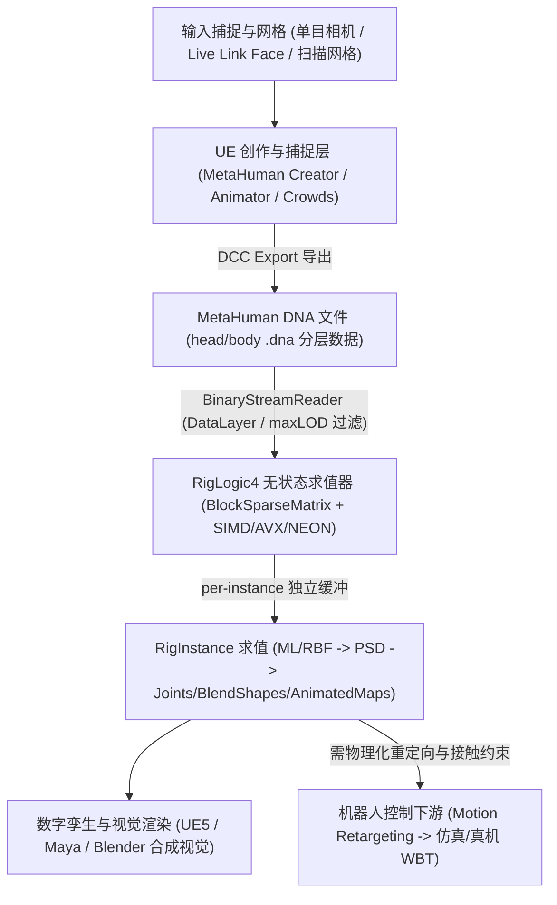
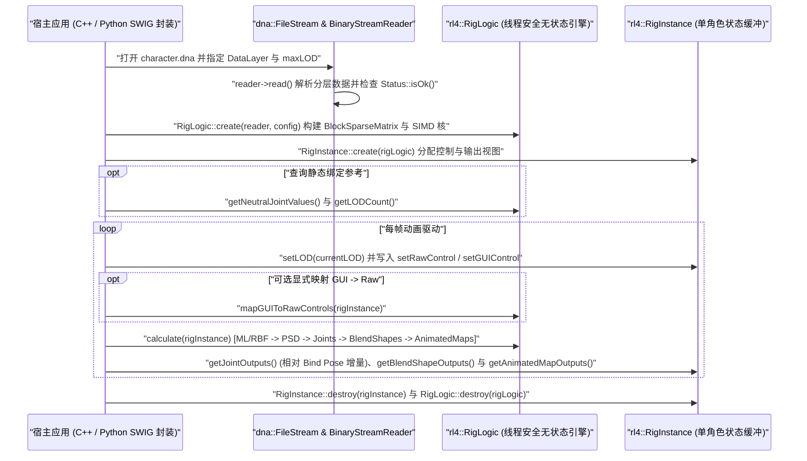

# MetaHuman（Epic 数字人平台）

## 一句话定义

**MetaHuman** 是 **Epic Games** 基于 **Unreal Engine** 构建的**高保真数字人（digital human）创建、表演驱动与跨引擎运行平台**，上游通过 **MetaHuman Creator** 与 **MetaHuman Animator** 从扫描网格、单目相机或音频生成并驱动写实数字人表演，底层核心绑定格式与求值器则通过 **MIT 开源的 OpenRigLogic（DNA + RigLogic4）** 在 C++ 与 Python 生态实现与 UE 一致的实时跨平台求值。

## 英文缩写速查

| 缩写 | 英文全称 | 简要说明 |
|------|----------|----------|
| UE | Unreal Engine | Epic 实时 3D 引擎，MetaHuman Creator/Animator 的宿主环境 |
| DNA | Digital Neutral Animation | MetaHuman 角色骨骼定义、几何与变形行为的序列化格式（`.dna`） |
| PSD | Pose Space Deformation | 姿态空间变形，在 RigLogic 中将基础控制量组合为复合纠正表达 |
| RBF | Radial Basis Function | 径向基函数插值行为层，驱动非线性身体/面部从动关节控制 |
| LOD | Level of Detail | 细节层次；RigLogic 4 将高编号 LOD 组织为低编号的子集以裁剪内存与算力 |
| DCC | Digital Content Creation | 数字内容创作工具链（Maya、Houdini、Blender 等） |
| MoCap | Motion Capture | 动作捕捉；Animator 5.8 支持单相机无标记全身捕捉（Experimental） |

## 为什么重要

1. **低成本人类视觉参考与表演来源：** **MetaHuman Animator** 可利用单离机位相机（如普通 webcam）或音频离线/实时求解面部与无标记全身表演（5.8 Experimental），为「人类视频表演 → 参考运动 → [Motion Retargeting](../concepts/motion-retargeting.md)」提供标准化的工业级数字人资产与表情控制曲线。
2. **机器人遥操作化身与人机交互视觉仿真层：** 在具身人机协作、社交机器人交互或数字孪生演示中，结合 [SPEAR](./spear-sim.md) 或 [AirSim](./airsim.md) 等 UE 仿真宿主，MetaHuman Crowds 与写实角色提供远优于低模占位符的皮肤、毛发、服装与表情反馈信号。
3. **跨引擎兼容的开源核心求值层（OpenRigLogic）：** UE 5.8 起开源的 [OpenRigLogic](https://github.com/EpicGames/OpenRigLogic)（MIT）开放了 `DNA` 读写与 `RigLogic` 运行时库（C++11+ 及 SWIG Python 绑定），允许在非 Unreal 的第三方引擎、自定义数据合成器或机器人视觉渲染器中无损复现与 UE 完全一致的 `.dna` 角色驱动结果。

## 核心原理

MetaHuman 的技术栈由上游 Unreal Engine 内容生产与驱动层（Creator / Animator / Crowds）以及底层开源跨平台数据与求值核（DNA / OpenRigLogic）共同构成：

### 1. MetaHuman 平台核心模块（UE 生态）

| 模块 | 核心功能 | 与机器人技术栈关系 |
|------|------|------|
| **MetaHuman Creator** | 基于云端/UE 资产库组合角色，或通过 **Mesh to MetaHuman** 将三维扫描/DCC 网格转换为标准拓扑与绑定 | 统一人类网格与骨骼命名规范，可与 [KeenTools FaceBuilder](./keentools-facebuilder.md) 配合做人脸纹理迁移 |
| **MetaHuman Animator** | 实时（webcam / Live Link Face / 音频）与离线深度/单目无标记全身与面部捕捉 | 作为人类演示/表情交互采集上游，需经重定向才能送入 [模仿学习（IL）](../methods/imitation-learning.md) 或跟踪策略 |
| **MetaHuman Crowds** | 基于 Mass 与 ISKM 近远景 LOD 的大规模数字人调度（Experimental） | 多智能体与人群避障/视觉感知场景的背景动态行人渲染层 |
| **DCC Export（Maya / Houdini）** | 导出角色头部与身体 `.dna` 文件及材质贴图（不含 Groom 毛发与衣物） | 与 [Blender](./blender.md)、[Mixamo](./mixamo.md) 共同构成机器人仿真外围资产制备链路 |

### 2. OpenRigLogic（`DNA` + `RigLogic4 v13.5.2`）底层求值机制

据 `EpicGames/OpenRigLogic` 源码与 `docs/design/design.md` 设计文档，底层核心实现如下：

- **无状态求解器与实例隔离：** `rl4::RigLogic` 持有只读且经块稀疏化优化的模型矩阵（所有成员函数线程安全），允许并发驱动任意数量的 `rl4::RigInstance`；各角色的当前 `LOD` 与控制/输出浮点数组则独立驻留在 `RigInstance` 内部。
- **从 CRS 到分块列主序矩阵（`BlockSparseMatrix`）：** 早期 RigLogic 使用逐行 CRS 稀疏矩阵，导致输入向量间接读取破坏缓存局部性、行末规约拖慢 SIMD 并使多角色融合（GeneSplicer）必须退化为稠密矩阵。RigLogic 4 通过语义剪枝与逻辑分离（仅关节组保留在主矩阵，BlendShape 转为单射映射，Mask Multiplier 移入条件评估表），将稀疏非零元组织为 **4 行对齐（匹配 SSE/AVX/NEON 寄存器宽度）的列主序稠密子矩阵**，在仅增加约 `2.5%` 零填充开销下显著提升向量化吞吐，并直接支持 `DataLayer`（`Descriptor`/`Definition`/`Behavior`/`Geometry`/`MachineLearnedBehavior`）与严格子集化的 `LOD` 加载优化（`maxLOD`/`minLOD`）。

## 源码运行时序图

以下时序图依据 `EpicGames/OpenRigLogic` 开源仓库中的 `examples/Basic.cpp`、`examples/Advanced.cpp`、`python/riglogic/examples/demo.py` 及 `RigLogic.h` / `RigInstance.h` 绘制。

图依据：`EpicGames/OpenRigLogic@994deb4aca3bd455729b4719b3e2ec91d0b83401`，实读 `CMakeLists.txt`、`README.md`、`docs/design/design.md`、`include/dna/BinaryStreamReader.h`、`include/riglogic/riglogic/RigLogic.h`、`include/riglogic/riglogic/RigInstance.h`、`examples/Basic.cpp`、`examples/Advanced.cpp` 与 `python/riglogic/examples/demo.py`。

## 工程实践

- **编译与性能调优开关：** 构建 `OpenRigLogic` 时需 `CMake 3.14+` 与支持 `C++11` 以上的编译器；x86 平台可开启 `-DRL_BUILD_WITH_AVX=ON`（或 `AVX2`/`AVX512F`/`FMA`）及 `-DRL_BUILD_WITH_HALF_FLOATS=ON`（需 F16C/FP16）压缩关节内存带宽，若需 Python 集成则通过 `-DRL_BUILD_PYTHON_WRAPPER=<版本>` 配合 SWIG 生成 `dna` 与 `riglogic` 模块。
- **LOD 与数据层内存裁剪：** 在大规模场景或训练用合成视觉渲染中，读取 `.dna` 时通过 `dna::Configuration`（如仅保留 `DataLayer::Behavior` 或限制 `maxLOD`）并在每帧按视距动态调用 `rigInstance->setLOD(lod)`，可跳过高模关节组与非活跃 BlendShape 通道计算。
- **跨角色并发求值与快照冷启动：** 多个同一拓扑的角色实例应共享单个 `rl4::RigLogic` 并分别持有 `RigInstance`；对频繁重启的服务端可利用 `RigLogic::dump` / `restore` 跳过初始化期的矩阵重排优化（需注意快照不跨库版本兼容）。
- **机器人动力学解耦：** 将 MetaHuman Animator 或 `.dna` 输出的骨骼旋转增量（`bindPose * jointDelta`）接入机器人仿真前，必须经过独立的骨骼映射、尺度比例标定与物理接触滤波，避免把角色蒙皮动画的足底穿透或不可行重心轨迹直接送给真机控制器。

## 常见误区与局限

- **误区 1：将 MetaHuman 角色或 `.dna` 直接视为物理仿真模型。** MetaHuman 的绑定拓扑面向高保真视觉蒙皮与肌肉/表情形变（见 [角色动画与机器人差异](../concepts/character-animation-vs-robotics.md)），不包含 URDF/MJCF 所需的惯量张量、关节力矩限位或刚体碰撞网格，接入真机前仍需完整重定向。
- **误区 2：以为开源 `OpenRigLogic` 等价于开源全套 MetaHuman。** 仅 `DNA` 与 `RigLogic` 核心运行时库采用 MIT 协议开源；MetaHuman Creator/Animator UE 插件、Groom/Clothing 管线与 Fab 示例资产均受 Unreal EULA 或 Fab Standard License 限制，且官方 `DCC Export` 当前导出的是头/身 `.dna` 与贴图，不含毛发与服装。
- **表演驱动不等同于光学动捕真值：** 单目 webcam 无标记全身估计虽便捷，但在自遮挡、快速旋转与脚部触地瞬间易引入漂移，不宜直接充当高精度动力学辨识基准。
- **跨平台特性差异：** `OpenRigLogic` 原生跨 Windows / Linux / macOS / 控制台与移动端，但 UE 插件侧如 Animator 的全部高级特性在不同操作系统间的支持成熟度仍存在差异。

## 关联页面

- [Character Animation vs Robotics](../concepts/character-animation-vs-robotics.md)
- [Motion Retargeting](../concepts/motion-retargeting.md)
- [遥操作（Teleoperation）](../tasks/teleoperation.md)
- [模仿学习（Imitation Learning）](../methods/imitation-learning.md)
- [Mixamo（Adobe 在线角色与动画）](./mixamo.md)
- [Blender（开源 DCC 枢纽）](./blender.md)
- [KeenTools FaceBuilder（照片→MH texture）](./keentools-facebuilder.md)
- [动作重定向知识链汇总](../overview/hub-motion-retargeting.md)
- [AirSim（UE 无人机/自驾视觉仿真）](./airsim.md)
- [SPEAR（UE5 具身仿真平台）](./spear-sim.md)
- [MotionCode（产业侧运动数据）](./motioncode.md)
- [LiveTalking（2D 流式交互数字人）](./livetalking.md)

## 参考来源

- [EpicGames/OpenRigLogic 源码与 MetaHuman DNA/RigLogic 架构核查（@994deb4）](../../sources/repos/epic_openriglogic.md)
- [MetaHuman 官网归档](../../sources/sites/metahuman-com.md)
- [MetaHuman 官方文档归档](../../sources/sites/metahuman-epic-docs.md)

## 推荐继续阅读

- [EpicGames/OpenRigLogic GitHub 仓库](https://github.com/EpicGames/OpenRigLogic)
- [MetaHuman 官方文档总入口](https://dev.epicgames.com/documentation/metahuman/metahuman-documentation)
- [MetaHuman Facial Description Standard](https://dev.epicgames.com/documentation/metahuman/mh-standards-docs) — Control Curves 标准定义
- [Mixamo](./mixamo.md) 与 [人形参考运动数据集选型](../comparisons/humanoid-reference-motion-datasets.md) — 区分数字人资产工具链与科研 MoCap 数据集
