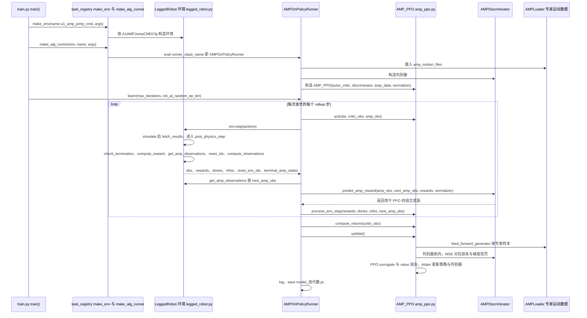

# MetalHead

**MetalHead**（<https://github.com/inspirai/MetalHead>）在 **Unitree A1** 四足上实现 **walk / run / jump / recovery** 等自然运动，核心算法为 **AMP**，代码基于 [AMP_for_hardware](./amp-for-hardware.md) 与 [legged_gym](./legged-gym.md)，仿真后端为 **Isaac Gym**。

## 英文缩写速查

| 缩写 | 英文全称 | 简要说明 |
|------|----------|----------|
| AMP | Adversarial Motion Prior | 从参考运动库学习风格约束 |
| A1 | Unitree A1 Quadruped | 宇树四足科研平台 |
| RL | Reinforcement Learning | PPO + 风格判别器 |
| Sim2Real | Simulation to Real | 论文/项目强调真机可迁移调参 |

## 为什么重要

- **四足 AMP 工程样板**：展示如何把动物/参考运动风格迁移到 A1 并处理高动态技能（跳跃、恢复）的超参与奖励权衡。
- 与纯几何重定向不同，重点在 **仿真内可跟踪 + 判别器风格匹配**。

## 源码运行时序图

入口：按 AMP_for_hardware 配置好 Isaac Gym 后，运行 `python legged_gym/scripts/train.py --task=a1_amp_jump_cmd --headless True`（推理演示为 `legged_gym/scripts/play.py`）

图依据：inspirai/MetalHead@1f55679，实际读过 README.md、legged_gym/scripts/train.py、legged_gym/envs/__init__.py（任务注册）、legged_gym/envs/a1/a1_amp_jump_cmd_config.py（runner_class_name）、legged_gym/envs/base/legged_robot.py（step 与 post_physics_step 调用顺序）、legged_gym/utils/task_registry.py（make_env、make_alg_runner）、rsl_rl/rsl_rl/runners/amp_on_policy_runner.py、rsl_rl/rsl_rl/algorithms/amp_ppo.py（act、update 结构）、rsl_rl/rsl_rl/algorithms/amp_discriminator.py（predict_amp_reward 签名）；未运行代码。

## 关联页面

- [AMP_for_hardware](./amp-for-hardware.md)
- [legged_gym](./legged-gym.md)
- [AMP 奖励设计](../methods/amp-reward.md)
- [Locomotion](../tasks/locomotion.md)

## 参考来源

- [MetalHead 仓库归档](../../sources/repos/metalhead.md)
- 源码核对（2026-11-02）：inspirai/MetalHead@1f55679，读过 README.md、legged_gym/scripts/train.py、legged_gym/envs/__init__.py、legged_gym/envs/a1/a1_amp_jump_cmd_config.py、legged_gym/envs/base/legged_robot.py、legged_gym/utils/task_registry.py、rsl_rl/rsl_rl/runners/amp_on_policy_runner.py、rsl_rl/rsl_rl/algorithms/amp_ppo.py、rsl_rl/rsl_rl/algorithms/amp_discriminator.py；时序图依据以上文件，未运行代码。

## 推荐继续阅读

- GitHub：<https://github.com/inspirai/MetalHead>
